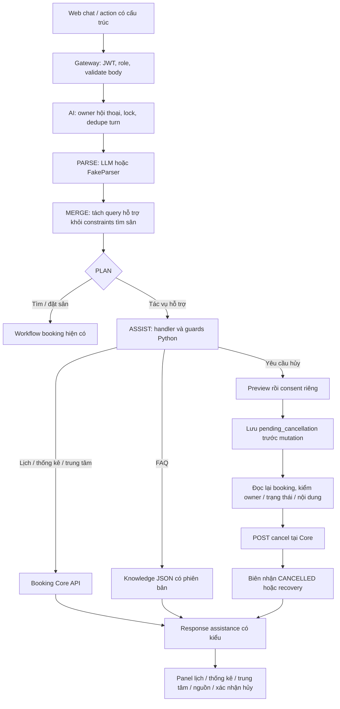

# Chatbot: lịch cá nhân, thống kê, hủy booking, trung tâm và FAQ

Ngày cập nhật: **28/10/2026**. Phạm vi: bổ sung năm nhóm chức năng vào chatbot tại `/booking-assistant`, trên nhánh `feat/ai-constraint-aware-recommendations`. Tài liệu này mô tả code đã viết và kiểm chứng local; không xác nhận đã triển khai production hoặc chất lượng trích xuất của Groq thật.

Đọc cùng [hướng dẫn AI](AI_SERVICE.md), [Recommendation V1](AI_SERVICE_UPGRADE.md) và [walkthrough nền tảng](AI_SERVICE_CODE_WALKTHROUGH.md). Luồng tìm sân, đề xuất thay đổi điều kiện và đặt sau xác nhận tiếp tục dùng workflow hiện có.

## 1. Chức năng và cách dùng

| Chức năng | Câu thử | Kết quả |
| --- | --- | --- |
| Lịch cá nhân | `Xem lịch của tôi tuần này`, `Lịch sắp tới`, `Xem lịch sử` | Booking của tài khoản hiện tại; ngày, sân/slot, trạng thái, giá trị booking; có phân trang. |
| Thống kê | `Thống kê của tôi tháng này`, rồi `Còn tháng trước?` | Số booking CONFIRMED/CANCELLED, giờ-sân, giá trị booking còn CONFIRMED và tối đa năm trung tâm có nhiều booking nhất. |
| Hủy | `Hủy lịch của tôi tuần này`, chọn booking, rồi xác nhận riêng | Preview trước; chỉ gọi API hủy sau consent hợp lệ và kiểm tra lại dữ liệu. |
| Thông tin/so sánh trung tâm | `So sánh "Cầu Giấy" và "Thanh Xuân"`, `Giờ mở cửa "Cầu Giấy"` | Địa chỉ, giờ mở cửa, số sân hoạt động, bảng giá ngày thường/cuối tuần và mô tả mà Core cung cấp. |
| FAQ/hướng dẫn | `Hủy booking như thế nào?`, `Mỗi slot dài bao nhiêu phút?`, `Có được hoàn tiền không?` | Câu trả lời từ bài kiến thức được quản lý phiên bản, kèm tên nguồn và trích đoạn. Câu ngoài bộ kiến thức được báo chưa có tài liệu xác minh. |

Sau danh sách lịch, người dùng có thể bấm **Yêu cầu hủy booking N**, hoặc nói `Hủy booking 2`. Con số tham chiếu danh sách vừa trả, không phải mã sân hay vị trí của trang trước. Có thể cung cấp UUID booking nguyên văn, ví dụ `Hủy booking <UUID>`; server vẫn kiểm tra chủ sở hữu.

Để tra cứu khoảng ngày cụ thể, dùng `Xem lịch sử từ 2026-10-01 đến 2026-10-28` hoặc `Thống kê từ 2026-10-01 đến 2026-10-28`. Khoảng custom tối đa chênh 366 ngày. Không tự đổi điều kiện tìm sân khi người dùng chỉ sửa khoảng ngày thống kê/tra cứu.

`AI_PROVIDER=fake` chỉ phục vụ các câu mẫu xác định trong test và demo offline. Cấu hình LLM hiện có tiếp tục dùng `ParsedMessage` có kiểu để hiểu câu tự nhiên; cần đánh giá provider thật trước khi kết luận độ chính xác cho mọi cách diễn đạt.

## 2. Luồng xử lý chung



LLM chỉ trích ý định và query. Giá, lịch, thống kê và kết quả hủy được tạo từ dữ liệu đã đọc hoặc biên nhận Core. Backend kiểm soát HTTP calls, actor và consent; model không nhận công cụ HTTP/SQL tùy ý.

Nếu đang có `pending_booking` hoặc `pending_cancellation`, workflow yêu cầu xử lý kết quả chưa xác định trước khi làm tác vụ khác. Chuyển sang tác vụ hỗ trợ sẽ xóa options, proposal và xác nhận đặt cũ; điều kiện tìm kiếm vẫn được giữ để người dùng có thể tiếp tục sau đó.

## 3. Booking Core API được sử dụng

| API hiện có | Nơi dùng | Giới hạn tại AI |
| --- | --- | --- |
| `GET /api/v1/bookings/me` | Lịch cá nhân và thống kê | Chỉ bộ lọc cho phép; không nhận userId từ model hoặc client. |
| `GET /api/v1/bookings/:id` | Preview hủy và kiểm tra kết quả | UUID hợp lệ; kiểm tra lại `userId == actor.user_id` ngay cả khi token có role manager/admin. |
| `POST /api/v1/bookings/:id/cancel` | Thực thi ý định hủy đã xác nhận | Chỉ booking trong preview server; Core tiếp tục quyết định quyền và thời điểm được hủy. |
| `GET /api/v1/centers?search=...` | Thông tin/so sánh | Tối đa ba từ khóa, mỗi từ khóa đọc một trang mười trung tâm; hiển thị tối đa mười trung tâm khác nhau. |

Mỗi call dùng JWT gốc của actor và `X-Request-Id`. AI không dùng tài khoản quản trị để thay người dùng đọc dữ liệu. Không cần bổ sung route nghiệp vụ hoặc schema database cho Booking Core trong thay đổi này.

**Vì sao không gọi nguyên API thống kê có sẵn?** Câu hỏi `tuần này`, `tháng trước` và khoảng custom cần cùng một phạm vi ngày cho tất cả chỉ số. Code tổng hợp từ `/bookings/me` với bộ lọc ngày rõ ràng, tránh trộn số liệu rolling/global của API thống kê hiện tại vào một báo cáo theo lịch.

## 4. Quy tắc lịch và thống kê

Ngày được tính theo `Asia/Ho_Chi_Minh`:

| Period | Phạm vi |
| --- | --- |
| `upcoming` | Từ hôm nay; mặc định CONFIRMED và bỏ booking đã có slot bắt đầu. |
| `history` | Không tự giới hạn ngày; vẫn phân trang và không gồm booking đã ẩn. |
| `this_week` / `next_week` | Thứ Hai đến Chủ nhật của tuần tương ứng. |
| `this_month` | Ngày đầu tháng đến hôm nay. |
| `last_month` | Toàn bộ tháng trước. |
| `this_year` | Ngày đầu năm đến hôm nay. |
| `custom` | Cả ngày đầu và ngày cuối do người dùng cung cấp, bao gồm hai đầu. |

Lịch đọc mười booking một trang theo thứ tự API Core. Bộ lọc upcoming/hủy được áp dụng thêm sau khi đọc vì Core lọc theo ngày, chưa loại booking đã bắt đầu trong ngày. Vì vậy, có thể có trang trống nhưng vẫn còn trang sau; UI hiển thị nút **Xem thêm booking** khi `has_more=true`.

Phạm vi ngày áp dụng vào **ngày chơi của booking** (`date` tại Core), không phải ngày tạo giao dịch (`createdAt`). Thống kê đọc tối đa năm trang, mỗi trang một trăm booking:

- `confirmed`: số booking còn CONFIRMED trong tập dữ liệu đã đọc.
- `cancelled`: số booking CANCELLED trong tập đó.
- `booked_court_hours`: tổng số slot của các booking CONFIRMED. Một slot hiện là 60 phút; hai sân cùng chơi hai tiếng được tính bốn giờ-sân.
- `confirmed_booking_value_vnd`: tổng `totalPrice` của các booking CONFIRMED.
- `centers`: tối đa năm **tên trung tâm** có số booking CONFIRMED lớn nhất. Bảng này nhóm theo tên mà API trả; các trung tâm trùng tên có thể được gộp.

Các chỉ số phản ánh booking, không chứng minh người dùng đã đến chơi hoặc đã trả tiền. Không gồm booking bị ẩn khỏi lịch cá nhân. Nhiều trang được đọc tuần tự, không phải một snapshot transaction xuyên Core; dữ liệu có thể thay đổi trong lúc truy vấn. Phát hiện UUID lặp giữa các trang thì báo lỗi thay vì cộng hai lần.

Nếu chưa đọc đủ `total`, response có `coverage=partial` và thông báo rõ dữ liệu mới bao phủ một phần. Core lỗi không được biến thành danh sách rỗng hoặc thống kê bằng không.

## 5. Hủy booking: lựa chọn, consent và recovery

### 5.1. Chọn booking chưa thực hiện hủy

Danh sách phát `choice_id` ngẫu nhiên cho mỗi booking, gắn với trang hiện tại và hết hiệu lực sau 300 giây. Chọn bằng action `select_booking` chỉ có `booking_choice_id`; server đọc lại booking từ Core rồi tạo preview.

Nếu vừa yêu cầu số booking vừa đổi bộ lọc ngày/trạng thái, bot yêu cầu tra cứu lại trước. Không diễn giải số thứ tự của danh sách cũ trên một phạm vi mới.

Preview gồm mã booking, trung tâm, ngày, sân/slot, giá trị booking và `cancellation_id` riêng. Preview hết hạn sau 300 giây và gắn với `state.version`. Thay tác vụ làm xác nhận cũ mất hiệu lực.

### 5.2. Xác nhận riêng

Action `confirm_cancellation` phải có đúng `cancellation_id`; không dùng `confirmation_id` của đặt sân hoặc `proposal_id` của thương lượng. Người dùng cũng có thể nói chính xác `xác nhận hủy booking` sau preview; server kiểm tra câu đồng ý rõ ràng, không tin riêng intent do model tạo.

Các action và mã thuộc tác vụ khác bị chặn tại cả Gateway và AI. Nút **Giữ booking** bỏ preview mà không gọi mutation.

### 5.3. Lưu ý định trước, đối soát sau

1. AI lưu `pending_cancellation`, gồm booking đã trình bày và sự đồng ý, trước khi gọi API ghi.
2. Đọc lại booking theo UUID và xác minh chủ sở hữu.
3. Nếu đã CANCELLED, dùng trạng thái đó làm kết quả mà không gửi POST thêm.
4. Nếu còn CONFIRMED, kiểm tra chưa bắt đầu và thông tin ngày/sân/giá khớp preview.
5. Gọi API cancel và chỉ báo thành công khi nhận đúng booking ở trạng thái CANCELLED.
6. Timeout hoặc lỗi 5xx giữ pending intent, trả `RETRY_CANCELLATION`. Nút **Kiểm tra lại hủy** tiếp tục ý định cũ, không chọn một booking khác.

Core hiện xử lý cancel dưới khóa và trả lại booking đã CANCELLED khi yêu cầu lặp; AI dựa vào tính chất trạng thái đó và kiểm tra trước retry. API cancel không sử dụng `Idempotency-Key` giống luồng tạo reservation. Không gọi đây là bảo đảm exactly-once xuyên hai database.

Turn vẫn được chống trùng bằng `client_message_id`. Nếu chỉ mất response HTTP, client gửi lại chính request và key cũ. Nếu worker dừng sau khi lưu ý định, `GET conversation` trả pending request và trạng thái để Web tiếp tục an toàn.

Điều kiện thời điểm và quyền cuối cùng thuộc Core. Nếu giá/nội dung thay đổi hoặc booking bắt đầu trước lúc thực thi, bot từ chối dùng consent cũ. Hủy ở đây giải phóng lịch; không có logic thu phí, thanh toán hoặc hoàn tiền.

## 6. So sánh trung tâm

`center_terms` chỉ chứa tên/khu vực người dùng vừa ghi hoặc context đã được server lưu. Handler không chấp nhận tên model tự bổ sung mà không có trong tin nhắn. Với `hai trung tâm này`, bot có thể dùng các tên trong context trước; khi chưa có tên thì hỏi lại.

Chỉ chiếu các trường public từ Core sang `CenterCard`. Các trường quản lý như `managerId` không được đưa vào response so sánh. Khi nhiều trung tâm cùng khớp từ khóa, response yêu cầu tên đầy đủ; khi vượt giới hạn, ghi `partial`. Không tự chọn một trung tâm rồi mô tả như kết quả duy nhất.

Bảng giá là giá niêm yết theo khung giờ và loại ngày. Nó không xác nhận còn sân hoặc thay thế báo giá cuối trong luồng đặt. Giờ mở cửa, bảng giá hoặc số sân thiếu được hiển thị là chưa có dữ liệu; model không điền số giả.

## 7. FAQ và quyết định kỹ thuật

Knowledge base trong `app/assistance/knowledge.json` hiện có bảy bài: hủy booking, lịch sử, slot 60 phút, xác nhận đặt, giới hạn thanh toán/hoàn tiền, kết quả chưa xác định và ý nghĩa thống kê.

Mỗi bài có ID, phiên bản, tiêu đề, các cụm từ truy hồi, câu trả lời đã rà soát và `source_paths` trỏ về source/docs hiện có. Test kiểm tra đường dẫn nguồn tồn tại. Khi đổi policy, người sửa phải cập nhật nội dung/phiên bản và đối chiếu implementation; ngày phiên bản không tự chứng nhận mọi policy đã được phê duyệt.

Retriever chuẩn hóa dấu/chữ hoa, khớp cụm từ theo ranh giới từ, chấm điểm và chọn tối đa hai bài có điểm đủ gần bài đầu. Nếu không đủ bằng chứng, trả lời chưa có tài liệu xác minh. Câu trả lời được lấy nguyên từ bài đã quản lý, không để model tự viết quy định hoặc hứa hoàn tiền.

Đây là truy hồi từ khóa trên bộ FAQ nhỏ, chưa có embeddings/vector database, ingest tự động hay semantic RAG. Cách này ít dependency, dễ kiểm tra nguồn, không tốn thêm lượt LLM để trả lời chính sách. Đổi lại, câu đồng nghĩa ngoài cụm từ cấu hình có thể chưa tìm được bài; cần mở rộng corpus và đánh giá trên câu thật khi nhu cầu tăng.

UI hiển thị tên bài, phiên bản và trích đoạn; đường dẫn code nằm trong API dành cho truy vết, không xuất chi tiết implementation lên luồng người dùng.

## 8. Contract, state, logs và metrics

API conversation giữ nguyên các đường dẫn HTTP; request được bổ sung `select_booking`, `confirm_cancellation`, `dismiss_cancellation`, `retry_cancellation`, `more_bookings`. Response thêm `assistance` có cấu trúc cho từng loại kết quả.

State schema chuyển lên **3**, thêm `assistance`, `assistance_context`, `cancellation_preview`, `pending_cancellation`. `normalize_state` thêm default cho hội thoại cũ; không đổi bảng hoặc cần migration database. Schema response, schema request độc lập và Gateway cùng mô tả các nonce không được trộn.

`scripts/export_contracts.py` xuất schema FastAPI/Pydantic mà không chạy lifespan, mở DB hay gọi LLM; giữ metadata ownership/security và các route Proposed trong contract. Chạy lại khi thay đổi schema:

```bash
cd services/ai-service
uv run python -m scripts.export_contracts
```

Node `ASSIST` tạo trace/log theo cơ chế hiện có, gồm outcome, request ID và version. Không log transcript, JWT hay key. Bộ đếm `ai_tool_calls_total{tool,outcome}` thêm các giá trị hữu hạn:

| tool | outcome được phát ở nhánh tương ứng |
| --- | --- |
| `list_my_bookings` | `success`, `failed`, `invalid` |
| `get_my_booking_stats` | `complete`, `partial`, `failed`, `invalid` |
| `compare_centers` | `success`, `partial`, `failed`, `invalid` |
| `search_faq` | `found`, `abstained` |
| `cancel_my_booking` | `started`, `confirmed`, `refused`, `uncertain`; lỗi preview có thể `failed`/`invalid`. |

Không phải mọi guard từ chối đều làm tăng tool counter; trace `ASSIST` ghi kết quả lượt xử lý. Retry có thể tăng `started` lần nữa. Không lấy `started - confirmed` làm số booking đang chờ, và không đưa UUID hoặc câu người dùng vào labels. Xem [MONITORING.md](MONITORING.md).

## 9. Các file mới và lý do

| File | Vai trò / lý do tách |
| --- | --- |
| `services/ai-service/app/assistance/__init__.py` | Khai báo package nghiệp vụ hỗ trợ cá nhân. |
| `services/ai-service/app/assistance/schemas.py` | Query và kết quả có kiểu: booking, center, stats, citation, cancellation preview. |
| `services/ai-service/app/assistance/parser.py` | Intent, prompt cho LLM và các ví dụ FakeParser riêng; tránh làm parser đặt sân phình thêm. |
| `services/ai-service/app/assistance/queries.py` | Khoảng ngày, xác minh dữ liệu/owner, phân trang, thống kê và public projection trung tâm. |
| `services/ai-service/app/assistance/cancellation.py` | Tách thao tác ghi có consent/recovery khỏi các truy vấn chỉ đọc. |
| `services/ai-service/app/assistance/handler.py` | Điều phối intent, context nhiều lượt, choice snapshot và tạo response. |
| `services/ai-service/app/assistance/knowledge.py` | Truy hồi FAQ và tạo citation theo quy tắc kiểm chứng được. |
| `services/ai-service/app/assistance/knowledge.json` | Bảy bài có phiên bản và nguồn; cập nhật nội dung độc lập với logic truy hồi. |
| `services/ai-service/scripts/export_contracts.py` | Đồng bộ contract native từ schema code, vẫn giữ phần thiết kế Proposed. |
| `services/ai-service/tests/unit/test_assistance.py` | Kiểm tra ngày theo lịch/timezone, nonce và nguồn FAQ. |
| `services/ai-service/tests/integration/test_assistance.py` | Kịch bản API nhiều lượt, privacy, consent, stale preview, phân trang và phục hồi lỗi với HTTP Core fixture. |
| `apps/web/src/features/assistant/components/AssistancePanel.tsx` | Hiển thị năm nhóm kết quả trên màn chat hiện có; tách UI khỏi trang điều phối. |
| `apps/web/test/unit/assistance.spec.tsx` | Kiểm tra nút lựa chọn/xác nhận khác nhau, expiry, recovery và nguồn/partial result. |
| `docs/AI_ASSISTANCE_FEATURES.md` | Hướng dẫn chức năng, giới hạn, luồng an toàn và inventory của thay đổi này. |

## 10. Các file được sửa và lý do

| File | Thay đổi |
| --- | --- |
| `services/ai-service/app/schemas.py` | Bổ sung intents/actions/nonce, `assistance` trong response và default state schema 3. |
| `services/ai-service/app/providers.py` | Cho LLM/FakeParser hiểu tác vụ hỗ trợ và query context; không trộn vào booking constraints. |
| `services/ai-service/app/core_client.py` | Adapter dùng API Core hiện có; whitelist bộ lọc, encode query, chuẩn hóa UUID. |
| `services/ai-service/app/workflow.py` | Routing node ASSIST, ưu tiên recovery, guard consent, trace/metric và thông báo đúng trạng thái receipt đã hủy. |
| `services/ai-service/app/service.py` | Đưa kết quả assistance có cấu trúc vào HTTP response. |
| `services/ai-service/app/db/store.py` | Khi tải lại hội thoại, ưu tiên pending cancellation/booking và giữ kết quả hỗ trợ hiện tại. |
| `services/ai-service/app/tools.py` | Khai báo allowlist các thao tác hỗ trợ; không cấp mutation tùy ý cho LLM. |
| `services/ai-service/tests/contract/test_contract.py` | Cập nhật tập tool cho phép; test equality schema vẫn bảo vệ contract xuất từ API. |
| `services/ai-service/tests/unit/test_recommendation.py` | Cập nhật kỳ vọng state normalization từ schema 2 sang 3. |
| `services/ai-service/tests/integration/test_live_core.py` | Bổ sung kịch bản với Core/PostgreSQL thật trong môi trường test biệt lập; kiểm status và việc giải phóng allocation. |
| `services/ai-service/evaluation/evaluate_conversations.py` | Đưa kịch bản hỗ trợ vào report hội thoại xác định, cùng nhóm negotiation. |
| `apps/web/src/features/assistant/api/chat.ts` | Request/response TypeScript và state khôi phục cho tác vụ mới. |
| `apps/web/src/features/assistant/pages/BookingAssistant.tsx` | Gắn panel, khôi phục từ state hiện tại, khóa tạo hội thoại khi chưa rõ kết quả, hiển thị receipt đã hủy đúng trạng thái. |
| `apps/web/test/unit/assistant.spec.tsx` | Bổ sung reload pending cancellation và receipt CANCELLED. |
| `services/api-gateway/src/routes/ai.route.ts` | Validate action/mã mới bằng Zod, từ chối trộn nonce của những tác vụ khác nhau. |
| `services/api-gateway/test/unit/ai.spec.ts` | Kiểm tra forward cancellation hợp lệ và từ chối request ghép sai quyền đồng ý. |
| `contracts/ai/openapi.json` | Schema native request/response/type mới của AI. |
| `contracts/ai-tools/conversation-message.schema.json` | Contract request độc lập với điều kiện action ↔ mã bắt buộc/không được có. |
| `contracts/ai-tools/conversation-message.schema.examples.json` | Mẫu dương/âm cho selection/cancellation và nonce sai. |
| `contracts/gateway/openapi.json` | Mô tả route message mới; tiếp tục dùng cross-reference schema AI. |
| `README.md`, `docs/AI_SERVICE.md` | Điểm vào hướng dẫn và danh sách chức năng/tool mới. |
| `docs/AI_SERVICE_CODE_WALKTHROUGH.md`, `docs/AI_SERVICE_UPGRADE.md` | Chỉ rõ tài liệu baseline/V1 và liên kết phần hỗ trợ được bổ sung. |
| `docs/MONITORING.md` | Ý nghĩa outcome mới, cách quan sát và recovery cancellation. |

## 11. Kiểm chứng local

Kết quả lần cập nhật này:

| Kiểm tra | Kết quả và phạm vi |
| --- | --- |
| `pytest tests -q` trong AI | **120 passed, 5 skipped**. Năm test live Core/PostgreSQL cần Docker bị skip do môi trường không có Docker daemon. |
| Web unit tests | **14 passed**, gồm panel, reload và luồng booking hiện có. |
| Gateway `test/unit/ai.spec.ts` | **6 passed** cho nhóm route AI, gồm ranh giới consent. |
| Python Ruff / mypy | Đạt; gồm code mới và regression trong service. |
| TypeScript typecheck / ESLint | Đạt cho Web/Gateway và các file TypeScript thay đổi. |
| Contract validator | Đạt nhóm `contracts/ai`, `contracts/ai-tools`, `contracts/gateway`; kiểm schema và ví dụ dương/âm. |
| Vite build Web | Đạt; tạo được bundle production. |
| `evaluation.evaluate_conversations` | **39 case đạt** với FakeParser/HTTP fixture; đây là tập con của pytest, không phải số đo LLM thật. |

Integration test không cần Docker sử dụng HTTP Core fixture, SQLite/checkpoint riêng và FakeParser. Test có mô phỏng dữ liệu nhiều chủ sở hữu, lỗi đọc, mất response sau khi Core đã hủy và worker dừng sau khi lưu consent. Những kết quả này không thay thế kiểm thử Core/PostgreSQL thật, trình duyệt E2E hoặc đánh giá Groq thật. Live scenario đã được thêm để chạy ở CI/môi trường có Docker.

Lệnh kiểm tra theo công cụ repo:

```bash
cd services/ai-service
uv run pytest tests -q
uv run ruff check app tests evaluation alembic scripts
uv run mypy app
uv run python -m evaluation.evaluate_conversations
```

```bash
pnpm --filter @badminton/frontend test:unit
pnpm --filter @badminton/frontend typecheck
pnpm --filter @badminton/frontend build
pnpm --filter @badminton/api-gateway exec vitest run test/unit/ai.spec.ts
pnpm --filter @badminton/api-gateway typecheck
```

Report `evaluation.evaluate_conversations` chạy lại một tập con các test integration; không cộng số case trong report vào tổng pytest như những test độc lập khác.
