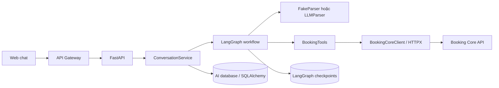
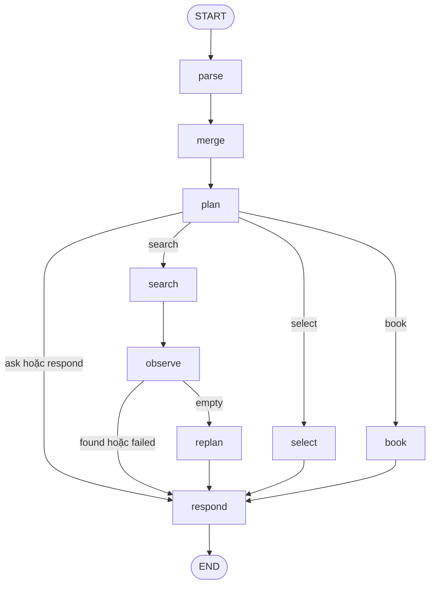
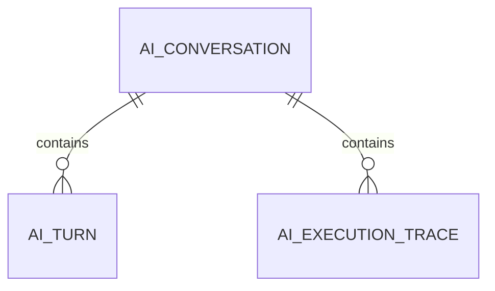
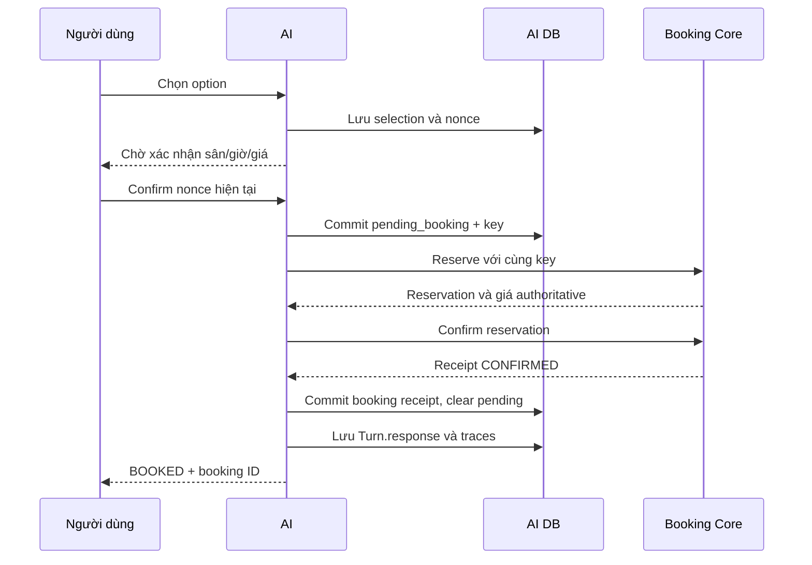

# Giải thích code AI Service — baseline và nâng cấp

## 1. Phạm vi và cách đọc

**Bổ sung 28/10/2026:** đọc [AI_ASSISTANCE_FEATURES.md](AI_ASSISTANCE_FEATURES.md) cho package `app/assistance`, state schema 3, lịch/thống kê/so sánh/FAQ và consent/recovery hủy booking. Những nhận xét bên dưới về chưa có truy hồi FAQ và inventory 38 file mô tả snapshot baseline 19/10, không phải toàn bộ service hiện tại.

Các mục baseline dưới đây giải thích snapshot `services/ai-service/` ngày **19/10/2026**. Từ 27/10/2026, SEARCH/negotiation/schema/provider/metrics được nâng cấp; đọc [AI_SERVICE_UPGRADE](AI_SERVICE_UPGRADE.md) cho implementation hiện hành và các file mới. Luồng BOOK, auth, lock và persistence nền tảng bên dưới vẫn là căn cứ; mô tả REPLAN chỉ fallback area của baseline đã được thay bằng diagnostics và near-miss có guard. Mục tiêu là giúp đọc được code, hiểu vì sao các phần nối với nhau và biết chỗ nào quyết định một request có được đặt sân hay không.

Phạm vi gồm code runtime, cấu hình, dependency, migration, Docker, evaluation, fixtures và toàn bộ nhóm test. Các file sinh tự động, virtual environment, cache và cấu hình bí mật local không phải source cần học thuộc. Phụ lục cuối tài liệu liệt kê đầy đủ các file source được Git theo dõi trong service.

Các nhãn cần phân biệt:

- **Đang có:** hành vi đọc được trực tiếp từ code; không tự chứng nhận chất lượng production hoặc kết quả test mới.
- **Proposed:** thiết kế contract chưa có route/workflow tương ứng.
- **Giới hạn:** khả năng chưa được triển khai hoặc điều code hiện tại chưa bảo đảm.

AI hiện tại hỗ trợ **hội thoại tìm và đặt sân sau xác nhận**. Profile chỉ đọc và endpoint `/v1/chat` là Proposed, liên quan [ADR-008](adr/ADR-008.md). Việc viết tài liệu này không thay implementation sang read-only.

Đọc nhanh theo thứ tự: mục 2 → 4 → 6 → 9 → 10 → 11. Khi cần tìm một file cụ thể, dùng mục 3 và phụ lục. [AI_SERVICE.md](AI_SERVICE.md) là hướng dẫn tổng quan/chạy service; tài liệu này đi sâu vào code.

Các phần có thể mở trực tiếp:

- [HTTP, vòng đời ứng dụng và endpoint](#4-mainpy-mở-tài-nguyên-và-nhận-http-request).
- [Cấu hình và xác thực JWT](#5-configpy-và-authpy-cấu-hình-và-danh-tính).
- [Schema và trạng thái hội thoại]vậy(#6-schemaspy-các-object-đi-xuyên-suốt-hệ-thống).
- [LLM và parser giả lập](#7-providerspy-hiểu-ngôn-ngữ-tự-nhiên).
- [Các bước và nhánh của workflow](#11-workflowpy-toàn-bộ-state-machine).
- [Lưu trữ, khóa và chống đặt trùng](#12-dbmodelspy-và-dbstorepy-lưu-trữ-và-khóa).
- [Logs, metrics và timeout](#15-logs-metrics-trace-và-timeouts).
- [Evaluation](#16-evaluation-evaluationevaluatepy-và-scenariosjsonl) và [các nhóm test](#17-toàn-bộ-nhóm-test-và-fixtures).
- [Danh mục đầy đủ 38 file](#23-phụ-lục--inventory-đầy-đủ-source-files).

Một số thuật ngữ dùng xuyên suốt:

| Thuật ngữ | Hiểu trong service này |
| --- | --- |
| Parser | Bộ chuyển câu nói thành dữ liệu có cấu trúc: ý định, ngày, giờ, thời lượng, giá… |
| State | Dữ liệu hội thoại hiện tại: điều kiện đã biết, options, lựa chọn, booking… |
| Turn | Một lượt gửi của người dùng và response tương ứng; có thể gồm nhiều bước xử lý bên trong. |
| Node / graph | Một bước xử lý / sơ đồ quyết định bước nào chạy tiếp. |
| DIFF | Chỉ các trường vừa thay đổi; dùng để cập nhật state cũ. |
| Consent / nonce | Sự đồng ý cuối của người dùng / mã xác nhận gắn với lựa chọn đang chờ. |
| Side effect | Thao tác làm thay đổi hệ thống khác, ví dụ giữ slot hoặc chốt booking tại Core. |
| Durable intent | Bản ghi ý định đặt đã được commit vào DB trước thao tác Core, để phục hồi khi lỗi. |
| Idempotency | Gửi lại cùng ý định với cùng key để nhận lại kết quả, tránh tạo booking thứ hai trong luồng retry được hỗ trợ. |
| Checkpoint | Bản lưu trạng thái xử lý của graph; khác với biên nhận booking tại Core. |

## 2. Service thực sự làm gì?

Một request như “Mai lúc 19:00 chơi 2 tiếng, dưới 200k, gần Cầu Giấy” được biến thành các điều kiện có cấu trúc. Service đọc lịch từ Booking Core, tìm hai slot 60 phút liên tiếp trên cùng sân, rồi trả danh sách phương án. Người dùng chọn một phương án và xác nhận cuối trước khi có request giữ/chốt booking.



Hai nguồn dữ liệu có vai trò khác nhau:

| Phần | Nguồn sự thật |
| --- | --- |
| Ngày/giờ/giá người dùng mong muốn, lựa chọn, tiến độ hội thoại | State AI đã lưu |
| Lịch trống, giá giữ chỗ, quyền booking, booking đã commit | Booking Core |

LLM không được cung cấp SQL tool, không tự tạo lịch sân và không quyết định quyền của người dùng. Trong implementation hiện tại, **LLM là bộ trích xuất dữ liệu**, còn **backend là bộ điều phối hành động**.

Đây chưa phải một hệ thống RAG: không có bước ingest tài liệu, chia chunk, tạo embedding, vector search hoặc truy hồi FAQ trong runtime. `evaluation/scenarios.jsonl` là tập câu đánh giá parser, không phải knowledge base được tìm kiếm khi chat.

## 3. Bản đồ code

```text
services/ai-service/
  app/
    main.py                  # FastAPI, lifespan, middleware, endpoints
    config.py                # Settings và validation môi trường
    auth.py                  # JWT -> Actor
    schemas.py               # Input, constraints, parser output, option, initial state
    domain.py                # Merge điều kiện, hỏi lại, lọc/xếp phương án
    providers.py             # FakeParser và LLMParser
    core_client.py           # HTTP client gọi Booking Core
    tools.py                 # Typed search tool và đọc option
    service.py               # Xử lý một lượt hội thoại, dedupe, persist response
    workflow.py              # Các node và nhánh LangGraph
    observability.py         # JSON logs và Prometheus collectors
    migrate.py               # Setup bảng checkpoint
    db/
      models.py              # Ba model dữ liệu AI
      store.py               # Session, lock, ownership, đọc/ghi hội thoại
  alembic/
    env.py                   # Chạy Alembic với async engine
    versions/
      20261009_01_conversations.py
  evaluation/
    evaluate.py              # Tính metric từ parser output và expected labels
    scenarios.jsonl          # 40 mẫu, small lấy 30 mẫu đầu
  tests/
    conftest.py
    unit/
    contract/
    integration/
    smoke/
  pyproject.toml
  uv.lock
  alembic.ini
  Dockerfile
  .env.example
```

Các `__init__.py` là package markers, hiện không chứa logic nghiệp vụ. Không có chương trình train model hoặc model weights trong cây source này.

## 4. `main.py`: mở tài nguyên và nhận HTTP request

Source: [app/main.py](../services/ai-service/app/main.py).

### 4.1. `lifespan(app)`

Đây là vòng đời startup/shutdown của process:

1. Gọi `settings()` để đọc và kiểm cấu hình.
2. Tạo `Store` với URL database AI.
3. Mở `AsyncPostgresSaver` cho checkpoint LangGraph.
4. Mở một `httpx.AsyncClient` dùng chung để gọi Core, có timeout và không follow redirect.
5. Tạo `ConversationService`; truyền factory tạo parser để chọn fake hoặc LLM theo cấu hình.
6. Đặt service vào `app.state.service` cho endpoint sử dụng.
7. Khi shutdown, dispose SQLAlchemy engine; `AsyncExitStack` quản lý đóng Core client và checkpoint connection.

`lifespan` **không tạo bảng**. Tables phải được migration trước. Việc tạo schema trong startup mỗi replica sẽ khiến deploy và DDL khó kiểm soát, nên migration được tách thành bước riêng.

### 4.2. `create_app(service=None, config=None)`

Hàm tạo FastAPI application. Hai tham số là điểm dependency injection để test truyền service/config của mình vào.

- Production không truyền service: sử dụng lifespan thật.
- Test truyền service: bỏ lifespan, không cần tự động mở PostgreSQL hoặc gọi provider.
- `cfg()` dùng config được inject nếu có, nếu không mới gọi `settings()`.
- Biến cuối file `app = create_app()` là application object để Uvicorn import.

Điều này giải thích vì sao contract test có thể gọi `create_app(...).openapi()` mà không chạy migrations hoặc LLM.

### 4.3. Dependency `actor()`

Đọc `Authorization`, yêu cầu prefix `Bearer `, rồi gọi `verify_actor()`. Dependency trả `Actor` cho các endpoint nghiệp vụ. Nó không lấy userId/role do body hoặc header tự khai làm danh tính.

### 4.4. Middleware `observe()`

| Bước | Hành vi trong code |
| --- | --- |
| Correlation | Chấp nhận `X-Request-Id` khớp `[A-Za-z0-9_-]{8,64}`; nếu không thì tạo UUID |
| Limit body | Đọc stream của POST, chặn khi vượt 8192 bytes, kể cả thiếu Content-Length |
| Cache body | Gán body đã đọc để downstream vẫn parse JSON được |
| Exception fallback | Exception không được xử lý thành HTTP response sẽ được log và trả 503 |
| Metrics | Đếm HTTP request và latency theo route template, bỏ `/metrics` |
| Response | Thêm `X-Request-Id`, ghi log hoàn thành request |

Giới hạn 8192 bytes của HTTP và 2000 ký tự của `MessageRequest.text` là hai tầng riêng. JSON có thể vượt giới hạn byte dù chưa vượt giới hạn ký tự.

Nhánh trả 413 nằm trước phần cập nhật counter/log cuối middleware: các POST bị chặn sớm ở nhánh này hiện không đi qua bộ đếm/log hoàn thành thông thường. Exception fallback không biến mọi lỗi thành 503: HTTPException và lỗi validation được FastAPI xử lý thành response tương ứng.

### 4.5. Tất cả endpoint đang triển khai

| Endpoint AI trực tiếp | Danh tính | Code xử lý |
| --- | --- | --- |
| GET `/health/live` | Không cần business JWT | Trả status, provider được cấu hình và slot_minutes=60 |
| GET `/health/ready` | Không cần business JWT | Kiểm DB AI, Core readiness và truy cập checkpoint store |
| GET `/metrics` | Monitoring bearer riêng | So token bằng `hmac.compare_digest`, xuất Prometheus text |
| POST `/api/conversations` | Actor từ JWT | `Store.create(actor.user_id)`, trả 201 |
| GET `/api/conversations/{conversation_id}` | Conversation owner | `Store.read()` |
| POST `/api/conversations/{conversation_id}/messages` | Conversation owner | Validate body rồi gọi `ConversationService.message()` |
| GET `/api/conversations/{conversation_id}/trace` | Conversation owner | `Store.traces()` |
| GET `/api/bookings/{booking_id}` | Actor từ JWT + booking owner | Đọc Core, sau đó kiểm `booking.userId == actor.user_id` |

Path IDs là UUID ở FastAPI; ID sai định dạng có thể bị 422 trước khi đi vào business handler. Đọc booking qua chatbot vẫn chỉ cho chính chủ, ngay cả khi role manager/admin có thể có quyền đọc rộng hơn tại Core.

Readiness không gọi LLM và không chứng minh model trả lời được. Nó kiểm khả năng truy cập DB/Core/checkpoint, không phải chất lượng AI. Service không có endpoint login, register hoặc refresh token.

## 5. `config.py` và `auth.py`: cấu hình và danh tính

### 5.1. `Settings`

Source: [app/config.py](../services/ai-service/app/config.py). Pydantic Settings đọc cấu hình môi trường/`.env`; `extra="ignore"` ở Settings cho phép file môi trường có biến ngoài phạm vi service. Đây không phải policy của HTTP message schema.

| Tên cấu hình môi trường | Mặc định trong class / vai trò |
| --- | --- |
| `AI_DATABASE_URL` | URL SQLAlchemy tới DB hội thoại AI, tách khỏi DB Core |
| `BOOKING_CORE_URL` | `http://localhost:3000`; phải là HTTP(S) origin, không path/query/credential |
| `JWT_SECRET` | Bắt buộc dài ít nhất 32 ký tự |
| `JWT_ISSUER` | `badminton-identity` |
| `JWT_AUDIENCE` | `badminton-system` |
| `METRICS_TOKEN` | Monitoring credential; thiếu thì endpoint metrics không cấp truy cập |
| `APP_ENV` | development/test/production; mặc định development |
| `AI_PROVIDER` | fake hoặc openai-compatible; class mặc định openai-compatible |
| `AI_OFFLINE` | Phải true đúng khi provider=fake |
| `LLM_API_KEY` | Bắt buộc khi dùng provider thật; kiểu SecretStr |
| `LLM_BASE_URL` | Class mặc định endpoint tương thích OpenAI; env có thể đổi provider |
| `LLM_MODEL` | Class mặc định gpt-4.1-mini; env có thể override |
| `LLM_TIMEOUT_SECONDS` | Mặc định 25 giây, cho phép 1..30 |
| `CORE_TIMEOUT_SECONDS` | Mặc định 5 giây, cho phép 1..10 mỗi request Core |
| `MAX_SEARCH_CENTERS` | Mặc định 5, cho phép 1..10 |
| `MAX_OPTIONS` | Mặc định 5, cho phép 1..10 |
| `CONFIRMATION_TTL_SECONDS` | Mặc định 600 giây, cho phép 60..1800 |

Đây là mặc định **trong code**, không kết luận cấu hình `.env` thực tế của máy đang dùng. Provider Groq hoặc endpoint tương thích khác được chọn bằng base URL/model/key; tên `openai-compatible` mô tả protocol chứ không bắt buộc request đến một nhà cung cấp cụ thể.

`valid()` kiểm tra sự nhất quán provider/offline, URL, độ dài JWT secret, search bounds và timeouts. Production còn chặn fake provider, secret có dấu hiệu development, monitoring token trống và DB URL không dùng PostgreSQL+psycopg. Code hiện cho URL HTTP hoặc HTTPS; không tự thiết lập TLS/ingress chỉ nhờ Settings validation.

`checkpoint_url` đổi prefix SQLAlchemy `postgresql+psycopg://` thành dạng `postgresql://` mà psycopg checkpointer nhận. `settings()` dùng `lru_cache`: process dùng lại Settings, không đọc cấu hình lại sau mỗi message.

`SecretStr` hạn chế lộ giá trị khi biểu diễn object; `.get_secret_value()` chỉ lấy giá trị thật lúc cần ký/kiểm token hoặc gọi provider. Nó không thay thế cơ chế phân phối và quản lý secret.

### 5.2. `Actor` và `verify_actor()`

Source: [app/auth.py](../services/ai-service/app/auth.py).

`Actor` là frozen dataclass chứa `user_id`, `role`, `name`, `loyalty_points`. Nó là danh tính đã kiểm chứng của request, không là dữ liệu do LLM trả ra.

`verify_actor()`:

1. Verify JWT với HS256, secret, issuer và audience được cấu hình.
2. Yêu cầu claims sub/exp/iss/aud; thư viện kiểm expiration.
3. Kiểm sub string dài 1..128, role thuộc user/center_manager/super_admin.
4. Kiểm loyaltyPoints là int không âm; `type(points) is int` cũng loại bool, dù bool trong Python có quan hệ kế thừa với int.
5. Giới hạn name tối đa 150 ký tự, fallback sub.
6. Lỗi token/claim/type thành 401, không trả stack trace từ decode.

Xác thực và quyền tài nguyên khác nhau: token hợp lệ chưa cho phép đọc hội thoại người khác. `Store.owned()` kiểm chủ hội thoại riêng; Core kiểm quyền booking riêng. Không có đường bỏ qua conversation ownership chỉ vì role super_admin.

## 6. `schemas.py`: các object đi xuyên suốt hệ thống

Source: [app/schemas.py](../services/ai-service/app/schemas.py).

### 6.1. `StrictModel`

Đặt `extra="forbid"`: trường ngoài schema bị từ chối. Tên StrictModel không có nghĩa đã bật `strict=True` cho mọi scalar; Pydantic vẫn có những phép chuyển kiểu theo cấu hình mặc định. Domain validation vẫn cần thiết sau schema validation.

### 6.2. `Constraints`

Đây là điều kiện hiện tại của cuộc hội thoại:

| Field | Ý nghĩa / giới hạn |
| --- | --- |
| sport | Chỉ badminton |
| date | Ngày nghiệp vụ dạng string; domain kiểm ISO date và horizon |
| preferred_start | Giờ mong muốn, phút từ 00:00, 0..1439 |
| earliest_start / latest_start | Cửa sổ giờ **bắt đầu**, không phải cửa sổ toàn bộ trận |
| duration_minutes | 1..1140 ở schema; domain yêu cầu bội 60 |
| max_total_price_vnd | Tổng tiền tối đa cho cả thời lượng, 0..38.000.000 |
| area | String tối đa 100 ký tự; hiện tìm theo text tên/địa chỉ |
| soft_fields | Chỉ preferred_start và area được đánh dấu mềm |

Ngày, thời lượng, ngân sách và cửa sổ giờ là các ràng buộc mà search không tự vượt. Giờ ưu tiên vẫn bắt buộc khớp chính xác nếu chưa nằm trong soft_fields.

**Hard constraint** là điều kiện phải thỏa; **soft constraint** là ưu tiên được phép nới theo policy. Ví dụ “đúng 19:00” phải khớp 19:00; “khoảng 19:00” có thể cho phép giờ gần đó khi preferred_start được đánh dấu mềm. Area có thể không được cung cấp; nhưng nếu đã cung cấp và chưa đánh dấu mềm thì không tự tìm ngoài khu vực đó khi replan.

### 6.3. `Change` và `ParsedMessage`

LLM không trả toàn bộ state mới. Nó trả **DIFF**: những điều kiện vừa được thêm/sửa/xóa, kèm evidence từ tin nhắn.

```json
{
  "intent": "search",
  "changes": [
    {"field": "duration_minutes", "value": 120, "evidence": "2 tiếng"}
  ],
  "confidence": 1
}
```

`Change.field` là tập tên field cho phép; không có userId/role/SQL/tool name. `value=null` có ý nghĩa bỏ điều kiện. ParsedMessage còn có intent search/select/confirm/cancel/help, option_number từ 1..10, optional soft_fields, clarification và confidence từ 0..1. Tối đa 10 changes.

`soft_fields=None` nghĩa giữ danh sách cũ; `soft_fields=[]` nghĩa xóa toàn bộ ưu tiên mềm. Đây là khác biệt quan trọng khi chuyển từ “khoảng 19h” sang một giờ chính xác.

### 6.4. `MessageRequest`

| Field | Vai trò |
| --- | --- |
| text | 1..2000 ký tự; strip và chặn chỉ có khoảng trắng |
| client_message_id | 8..128 ký tự chữ/số/underscore/hyphen; key cho một lượt gửi |
| action | select/confirm/retry hoặc không có |
| option_id | ID phương án server đã trả, tối đa 64 ký tự |
| confirmation_id | Nonce server đang chờ, tối đa 64 ký tự |

Tin nhắn action vẫn cần text. Schema không nhận actor/role/userId từ người gửi. Việc `option_id` là string không tự chứng minh nó hợp lệ: workflow phải tìm ID trong options hiện tại.

### 6.5. `Option`

Một kết quả đã được backend tính: option_id, search_id, center/court IDs và names, date, start/end ISO, slots theo phút, total_price_vnd và relaxed_fields. `search_id` nhóm kết quả của một lần tìm; option_id là giá trị được SELECT kiểm tra.

### 6.6. `initial_state()`

| Key state | Vai trò |
| --- | --- |
| constraints | Điều kiện đã merge |
| version | Bắt đầu 0, tăng khi constraints thay đổi; không tăng mỗi message |
| options | Các lựa chọn server tạo |
| selected_option_id | Lựa chọn hiện tại |
| confirmation_id / confirmation_expires_at | Nonce và hạn xác nhận |
| booking | Biên nhận Core đã xác nhận |
| pending_booking | Ý định ghi đã commit nhưng cần thực thi/đối soát |
| plan | Các bước hiển thị cho lượt hiện tại |
| next_action | Trạng thái trả về cho frontend |

Hàm trả object mới mỗi lần; không dùng một dict global dùng chung cho mọi user.

## 7. `providers.py`: hiểu ngôn ngữ tự nhiên

Source: [app/providers.py](../services/ai-service/app/providers.py).

### 7.1. `Parser` protocol

Định nghĩa interface async `parse(text, state, now) -> ParsedMessage`. Workflow chỉ cần interface này, nên test thay parser không phải sửa planner.

### 7.2. `LLMParser.__init__()`

Khởi tạo ChatOpenAI với model/base URL/key/timeout từ Settings, `temperature=0`, `max_retries=0`. Sau đó dùng `with_structured_output(ParsedMessage, method="function_calling", include_raw=True)`.

Function calling ở đây yêu cầu model điền object ParsedMessage. Nó **không gắn create_booking thành một tool để model tự thực thi**. Provider trả dữ liệu; backend tiếp tục kiểm và lập kế hoạch.

### 7.3. `LLMParser.parse()`

Prompt quy định cách hiểu phút/ngày/giá tổng, DIFF và evidence, cách hỏi khi mơ hồ, phân biệt select với confirm, và giới hạn soft fields. Thời điểm được chuyển sang giờ Việt Nam trước khi đưa cho model.

Input gửi provider gồm:

- System instructions.
- Thời điểm Việt Nam của lượt này.
- `state["constraints"]` hiện tại.
- Human message mới.

Không gửi toàn bộ state, transcript hay token trong code adapter. Test SDK có kiểm dữ liệu private gắn vào state không bị gửi kèm.

Kết quả có parsing_error hoặc thiếu parsed thì raise ValueError. Hợp lệ thì ghi nhận usage_metadata và validate thành ParsedMessage. Đây là structured validation, không là chứng minh model hiểu mọi câu tiếng Việt đúng về ngữ nghĩa.

### 7.4. `FakeParser.parse()`

Đây là test double/offline parser viết bằng regex và rule, không phải LLM được huấn luyện. Nó xử lý một tập mẫu có chủ đích:

| Nhóm | Cách xử lý |
| --- | --- |
| Consent/selection/cancel | Nhận một tập câu cố định; “phương án 2” khác “sân số 2” mơ hồ |
| Ngày | Hôm nay/mai/ngày kia, ISO date, tên thứ; cùng thứ hiện tại hiểu là tuần sau |
| Duration | Số tiếng/phút |
| Budget | k/nghìn/ngàn/VND/đồng, hoặc bỏ giới hạn giá |
| Time | HH:MM hoặc “giờ/h/rưỡi”, dựa từ sáng/chiều/tối để phân giải |
| Khoảng giờ | Prefix “sau”, “không quá”, “chậm nhất” chọn earliest/latest |
| Approximate time | “khoảng” đặt preferred_start mềm và cửa sổ ±60 phút, cắt về 5h..23h |
| Area | Hỗ trợ pattern Cầu Giấy và bỏ khu vực; không có bộ địa danh tổng quát |

Nested helper `change()` gom các thay đổi thành Change objects. Không match change nào thì dùng intent help. Parser có giới hạn rõ về từ vựng và cách diễn đạt; các điểm regression như “thứ bảy” không nhầm “thứ ba”, “20:30” không nhầm giá được bảo vệ bằng tests.

## 8. `domain.py`: điều kiện, thời gian, thuật toán tìm sân

Source: [app/domain.py](../services/ai-service/app/domain.py).

### 8.1. `normalized()`

Lowercase, đổi đ thành d và bỏ dấu Unicode bằng NFD. Dùng khi so evidence, câu consent và tên/khu vực. Không phải NLP model hoặc geocoder.

### 8.2. `merge_state()`

1. Deep copy state cũ để không sửa object đầu vào ngoài ý muốn.
2. Với từng Change, kiểm evidence sau normalize có nằm trong text không.
3. Chỉ ghi lại các field được thay đổi; field không nhắc tới giữ nguyên.
4. Nếu parser trả soft_fields khác None thì cập nhật.
5. Validate tổng Constraints sau merge.
6. Nếu thay đổi trong khi có pending_booking thì từ chối để xử lý kết quả cũ trước.
7. Khi thực sự thay constraints: tăng version, xóa options/selection/nonce/booking cũ.

Evidence check chặn một số thay đổi không có căn cứ trong text. Nó không tự chứng minh giá trị được model suy ra từ evidence là đúng; chẳng hạn một câu có từ “mai” vẫn cần parser tính đúng ngày.

### 8.3. `clarification()`

Trả câu hỏi/lời nhắc đầu tiên cần giải quyết, theo thứ tự:

1. Thiếu ngày.
2. Ngày không parse được hoặc ngoài hôm nay..90 ngày theo giờ Việt Nam.
3. Thiếu duration.
4. Duration không chia hết 60.
5. Thiếu cả preferred_start và earliest_start.
6. preferred_start không là giờ tròn.
7. earliest_start lớn hơn latest_start.

Thiếu area hoặc budget không bắt buộc hỏi lại. Muốn 1,5 tiếng phải yêu cầu người dùng sửa; không tự đổi thành 1h hoặc 2h. earliest/latest có thể là phút lẻ vì chúng là biên khoảng giờ; candidate slots vẫn lấy từ Core.

### 8.4. `search_options()`

Input là centers, calendar theo center, Constraints, Actor và now. Hàm thuần về nghiệp vụ, không gọi HTTP/DB.

Ví dụ `duration_minutes=120`, bắt đầu 19h:

```text
19:00 = 1140 phút
20:00 = 1200 phút
slots phải có [1140, 1200] trên cùng court
end = 21:00, không phải20:00
```

Với từng center đang active, từng court active và từng minute trong lịch:

- Tạo chuỗi minute + i×60 theo số slot cần.
- Kiểm start nằm trong earliest/latest.
- Nếu preferred_start là hard, bắt buộc đúng giờ đó ngay cả khi có window rộng.
- Kiểm giờ bắt đầu còn ở tương lai.
- Kiểm toàn bộ slot tồn tại và available trên **cùng court**.
- Cộng giá toàn bộ chuỗi, áp dụng mức điểm loyalty, kiểm hard budget.
- Tạo Option với UUID mới và đánh dấu field đã nới.

Ước tính loyalty trong search: từ 4000 điểm giảm 10%, từ 2000 giảm 5%, còn lại 0%. Công thức integer `(base * (100 - discount) + 50) // 100` làm tròn theo đơn vị VND. Giá này là dự tính dựa trên lịch và JWT; giá reserve của Core được so lại trước confirm.

Xếp phương án theo độ lệch với giờ ưu tiên, tổng giá, tên center, tên court và start để có thứ tự ổn định, rồi lấy max_options. Implementation dùng biểu thức `preferred_start or slot_start`; giá trị 0 có tính falsy trong Python, cần lưu ý nếu mở rộng tìm kiếm ưu tiên quanh 0h.

Đây là liệt kê/lọc chuỗi slot hữu hạn rồi sort, không dùng BFS/A*, vector search hoặc bộ giải CSP tổng quát. Với C centers, K courts, S slots và d slots cần chơi, phần kiểm candidate cỡ O(C×K×S×d), sau đó sort các kết quả. Các cap giúp giới hạn số lịch cần đọc; không có bảo đảm tối ưu toàn bộ catalogue.

## 9. `core_client.py` và `tools.py`: nối sang Booking Core

### 9.1. `BookingCoreClient`

Source: [app/core_client.py](../services/ai-service/app/core_client.py).

| Method | Request Core | Vai trò |
| --- | --- | --- |
| `call()` | Generic HTTP method/path/body | Gắn bearer gốc, X-Request-Id, optional Idempotency-Key |
| `centers()` | GET `/api/v1/centers?limit=100&page=n` | Tối đa 5 trang, tối đa 500 bản ghi theo giới hạn trang |
| `availability()` | GET `/api/v1/centers/{id}/availability?date=...` | Lịch snapshot |
| `reserve()` | POST `/api/v1/reservations` | Gửi centerId/date/một court và slots; giữ cùng key |
| `confirm()` | POST `/api/v1/reservations/{id}/confirm` | Chốt reservation |
| `release()` | DELETE `/api/v1/reservations/{id}` | Bỏ hold, dùng khi giá thay đổi |
| `booking()` | GET `/api/v1/bookings/{id}` | Đọc biên nhận theo quyền Core |

`CoreError` chứa status/message để workflow phân biệt lỗi. HTTP status ngoài nhóm 2xx bị chuyển sang CoreError với message tổng quát; timeout thành 504, HTTP transport hoặc JSON parse lỗi thành 502. Client không tự replay mutation khi lỗi mạng.

Token gốc được giữ trong object client của request để forward, không serialize thành conversation state. Client không gửi X-User-ID/X-User-Role tự khai.

### 9.2. `SearchArguments`

Source: [app/tools.py](../services/ai-service/app/tools.py). Gói Constraints và relax_area, kiểm ngày/duration/whole-hour preferred_start trước khi search tool chạy. Đây là lớp typed interface bổ sung; không thay thế toàn bộ clarification theo clock/horizon trong planner.

### 9.3. `BookingTools`

- Constructor tạo một `StructuredTool` tên search_availability, gắn coroutine search và SearchArguments.
- `search()` đọc centers, lọc area theo chuỗi tên+địa chỉ nếu chưa relax_area.
- Chỉ giữ tối đa max_search_centers trước khi gọi availability.
- `asyncio.gather()` đọc lịch các center đã giới hạn song song; không tuần tự chờ từng center.
- Gọi hàm domain search_options để tính options và ghi metric.
- `details()` tìm option_id trong state server đang giữ; không tin một option object do client gửi lên.

ALLOWLIST có bốn tên: search_availability, get_option_details, create_booking, get_booking. Tuy nhiên code chỉ bọc search_availability thành StructuredTool; create_booking được thực hiện trong Workflow.book, get_booking qua client/endpoint, không có bốn LangChain tools động để model tự chọn.

ALLOWLIST hiện là khai báo được tests kiểm tra. Ranh giới thực thi thực tế còn dựa trên các method gọi tĩnh trong workflow, actor/ownership và điều kiện consent. Không có dispatcher cho model truyền bất kỳ tool name nào rồi chạy tùy ý.

## 10. `service.py`: xử lý trọn một lượt hội thoại

Source: [app/service.py](../services/ai-service/app/service.py). `ConversationService.__init__()` nhận Store, checkpointer, parser factory, Core HTTP client, config và optional clock. Clock mặc định UTC hiện tại; test thay clock cố định.

`message()` là application service, không phải endpoint và cũng không phải một node LangGraph:

1. Vào `Store.locked(conversation_id)` để không chạy đồng thời hai lượt ghi cùng hội thoại.
2. Kiểm ownership.
3. Tìm Turn theo conversation_id + client_message_id.
4. Nếu key tồn tại nhưng request body khác: trả 409.
5. Nếu đã có response: trả nguyên response đã lưu, không gọi model/Core lần nữa.
6. Nếu chưa có Turn: thêm và commit request trước khi chạy graph.
7. Tạo Core client với token/requestId của lượt này.
8. Tạo callback `persist(state)` để deep copy state vào Conversation rồi commit khi workflow cần một mốc bền vững.
9. Tạo parser, tools và Workflow; compile graph với checkpointer.
10. Gọi graph với state hiện tại, message mới và `thread_id=conversation_id`, recursion_limit 15.
11. Bao `graph.ainvoke()` trong timeout 40 giây; vượt thì 504 và yêu cầu gửi lại cùng client_message_id.
12. Ghép response cho UI, lưu state, response của Turn và các Trace, rồi commit.

Callback persist đặc biệt quan trọng: một lần đặt không được chỉ nằm trong RAM rồi mới gọi Core. Nó phải commit key/option/consent trước mutation để worker chết vẫn biết request nào cần đối soát.

Deadline 40 giây bao phần graph invocation; checkout connection, đọc/dedupe Turn và khởi tạo Workflow nằm ngoài scope timeout đó. Nó không phải SLA cứng cho toàn bộ HTTP request.

### 10.1. Response nghiệp vụ

| Field | Ý nghĩa |
| --- | --- |
| conversation_id | ID hội thoại |
| assistant_message | Câu trả lời do workflow dựng |
| action | next_action cho frontend |
| options / selected_option_id | Kết quả và lựa chọn hiện tại |
| confirmation_id | Nonce nếu đang chờ xác nhận |
| requires_confirmation | Có nonce, chưa pending_booking và chưa có booking |
| booking | Biên nhận Core, không do model tự tạo |
| plan_version / plan | Version điều kiện và tiến độ lượt này |
| provider / slot_minutes | Cấu hình provider và 60 phút |

Không có response_model cho các handler này trong FastAPI hiện tại; response dict được xây ở service. Vì thế OpenAPI được xuất tự động chưa mô tả đầy đủ mọi response field như bảng trên.

## 11. `workflow.py`: toàn bộ state machine

Source: [app/workflow.py](../services/ai-service/app/workflow.py).

### 11.1. `Run`, constructor và `trace()`

Run là TypedDict các trường state/message/parsed/changed/action/reply/traces đi giữa các node. Nó khác business state lưu trong Conversation: Run còn chứa dữ liệu trung gian của lượt hiện tại.

Constructor nhận parser, toolset, config, now, persist_intent, conversation_id và request_id. `trace()` ghi log node/outcome và trả danh sách trace mới; trace này không chứa suy nghĩ riêng hay chain-of-thought của model.

### 11.2. Graph thực tế



Không có node CONFIRM độc lập trong builder. Bước chờ xác nhận được tạo trong select, kiểm ở plan và hiển thị bởi respond. Các trace label như PARSE/CONFIRM/RESPONSE là tên sự kiện quan sát, không hoàn toàn trùng tên node Python.

### 11.3. `parse()`

Nếu request có action hoặc state có pending_booking, không gọi LLM: tạo intent phục vụ selection/confirmation/retry. Nếu là tin nhắn tự nhiên bình thường thì gọi parser và đếm token usage.

Parser lỗi được chuyển thành clarification với confidence 0; không để lỗi parsing tự cho quyền đặt sân. Schema ParsedMessage được serialize vào Run.

### 11.4. `merge()`

Gọi domain merge_state. Nếu merge bị ValueError, giữ copy state cũ và đưa lỗi thành clarification. Node trả changed để PLAN biết cần search lại và bỏ kết quả cũ.

### 11.5. `plan()` — nơi chọn hành động

Thứ tự branch có ý nghĩa:

1. Có clarification hoặc confidence<0.8: hỏi lại.
2. Có pending_booking: chỉ action retry/confirm hoặc câu retry/consent rõ mới đi BOOK để replay ý định cũ; không cho đổi yêu cầu hoặc bỏ lựa chọn để lờ kết quả chưa rõ.
3. Intent cancel: xóa lựa chọn/nonce; **không hủy booking đã confirm tại Core**.
4. Đã có booking và constraints không đổi: trả lại mã booking, không đặt lần mới.
5. Constraints đổi hoặc intent search: kiểm clarification, đủ điều kiện mới SEARCH.
6. Intent select: chuyển SELECT.
7. Intent confirm: kiểm lựa chọn, nonce, TTL và bằng chứng xác nhận.
8. Còn lại: trả hướng dẫn phạm vi hỗ trợ.

Consent tự nhiên chỉ nhận đúng các câu sau sau khi normalize: `xác nhận`, `xác nhận đặt`, `xác nhận đặt sân`, `đồng ý đặt`, `đặt đi`. Một câu “được” hoặc model tự phân loại intent=confirm chưa đủ.

Với action confirm, confirmation_id phải khớp nonce hiện tại; nonce cũ bị từ chối kể cả text có câu xác nhận. Nonce hết hạn làm xóa selection/options và search lại.

PLAN dựng hai bước hiển thị VALIDATE_CONSTRAINTS và action được chọn. Đây là rule planner: LLM không sinh một chương trình hoặc một chuỗi tool call tùy ý.

### 11.6. `search()` và `observe()`

SEARCH gọi typed search tool, gán options và xóa selection/nonce trước đó. Có kết quả → found; rỗng → empty; CoreError → failed với câu trả lời chưa đọc được lịch.

OBSERVE chỉ ghi trace khả thi/không có options. Nhánh conditional sau nó dùng action của SEARCH để quyết định trả lời hay REPLAN; bản thân observe không gọi LLM hoặc Core.

### 11.7. `replan()`

Chỉ tìm lại ngoài khu vực khi có area và area nằm trong soft_fields. Nếu vẫn rỗng thì hỏi người dùng sửa điều kiện; không tự nâng ngân sách, đổi ngày hoặc đổi thời lượng.

Giờ ưu tiên mềm đã được xử lý trong lần search đầu. REPLAN không chạy vòng LLM tự lập kế hoạch mới nhiều lần; graph chỉ có một nhánh replan trước respond.

### 11.8. `select()`

Lấy option_id từ action hoặc chuyển option_number sang phần tử trong options hiện tại. Không tìm thấy thì trả stale/invalid. Hợp lệ thì ghi selected_option_id, tạo confirmation_id UUID mới và confirmation_expires_at.

Trả câu tóm tắt sân/trung tâm/bắt đầu/kết thúc/tổng giá. Chọn phương án **chưa reserve slot**; người khác vẫn có thể lấy sân trước khi confirm.

### 11.9. `book()` — mốc bền vững và side effect

Nếu chưa có pending_booking:

```text
key = "ai-" + sha256(conversation_id + confirmation_id)
pending_booking = {option, key, consent: true}
commit state trước khi gọi Core
```

Sau đó:

1. Reserve option với key này.
2. So `reservation.totalPrice` với giá đã xin consent.
3. Nếu khác giá: release hold, clear pending intent. Vượt budget thì bỏ option và báo; còn trong budget thì cập nhật giá, tạo nonce mới và xin xác nhận lại. Không tự confirm giá mới.
4. Nếu giá khớp: confirm reservation.
5. Chỉ chấp nhận biên nhận có status CONFIRMED, đúng userId và có id.
6. Ghi booking, clear selection/options/pending/nonce rồi commit state.

| Lỗi Core | Hành vi hiện tại |
| --- | --- |
| 400/404/409/410 | Xóa pending và option/selection, trả conflict để tìm/chọn lại |
| Các status khác, timeout, transport hoặc receipt không hợp lệ | Giữ pending intent, trả retry vì kết quả chưa rõ |
| Exception không phải CoreError | Đi ra ngoài workflow, có thể thành 503 từ middleware; intent đã commit vẫn là cơ sở phục hồi |

Code hiện cũng xếp 401/403 vào nhóm chưa rõ kết quả, không có nhánh riêng cho việc cần refresh/cấp lại quyền. Đây là giới hạn của error classification, không phải khẳng định mọi lỗi auth đã thực hiện booking.

### 11.10. `respond()`

| Action nội bộ | next_action trả UI |
| --- | --- |
| found | SEARCH_RESULTS |
| confirm | CONFIRM_BOOKING |
| booked | BOOKED |
| retry | RETRY_BOOKING |
| conflict | SLOT_UNAVAILABLE |
| empty | REPLAN |
| ask | ASK_CLARIFICATION |
| respond/failed/invalid/price_changed và các giá trị còn lại | REPLY |

Đánh dấu bước cuối của plan DONE, hoặc UNCERTAIN khi RETRY_BOOKING. Nếu có nonce mà chưa pending, thêm WAIT_FOR_CONFIRMATION/PENDING.

Một bước plan có status DONE chỉ nói bước xử lý đã kết thúc; nó không chứng minh đã tạo booking. UI phải nhìn action/booking receipt tương ứng.

### 11.11. `graph()`

Tạo StateGraph(Run), đăng ký chín node, add edges/conditional edges như sơ đồ, rồi compile với checkpointer. Constructor và hàm trace không phải graph nodes.

## 12. `db/models.py` và `db/store.py`: lưu trữ và khóa

### 12.1. Các model SQLAlchemy

Source: [models.py](../services/ai-service/app/db/models.py).

| Model/table | Fields và vai trò |
| --- | --- |
| Base | DeclarativeBase, gom metadata cho ORM/migration/test |
| now() | Tạo timestamp UTC ở phía Python |
| Conversation / ai_conversations | UUID, owner_id có index, state JSON, created_at/updated_at |
| Turn / ai_turns | UUID, FK conversation_id, client_id, text, request JSON, optional response JSON, timestamp |
| Trace / ai_execution_traces | UUID, FK conversation_id, turn_id, plan_version, data JSON, timestamp |

Turn có unique `(conversation_id, client_id)`. Trace.turn_id hiện là string tham chiếu logic, chưa khai báo foreign key tới Turn. UUID/timestamps default được ORM cấp; migration không tự biến chúng thành server-side UUID defaults.



State JSON được gán deep copy khi persist; không phụ thuộc ORM tự phát hiện mọi sửa đổi in-place lồng trong dict/list.

### 12.2. `Store.__init__()` và `locked()`

Source: [store.py](../services/ai-service/app/db/store.py). Tạo async engine với pool_pre_ping và một map asyncio.Lock dùng cho môi trường không phải PostgreSQL.

PostgreSQL dùng `pg_try_advisory_lock` với key int64 từ 8 bytes đầu SHA256(conversation_id). Không lấy được lock thì trả 409 ngay. Lock nằm ở **session/connection**, nên vẫn giữ qua các session.commit() cần cho durable intent; một row/transaction lock thông thường sẽ không có cùng vòng đời đó.

Nhánh SQLite dùng asyncio.Lock trong Store instance để test. Nó không cung cấp bảo vệ nhiều process/Store như PostgreSQL advisory lock.

Trong finally, rollback transaction còn mở rồi unlock/commit, hoặc release local lock. Connection gắn với AsyncSession được giữ trong suốt lượt; khi sizing cần tính pool và số conversation xử lý đồng thời. Lock hội thoại không thay constraint chống trùng slot của Core: hai hội thoại khác nhau vẫn có thể tranh cùng sân.

### 12.3. `create()`, `owned()`, `read()`, `traces()`

| Method | Chi tiết |
| --- | --- |
| create | Tạo Conversation với initial_state và signed owner, commit rồi trả ID |
| owned | Lấy conversation, so owner với Actor; thiếu/sai owner đều 404 để không phân biệt resource của người khác |
| read | Lấy 200 Turn mới nhất, đảo lại thứ tự để render; mỗi Turn có user message và optional assistant response |
| traces | Kiểm owner rồi lấy tối đa 500 Trace theo created_at/id tăng dần |

200 Turn có thể tạo tối đa 400 message entries, không phải giới hạn 200 bong bóng chat. Trace query lấy 500 entry đầu theo thứ tự tăng dần, chưa có cursor paging.

`read()` còn chỉnh trạng thái trả về để phục hồi UI:

- Có booking receipt → next_action BOOKED.
- Có pending_booking → RETRY_BOOKING.
- Có Turn chưa có response → trả pending_turn với request gốc để browser replay cùng key.

GET không tự đặt lại sân. Nó chỉ giúp UI biết trạng thái và request cần gửi lại.

## 13. Ba lớp dữ liệu và hai loại idempotency

### 13.1. Conversation state, checkpoint và durable intent khác nhau

| Loại | Lưu ở đâu | Giải quyết việc gì |
| --- | --- | --- |
| Conversation.state + Turn.response | Bảng ORM AI | Điều kiện, kết quả, lịch sử và replay response cho UI |
| LangGraph checkpoint | Bảng do AsyncPostgresSaver quản lý | Snapshot trạng thái graph theo thread, hỗ trợ persistence/quan sát |
| pending_booking | Bên trong Conversation.state, commit riêng | Ghi nhận consent/option/key trước side effect Core |

Service gọi graph từ START với business state mới nhất cho mỗi lượt. Nó không dùng một cơ chế “tự resume node BOOK sau crash” để thay mọi kiểm tra nghiệp vụ. Phục hồi side effect hiện dựa nhiều vào pending_booking và key Core ổn định.

### 13.2. Hai key có scope khác nhau

| Key | Scope | Replay |
| --- | --- | --- |
| client_message_id | Một message trong một conversation | Cùng body trả Turn.response đã lưu; khác body 409 |
| ai-SHA256(conversation_id+confirmation_id) | Một ý định reserve/confirm đã được consent | Retry tiếp tục reservation/booking cũ qua Core |

Không cần hai key có cùng giá trị. Nếu response turn chưa lưu nhưng Core đã commit, dùng key Core cũ để tìm lại kết quả thay vì tạo thêm booking.

### 13.3. Sequence thành công



### 13.4. Các điểm có thể bị ngắt

| Điểm ngắt | Dữ liệu còn để phục hồi |
| --- | --- |
| Sau lưu Turn, trước mutation | Request gốc còn, replay cùng client_message_id |
| Sau persist intent, trước reserve | Option/key/consent đã có trong DB AI |
| Sau Core reserve/confirm nhưng mất response | Giữ pending, dùng key cũ để replay |
| Sau lưu booking receipt, trước Turn.response | GET state nhìn thấy BOOKED; pending_turn còn để hoàn tất response |

Không có distributed transaction giữa AI DB và Core DB. Không hứa exactly-once với mọi dependency. Core giữ invariant allocation, quyền và transaction cuối; AI cung cấp orchestration, consent và recovery.

## 14. Migration, dependency và container

### 14.1. Alembic

- [alembic.ini](../services/ai-service/alembic.ini): trỏ thư mục migration, thêm project root vào import path.
- [alembic/env.py](../services/ai-service/alembic/env.py): tạo async engine từ Settings; `run()` mở connection, `run_sync(migrate)` chạy Alembic trong transaction rồi dispose engine. Đây là luồng online, không có nhánh xuất SQL offline riêng.
- [20261009_01_conversations.py](../services/ai-service/alembic/versions/20261009_01_conversations.py): revision đầu, down_revision=None; `upgrade()` tạo ba bảng/indexes/unique constraint; `downgrade()` drop theo thứ tự trace → turn → conversation.
- [app/migrate.py](../services/ai-service/app/migrate.py): `checkpoint_setup()` mở AsyncPostgresSaver và chạy setup cho bảng checkpoint; không thay thế migration ba bảng ORM.

`Base.metadata.create_all()` chỉ xuất hiện trong fixtures test, không phải chiến lược migration production. Cần chạy Alembic rồi checkpoint setup trước Uvicorn.

### 14.2. `pyproject.toml`, `uv.lock`, `.env.example`

Source: [pyproject.toml](../services/ai-service/pyproject.toml), [uv.lock](../services/ai-service/uv.lock), [.env.example](../services/ai-service/.env.example).

pyproject khai báo Python>=3.12,<3.13, runtime deps và dev group; cấu hình pytest asyncio auto, Ruff, mypy; section `tool.badminton-ci.commands` là interface cho CI gọi lint/typecheck/unit/contract/integration/golden/smoke.

uv.lock cố định phiên bản đã resolve. Một số phiên bản đọc từ lock ở mốc tài liệu:

| Dependency | Phiên bản lock | Vai trò trong service |
| --- | --- | --- |
| FastAPI | 0.143.0 | HTTP API/dependencies/OpenAPI |
| Pydantic | 2.14.0 | Validate input và parser output |
| LangGraph | 1.2.14 | Workflow graph |
| langchain-openai | 1.7.0 | Chat API compatible adapter, structured output |
| langgraph-checkpoint-postgres | 3.1.2 | Checkpoint PostgreSQL |
| SQLAlchemy | 2.0.54 | Async ORM/session/queries |
| psycopg | 3.3.6 | PostgreSQL driver |
| Alembic | 1.20.0 | Schema migration |
| HTTPX | 0.28.1 | Core/provider HTTP transport |
| PyJWT | 2.15.1 | Verify JWT |
| prometheus-client | 0.26.0 | Metrics registry |
| Uvicorn | 0.54.0 | ASGI server |

Đây là snapshot lock, không là khuyến nghị phiên bản mới nhất. Test deps có pytest, pytest-asyncio, aiosqlite, SQLite checkpointer và Testcontainers. `.env.example` là mẫu tên/cấu hình để thiết lập môi trường; tài liệu không sao chép giá trị secret local.

### 14.3. `Dockerfile`

Source: [Dockerfile](../services/ai-service/Dockerfile).

Build stage dùng Python 3.12-slim, copy uv 0.8.22 và cài dependency bằng `uv sync --locked --no-dev --no-install-project`. Không cài dev tools và không cần package hóa app để import từ WORKDIR.

Runtime stage tạo user app UID 10001, copy `.venv`, app và migration files, đặt APP_ENV=production, tắt bytecode/bật stdout unbuffered, expose cổng 8000. Uvicorn chạy `app.main:app`, không bật access log vì service đã có structured middleware logs. Container không tự chạy migration trong CMD.

Trong [Compose](../compose.yml), ai-migrate đợi AI PostgreSQL healthy rồi chạy Alembic + app.migrate; ai đợi migration thành công và Core healthy. Compose đặt cấu hình phát triển để có thể chạy fake; Dockerfile mặc định production không cho fake theo Settings.valid().

## 15. Logs, metrics, trace và timeouts

Source: [app/observability.py](../services/ai-service/app/observability.py).

### 15.1. Logs

Tạo logger badminton-ai, stdout handler chỉ in message JSON, không propagate lên root logger. `log(event, **fields)` thêm service và event rồi JSON encode giữ tiếng Việt.

| Event | Fields điển hình |
| --- | --- |
| http.completed | requestId,method,route,status,durationMs |
| http.failed | requestId |
| agent.step | requestId,node,outcome |

Bearer/API key không được đưa vào log fields hoặc conversation state theo luồng code chủ đích. Transcript user text vẫn được lưu trong Turn, nên lưu trữ hội thoại là dữ liệu riêng cần có policy quyền truy cập/retention.

Trace DB lưu node/outcome cùng turn_id/plan_version; hiện không có cột requestId. HTTP requestId được forward tới Core và xuất logs, nhưng không nên mô tả rằng có thể query trực tiếp toàn bộ DB trace theo requestId nếu chưa bổ sung mapping.

### 15.2. Metrics thực sự được ghi ở đâu?

| Metric | Label | Điểm tăng/observe |
| --- | --- | --- |
| ai_http_requests_total | method,route,status | Middleware sau response, trừ metrics và nhánh POST bị 413 sớm |
| ai_http_duration_seconds | route | Middleware sau response |
| ai_agent_actions_total | action | PLAN chọn action |
| ai_tool_calls_total | tool,outcome | Search started/success, details started, create_booking started/confirmed/conflict/uncertain |
| ai_llm_tokens_total | direction | PARSE đọc usage sau một lần parser trả thành công |

Registry riêng tránh trộn collector mặc định với service. Labels không chứa user/conversation/booking ID. Counter token không biến fake parser thành model thật; lỗi parser không nhất thiết có đủ usage để ghi. Tool instrumentation hiện chưa có mọi cặp success/failure và get_booking chưa có metric riêng trong client.

### 15.3. Budget thời gian

| Lớp | Giá trị trong implementation |
| --- | --- |
| LLM call | Mặc định 25 giây; max_retries = 0 |
| Mỗi Core request | Mặc định 5 giây; client không auto retry mutation |
| Graph invocation | 40 giây |
| Gateway gọi AI | Mặc định 45 giây |
| Web sendMessage | 65 giây |

Graph có nhiều request Core/checkpoint, nên tổng không chỉ là một timeout 5 giây. Search calendars được gather song song sau catalogue; có cap số center. Không suy SLA/p95 thực tế chỉ từ những hằng số timeout này.

## 16. Evaluation: `evaluation/evaluate.py` và `scenarios.jsonl`

Source: [evaluate.py](../services/ai-service/evaluation/evaluate.py), [scenarios.jsonl](../services/ai-service/evaluation/scenarios.jsonl).

File JSONL có 40 mẫu, mỗi dòng có text, expected map field/value và intent. Small dùng 30 mẫu đầu; full dùng cả 40. Clock cố định `2030-01-07T00:00:00Z` để “mai/thứ bảy” có đáp án tái lập.

Evaluator chọn FakeParser nếu AI_PROVIDER=fake; provider thật là opt-in qua Settings. Mỗi mẫu bắt đầu với initial_state, nên đây không phải đánh giá toàn bộ hội thoại nhiều lượt.

| Chỉ số | Code tính |
| --- | --- |
| schema_validity | Số parser result validate ParsedMessage / số mẫu |
| constraint_f1 | Micro F1 trên cặp field/value của changes; sai value có thể tính cả FP và FN |
| critical_field_accuracy | Tỷ lệ mẫu có các critical expected fields date/duration/budget đều đúng và parse thành công |
| intent_accuracy | Tỷ lệ intent đúng |

F1 dùng `2TP / (2TP + FP + FN)`; nếu mẫu số bằng 0 thì kết quả là 1. Critical check chỉ xét critical fields xuất hiện trong expected. Mẫu không có các field này vẫn có thể pass critical check khi parse thành công; không đọc metric đó thành accuracy riêng trên tất cả ngày/giá/thời lượng thật.

Expected changes được chuyển thành dict, cùng field nhiều lần sẽ lấy giá trị cuối. Evaluator chưa đo đầy đủ sự đúng đắn của soft_fields, clarification, option selection, booking commit, latency hoặc cost. Các hành vi workflow có nhóm integration test riêng.

Report ghi vào GOLDEN_REPORT, mặc định reports/golden.json, có details từng mẫu và note về fake provider. CI gate hiện kiểm schema_validity = 1.0, constraint_f1 ≥ 0.9 và critical_field_accuracy ≥ 0.95; intent_accuracy được báo cáo nhưng không nằm trong ba ngưỡng manifest hiện tại.

Không dùng kết quả FakeParser làm độ chính xác tiếng Việt của LLM, FAQ retrieval accuracy hoặc task success rate. Tài liệu này không chạy một benchmark provider thật mới.

## 17. Toàn bộ nhóm test và fixtures

Mục này mô tả **test code đang tồn tại**, không tuyên bố mọi test vừa được chạy trong lần viết tài liệu.

### 17.1. `tests/conftest.py`

Source: [conftest.py](../services/ai-service/tests/conftest.py).

| Thành phần | Vai trò |
| --- | --- |
| NOW/CENTER/COURT/SECRET | Clock, IDs và signing material của test, không phải cấu hình production |
| config(url) | Settings fake/offline, secret và monitoring test |
| token() | Tạo JWT có claims đúng để test authentication |
| CoreFixture.transport() | HTTP fixture có catalogue, lịch, reserve, release, confirm; có cờ mất response trước/sau commit |
| env | Tạo SQLite tables, bật FK, SQLite checkpointer, MockTransport Core và ASGI client AI |
| create()/send() | Helpers gọi API với actor/key và assert response |

CoreFixture có state thật trong bộ nhớ của test, nhưng nó không thay thế Core/PostgreSQL thật. env dùng FakeParser và clock cố định để scenario tái lập; test không cần trả tiền cho LLM.

### 17.2. Unit tests

Source: [test_domain.py](../services/ai-service/tests/unit/test_domain.py), [test_llm_adapter.py](../services/ai-service/tests/unit/test_llm_adapter.py).

| Case | Điều cần bảo vệ |
| --- | --- |
| Hai tiếng | Chính xác hai slot liên tiếp cùng court |
| Slot bị chiếm/hai court | Không nối chỗ trống sai sân hoặc bắc qua slot bận |
| Budget và points | Giá toàn bộ thời lượng, boundary discount/budget |
| 90 phút/19h30 | Hỏi lại, không làm tròn |
| latest_start | Là giờ bắt đầu chậm nhất, không là giờ kết thúc |
| preferred time hard | Window rộng không tự biến giờ chính xác thành mềm |
| Merge | Giữ field không đổi, hủy options/nonce khi constraints đổi |
| Evidence/pending | Từ chối evidence không có trong message và thay điều kiện khi kết quả chưa rõ |
| FakeParser regression | Thứ bảy và giờ/giá không bị nhận nhầm |
| Real SDK adapter với MockTransport | Kiểm function-calling envelope, schema extra-field rejection, usage và không gửi private state |

Test tên “real LangChain adapter” dùng SDK thật nhưng HTTP fixture, không phải gọi model thật để đo accuracy.

### 17.3. Contract tests

Source: [test_contract.py](../services/ai-service/tests/contract/test_contract.py).

1. Published AI OpenAPI: operation implemented và MessageRequest schema khớp FastAPI, `/v1/chat` vẫn Proposed; không chạy lifespan.
2. JSON Schema/valid-invalid samples trong contracts/ai-tools khớp MessageRequest/SearchArguments.
3. Core adapter forward signed actor/requestId/idempotency key và slots theo phút; không actor header tự khai.
4. Allowlist giữ đúng bốn tên, không thêm SQL/payment/admin mutation.

### 17.4. Conversation integration tests dùng fixture

Source: [test_conversation.py](../services/ai-service/tests/integration/test_conversation.py).

| Test scenario | Điều xác minh |
| --- | --- |
| Missing/multi-turn | Hỏi thiếu ngày, sửa giờ nhưng giữ ngày/duration/budget |
| Final consent/replay | Select và “được” chưa ghi; confirm đúng mới ghi; same key/body replay; đổi body trả 409 |
| Changed constraints | Option/nonce cũ không dùng được |
| Hard budget/soft time | Không vượt giá; được nới giờ đã đánh dấu mềm |
| Changed price | Release, xin consent mới rồi mới chốt giá mới |
| Slot taken | Không báo thành công khi availability đã stale |
| Uncertain result | Không bỏ qua intent, retry dùng đúng key/reservation |
| Ownership | History/trace/write của user khác đều bị từ chối, kể cả admin |
| New service instance | State/checkpoint/nonce tồn tại qua instance mới |
| Concurrent turns | Một conversation không chạy hai lượt ghi song song |
| Lost receipt | Core commit rồi mất response vẫn phục hồi cùng booking |
| Stop after consent | Worker lỗi sau persist intent, GET thấy pending và replay được request gốc |
| Untrusted parser | Intent confirm giả không tự cấp quyền reserve |

### 17.5. Live Core/PostgreSQL integration

Source: [test_live_core.py](../services/ai-service/tests/integration/test_live_core.py).

`live_urls()` dùng Docker/Testcontainers để tạo Core PostgreSQL 16 và AI PostgreSQL riêng, build/run Core thật và đợi readiness. Nếu cung cấp AI_LIVE_* thì phải đủ URL và database test có suffix `_test`. Local thiếu Docker có thể skip; CI=true thiếu Docker phải fail.

`live()` seed một center/court/pricing UUID riêng vào DB test, tạo AI tables/checkpoint cho test, rồi dọn các record thuộc fixture center. Đây là chỗ test code chủ động thao tác DB Core, không phải runtime AI đọc SQL của Core. `pick()` dựng hội thoại/chọn option và trả request confirm dùng cho assertions.

Ba case live: booking hai slot có row allocation/booking/outbox và checkpoint đúng; hai user tranh cùng sân chỉ một booking commit; PostgreSQL advisory lock bảo vệ giữa hai Store/connection pool độc lập.

### 17.6. Smoke API tests

Source: [test_api.py](../services/ai-service/tests/smoke/test_api.py).

Kiểm health/readiness/metrics credential, bảo vệ conversation, không có login route, actor header giả/token thiếu claim bị chặn, extra userId bị 422 và body quá lớn bị 413. Smoke ở đây chạy ASGI app với fixture, không chứng minh đã deploy production hoặc có HTTP ingress thật.

## 18. Luồng minh họa từ đầu đến cuối

Ví dụ diễn giải với clock của fixture, không phải một booking vừa được tạo trên môi trường ứng dụng:

| Lượt | Input | State/hành động |
| --- | --- | --- |
| 1 | “Chơi 2 tiếng” | duration_minutes = 120, thiếu ngày → ASK_CLARIFICATION |
| 2 | “Mai lúc 19:00, dưới 200k, gần Cầu Giấy” | Merge ngày/giờ/giá/area; version tăng; đọc lịch → SEARCH_RESULTS |
| 3 | “Chọn phương án 1” | selected_option_id + nonce/TTL; CONFIRM_BOOKING, chưa reserve |
| 4 | “Được” | Không có consent rõ theo policy; chưa tạo booking |
| 5 | action confirm + nonce hiện tại | Commit intent → reserve → so giá → confirm → BOOKED |
| 6 | Gửi lại request lượt 5 cùng key/body | Trả Turn.response đã lưu, không tạo booking mới |

Nếu mất response ở lượt 5, UI dùng GET conversation để xem pending_turn/state rồi replay. Nếu đổi điều kiện sau search thì phải dùng options/nonce mới. Nếu giá Core đổi thì lượt confirm đầu chỉ dẫn tới xin consent lại.

## 19. Các công nghệ/lý thuyết được áp dụng và giới hạn

| Khái niệm | Trong code này | Lý do |
| --- | --- | --- |
| Structured extraction | ParsedMessage + function calling | Chuyển ngôn ngữ thành dữ liệu có schema, không chạy văn bản model như lệnh |
| Stateful conversation / DIFF | Constraints + Change + merge_state | Sửa một điều kiện mà giữ ngữ cảnh còn lại |
| Finite-state/rule planning | Các branch PLAN và graph cố định | Kiểm soát bước ghi, quan sát và test từng nhánh |
| Constraint filtering | Chuỗi slot 60 phút, price/window/date | Không ghép sân/giờ sai và không tự vượt hard constraints |
| Human-in-the-loop | Select → nonce/TTL → explicit confirmation | Tách tìm/đề xuất khỏi side effect |
| Durable workflow intent | pending_booking commit trước reserve | Phục hồi khi process hoặc network lỗi giữa hai hệ thống |
| Idempotency | Turn key và Core key | Retry an toàn theo từng scope |
| Defense in depth | Gateway JWT, AI owner, Core permission/invariant | Không dựa UI hoặc một lớp token check duy nhất |
| Async I/O | FastAPI/HTTPX/SQLAlchemy/gather | Chờ network/DB mà không chặn cùng kiểu synchronous call |
| Dependency injection | Parser factory, clock, create_app(service,config) | Test có thể thay transport/time/store mà không gọi dịch vụ thật |

Các giới hạn cần hiểu để không giải thích quá mức code:

- Không có RAG/vector search/FAQ runtime/training loop. Hội thoại có memory state nhưng provider chỉ nhận constraints và tin nhắn mới, không toàn transcript.
- Read-only profile chưa triển khai; current workflow có thao tác reserve/confirm sau consent.
- Evidence chỉ được kiểm là substring sau normalize, chưa chứng minh mọi suy diễn value đều đúng. soft_fields nhận từ parser chưa có evidence validator riêng; chuyển mềm→cứng cần parser trả danh sách phù hợp.
- Area là text match; cap catalogue/centers/options nghĩa không đảm bảo sân gần nhất theo km hoặc tìm hết toàn hệ thống.
- Availability/giá search là snapshot/ước tính. Core reserve/confirm mới quyết định trạng thái và giá thật.
- Intent cancel chỉ bỏ lựa chọn trong chat, chưa có workflow hủy booking đã chốt.
- Chưa có response_model đầy đủ cho các response dict, chưa có cursor paging, retention/TTL transcript hoặc quota/rate limit riêng trong service này.
- Không tự có distributed transaction/exactly-once, production SLO hay chất lượng LLM thật chỉ vì đã dùng LangGraph và có tests.

## 20. Lệnh đọc/chạy/kiểm tra khi cần

Các lệnh dưới là hướng dẫn, **không phải danh sách đã chạy trong lần viết tài liệu**. Cần môi trường/DB/config phù hợp và Python 3.12.

```bash
cd services/ai-service
uv sync --locked --all-groups

# Sau khi đã cấu hình DB AI và Core:
uv run alembic upgrade head
uv run python -m app.migrate
uv run uvicorn app.main:app --host 127.0.0.1 --port 8000 --no-access-log
```

```bash
# Từ services/ai-service, trong môi trường đã cài dependencies:
uv run ruff check app tests evaluation alembic
uv run mypy app
uv run pytest tests/unit tests/contract tests/smoke -q
uv run pytest tests/integration/test_conversation.py -q

# Live Core/PostgreSQL cần Docker hoặc cả bộ AI_LIVE_* tới test-owned DB:
uv run pytest tests/integration/test_live_core.py -q

# Golden offline; ghi report ngoài source đang version:
AI_PROVIDER=fake AI_OFFLINE=true GOLDEN_SUITE=small uv run python -m evaluation.evaluate
AI_PROVIDER=fake AI_OFFLINE=true GOLDEN_SUITE=full uv run python -m evaluation.evaluate
```

Để khởi động stack đã cấu hình từ root repo dùng `docker compose up --build -d`; Web assistant ở `/booking-assistant`. Không đưa API key vào frontend hoặc ví dụ request chat. [AI_SERVICE.md](AI_SERVICE.md) trình bày phần thiết lập môi trường chi tiết hơn.

## 21. Ranh giới với phần ngoài thư mục service

| File ngoài service | Vai trò |
| --- | --- |
| [Gateway AI routes](../services/api-gateway/src/routes/ai.route.ts) | JWT/RBAC, schema body, timeout 45 giây; chuyển conversation routes và booking chatbot tới AI |
| [Web chat API client](../apps/web/src/features/assistant/api/chat.ts) | Typed payload, timeout 65 giây, create/read/send/trace calls |
| [BookingAssistant page](../apps/web/src/features/assistant/pages/BookingAssistant.tsx) | Render hội thoại/options/consent/retry, dùng session hiện có |
| [AI OpenAPI](../contracts/ai/openapi.json) | Current routes + read-only Proposed, có status rõ |
| [Gateway OpenAPI](../contracts/gateway/openapi.json) | Public interface mà frontend sử dụng |
| [AI tool schemas](../contracts/ai-tools/) | Request/search constraints schemas và examples cho contract tests |
| [Compose](../compose.yml) | Database, migration dependency và networking local |
| [CI manifest](../.github/ci/components.yml) | API/schema/deployable dependency graph, golden thresholds |
| [Python CI](../.github/workflows/reusable-python-ci.yml) | Locked install, lint/typecheck/unit/contract/integration/golden/smoke/build-scan |
| [Golden gate](../.github/scripts/check_golden_report.py) | Kiểm sample count, suite, metric finite/range và thresholds |

AI route đọc booking qua Gateway là `/api/ai/bookings/{id}`, còn AI provider là `/api/bookings/{id}`. `/api/conversations` hiện thuộc AI; Social REST được thiết kế namespace khác để không va route.

## 22. Trạng thái kiểm chứng của tài liệu

Tài liệu được viết từ source runtime, migrations, tests, fixture/evaluator và cấu hình versioned. Các con số schema/slot/timeout/corpus trong bài được đối chiếu code; phiên bản dependency đối chiếu uv.lock.

Lần viết này chỉ bổ sung tài liệu và kiểm tra tĩnh: inventory file/symbol, đường dẫn nguồn, link và tính nhất quán các hằng số. Không chạy lại bộ test ứng dụng, không gọi provider thật, không migrate database hoặc deploy. Tên test mô tả điều test kiểm tra, không tự là báo cáo kết quả chạy mới.

## 23. Phụ lục — inventory đầy đủ source files

Danh sách sau được đối chiếu với `git ls-files services/ai-service` tại mốc tài liệu. Số dòng chỉ giúp định vị quy mô; file rỗng cũng được liệt kê để không bỏ sót package markers.

| File | Số dòng | Nội dung và nơi giải thích |
| --- | ---: | --- |
| [.env.example](../services/ai-service/.env.example) | 15 | Mẫu cấu hình môi trường; xem mục 5 và 14.2. Không phải file chứa secret thực tế của máy. |
| [Dockerfile](../services/ai-service/Dockerfile) | 16 | Build hai stage, dependency lock, runtime user và Uvicorn; mục 14.3. |
| [alembic.ini](../services/ai-service/alembic.ini) | 3 | Đường dẫn Alembic và import path; mục 14.1. |
| [alembic/env.py](../services/ai-service/alembic/env.py) | 23 | Kết nối async DB để chạy migration; mục 14.1. |
| [alembic/versions/20261009_01_conversations.py](../services/ai-service/alembic/versions/20261009_01_conversations.py) | 54 | Tạo/xóa ba bảng AI và indexes/constraint; mục 12 và 14.1. |
| [app/__init__.py](../services/ai-service/app/__init__.py) | 1 | Package marker; không chứa logic. |
| [app/auth.py](../services/ai-service/app/auth.py) | 38 | Actor và xác thực JWT; mục 5.2. |
| [app/config.py](../services/ai-service/app/config.py) | 85 | Settings, validation và URL checkpointer; mục 5.1. |
| [app/core_client.py](../services/ai-service/app/core_client.py) | 64 | CoreError và HTTP client tới Booking Core; mục 9.1. |
| [app/db/__init__.py](../services/ai-service/app/db/__init__.py) | 1 | Package marker cho lớp lưu trữ. |
| [app/db/models.py](../services/ai-service/app/db/models.py) | 44 | Base, timestamp helper, Conversation, Turn, Trace; mục 12.1. |
| [app/db/store.py](../services/ai-service/app/db/store.py) | 115 | Engine, lock, ownership, tạo/đọc hội thoại và trace; mục 12.2–12.3. |
| [app/domain.py](../services/ai-service/app/domain.py) | 163 | Chuẩn hóa, merge DIFF, hỏi lại và tìm chuỗi slot; mục 8. |
| [app/main.py](../services/ai-service/app/main.py) | 192 | Lifespan, dependencies, middleware và tám endpoint; mục 4. |
| [app/migrate.py](../services/ai-service/app/migrate.py) | 14 | Setup bảng checkpoint LangGraph; mục 14.1. |
| [app/observability.py](../services/ai-service/app/observability.py) | 25 | JSON logger và năm nhóm metric Prometheus; mục 15. |
| [app/providers.py](../services/ai-service/app/providers.py) | 162 | Parser protocol, LLM adapter và FakeParser; mục 7. |
| [app/schemas.py](../services/ai-service/app/schemas.py) | 87 | Sáu schema và hàm tạo state ban đầu; mục 6. |
| [app/service.py](../services/ai-service/app/service.py) | 108 | Điều phối một lượt, dedupe, persist intent/response/trace; mục 10 và 13. |
| [app/tools.py](../services/ai-service/app/tools.py) | 67 | SearchArguments, tool tìm sân và đọc option; mục 9.2–9.3. |
| [app/workflow.py](../services/ai-service/app/workflow.py) | 358 | Run, chín node, trace, graph edges và booking recovery; mục 11. |
| [evaluation/__init__.py](../services/ai-service/evaluation/__init__.py) | 0 | Package marker để chạy evaluator bằng `python -m`. |
| [evaluation/evaluate.py](../services/ai-service/evaluation/evaluate.py) | 75 | Đọc scenario, chạy parser, tính metric và xuất report; mục 16. |
| [evaluation/scenarios.jsonl](../services/ai-service/evaluation/scenarios.jsonl) | 40 | Bộ câu đầu vào và nhãn kỳ vọng cho evaluator; mục 16. |
| [pyproject.toml](../services/ai-service/pyproject.toml) | 26 | Python/dependencies/tooling và các lệnh CI; mục 14.2. |
| [tests/__init__.py](../services/ai-service/tests/__init__.py) | 0 | Package marker của tests. |
| [tests/conftest.py](../services/ai-service/tests/conftest.py) | 211 | Settings/JWT/clock test, CoreFixture, SQLite và API helpers; mục 17.1. |
| [tests/contract/__init__.py](../services/ai-service/tests/contract/__init__.py) | 0 | Package marker của contract tests. |
| [tests/contract/test_contract.py](../services/ai-service/tests/contract/test_contract.py) | 83 | Kiểm schema/tool allowlist, examples và route parity; mục 17.3. |
| [tests/integration/__init__.py](../services/ai-service/tests/integration/__init__.py) | 0 | Package marker của integration tests. |
| [tests/integration/test_conversation.py](../services/ai-service/tests/integration/test_conversation.py) | 258 | Hội thoại nhiều lượt, consent, lỗi và phục hồi với Core fixture; mục 17.4. |
| [tests/integration/test_live_core.py](../services/ai-service/tests/integration/test_live_core.py) | 295 | Tích hợp Core/PostgreSQL thật trong môi trường test; mục 17.5. |
| [tests/smoke/__init__.py](../services/ai-service/tests/smoke/__init__.py) | 0 | Package marker của smoke tests. |
| [tests/smoke/test_api.py](../services/ai-service/tests/smoke/test_api.py) | 46 | Health/metrics, auth, ownership và HTTP validation; mục 17.6. |
| [tests/unit/__init__.py](../services/ai-service/tests/unit/__init__.py) | 0 | Package marker của unit tests. |
| [tests/unit/test_domain.py](../services/ai-service/tests/unit/test_domain.py) | 142 | Thuật toán slot/giá, merge, validation và parser regression; mục 17.2. |
| [tests/unit/test_llm_adapter.py](../services/ai-service/tests/unit/test_llm_adapter.py) | 79 | LangChain SDK với HTTP giả lập, structured output và usage; mục 17.2. |
| [uv.lock](../services/ai-service/uv.lock) | 1373 | Dependency graph đã resolve, phiên bản và hashes; mục 14.2. Không sửa tay để đổi dependency. |

Tổng cộng **38 file được Git theo dõi**, gồm **32 file Python** và **6 file cấu hình/dữ liệu/build/lock**. File không chứa logic vẫn có vai trò đóng gói hoặc cấu hình; không phải một service hay module nghiệp vụ riêng.
