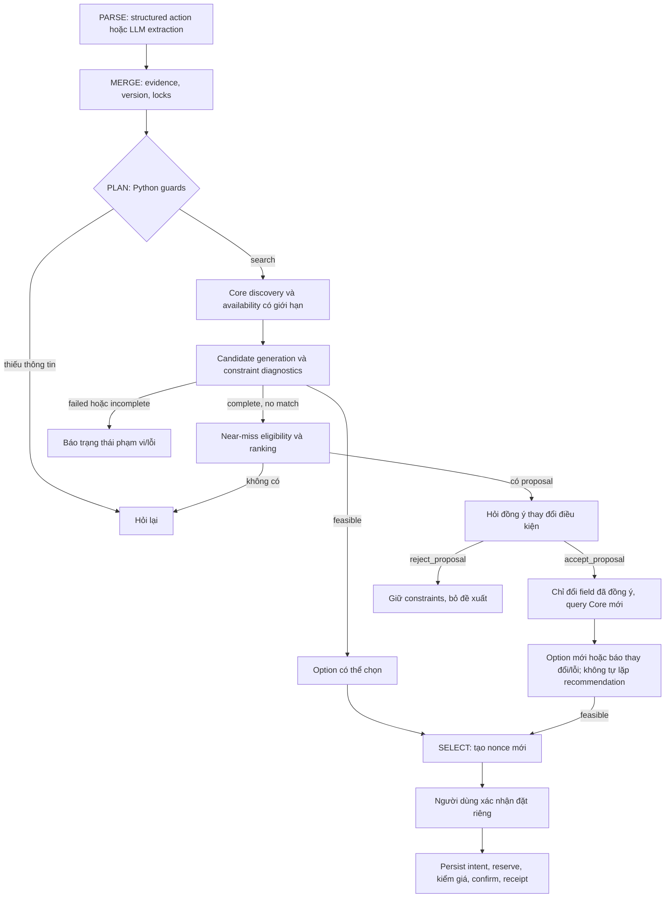

# AI Service — Constraint-Aware Recommendation V1

Triển khai dựa trên [bản thiết kế đầu vào V1](ai/designs/AI_SERVICE_UPGRADE_DESIGN_V1.md), ngày 27/10/2026. File thiết kế được giữ nguyên để đối chiếu, không phải bản ghi các chức năng đã chạy production. SHA256 đầu vào: `a42459e18daa00de68708e1eb3b58eefa5d255f837f737f77cc5a6c7accef69e`.

Ngày 28/10/2026 bổ sung nhánh hỗ trợ cá nhân trong [AI_ASSISTANCE_FEATURES.md](AI_ASSISTANCE_FEATURES.md): lịch, thống kê, hủy có consent, trung tâm và FAQ. State được nâng lên schema 3; các quy tắc eligibility/ranking near-miss V1 bên dưới tiếp tục áp dụng.

## 1. Hành vi sau nâng cấp

AI phân biệt bốn kết quả tìm kiếm:

| Kết quả domain | Ý nghĩa | Hành vi hội thoại |
| --- | --- | --- |
| `FOUND` | Có phương án đáp ứng constraints trong phạm vi đã kiểm tra | `SEARCH_RESULTS`, cho chọn option |
| `NO_MATCH` | Đã kiểm tra đủ scope nhưng không có phương án đáp ứng | Đề xuất gần đúng hoặc `ASK_CONSTRAINT_CHANGE` |
| `SEARCH_INCOMPLETE` | Catalogue/candidate cap, lỗi một phần, hoặc dữ liệu lịch/giá chưa đủ | Báo rõ coverage; chỉ hiển thị feasible option đã kiểm chứng, không tạo proposal |
| `SEARCH_FAILED` | Lỗi/timeout Core hoặc không đọc được dữ liệu cần thiết | Trả lỗi tìm kiếm có thể thử lại; không kết luận hết sân |

Slot vẫn là 60 phút. Ngày, thời lượng, quyền sở hữu và cơ chế ghi booking của Core không được nới tự động. Tìm kiếm không tạo reservation hay booking.

Ví dụ fixture tổng giá: yêu cầu 19h–21h, dưới 200k. Sân A 19h–21h giá 220k là đề xuất tăng ngân sách 20k; sân B 20h–22h giá 180k là đề xuất đổi giờ 60 phút. Sân C 270k hoặc phương án đồng thời đổi giờ và vượt ngân sách bị loại ở V1.

## 2. Luồng và ranh giới quyết định



Sơ đồ thể hiện các bước logic. Code gộp evaluation/ranking vào các hàm Python trong một lần search; không tạo thêm một vòng LLM/tool không giới hạn. Core vẫn là authority và kiểm quote/slot ở mutation cuối.

## 3. Các file và thuật toán

| File | Trách nhiệm |
| --- | --- |
| [schemas.py](../services/ai-service/app/schemas.py) | `Candidate`, `ConstraintViolation`, `NearMissOption`, `SearchResult`, `NegotiationContext`, response và actions mới |
| [candidates.py](../services/ai-service/app/recommendation/candidates.py) | Tạo chuỗi slot trống liên tiếp, cùng court, có giá và đúng ngày; từ chối dữ liệu sai/stale |
| [constraints.py](../services/ai-service/app/recommendation/constraints.py) | Đánh giá từng field, tính delta, phân biệt soft/locked và ngưỡng đề xuất |
| [ranking.py](../services/ai-service/app/recommendation/ranking.py) | Tách Option/Proposal, score chuẩn hóa và stable tie-breaker |
| [negotiation.py](../services/ai-service/app/recommendation/negotiation.py) | Resolve snapshot server, kiểm expiry/version/evidence, chỉ chấp thuận suggested changes được lưu |
| [tools.py](../services/ai-service/app/tools.py) | Discovery có pagination cap, semaphore, deadline; kết quả và coverage có kiểu |
| [workflow.py](../services/ai-service/app/workflow.py) | Routing, proposal lifecycle, revalidation; giữ luồng BOOK an toàn |
| [providers.py](../services/ai-service/app/providers.py) | LLM/Fake parser đọc context đề xuất, số thứ tự và evidence; không tự cấp quyền |
| [response_composer.py](../services/ai-service/app/response_composer.py) | Template tiếng Việt chỉ dùng structured facts |
| [service.py](../services/ai-service/app/service.py), [store.py](../services/ai-service/app/db/store.py) | Lock, dedupe, state JSON, resume và tương thích lượt V1 |

### Candidate và dữ liệu Core

Một candidate luôn giữ ngày và thời lượng yêu cầu. Các slot phải cùng court, liên tiếp theo 60 phút, chưa qua và đều khả dụng. Slot thiếu giá hoặc có state mâu thuẫn không được dùng để tạo recommendation. Nếu Core cung cấp timestamp, áp dụng freshness policy; khi Core không có timestamp, `verified_at` là thời điểm AI đọc snapshot, không phải lời bảo đảm giữ chỗ.

Tổng tiền được tính từ giá slot Core và chính sách discount theo signed actor đã có ở phiên bản trước. Đây vẫn là snapshot tìm kiếm; reserve của Core trả tổng quote cuối và luồng BOOK giữ nguyên bước đối chiếu giá, release và xin consent mới khi giá đổi. Không thêm API quote hay mutation trong SEARCH.

### Eligibility V1

- Không vi phạm hard constraint: feasible option, kể cả soft preference nằm trong phạm vi user đã cho phép.
- Đúng một vi phạm có thể thương lượng, trong ngưỡng và không locked: near-miss proposal.
- Hai vi phạm, sai invariant, ngoài ngưỡng hoặc vi phạm field locked: reject.
- Ngân sách bằng 0 không được dùng làm mẫu số hoặc tự tăng ngân sách.
- Area chỉ đề xuất lân cận theo whitelist cấu hình. Matching tên khu vực trên địa chỉ không phải đo khoảng cách; không tuyên bố km/GPS.
- Soft time không có cửa sổ tường minh chỉ có phạm vi ±60 phút; việc cho phép soft phải xuất phát từ chính field người dùng nhắc tới.

Score dùng độ lệch chuẩn hóa và trọng số cấu hình, càng thấp càng gần. Tie-break bằng tổng giá, độ lệch giờ, center/court ID và thời điểm; không dùng UUID ngẫu nhiên để quyết định thứ tự. Trọng số là policy ban đầu, không phải sở thích đã đo của người dùng.

## 4. Hai lần đồng ý khác nhau

`accept_proposal` chỉ đồng ý sửa điều kiện. Backend tìm proposal trong snapshot hội thoại, kiểm version/expiry và pending booking, rồi thay đúng field đã đề xuất. Sau đó query Core lại và tạo option mới; không tự SELECT, tạo nonce hoặc BOOK. Nếu slot/giá đổi, response nói rõ và chỉ dùng dữ liệu mới.

`select` chọn feasible option và sinh nonce. `confirm` với consent/nonce hiện tại mới đi vào BOOK. `proposal_id` không được dùng như `option_id` hoặc `confirmation_id`.

Với ngôn ngữ tự nhiên, số đề xuất hoặc giá/giờ/khu vực phải khớp đề xuất thật. LLM trả `proposal_number` chưa đủ để cấp quyền. “Được” khi có nhiều đề xuất là mơ hồ; khi chỉ có một đề xuất, sự đồng ý đó vẫn chỉ áp dụng cho thay đổi điều kiện.

`reject_proposal` không đổi giá trị constraints. Snapshot được bỏ và các signature vừa từ chối được nhớ có giới hạn để không lặp lại trong cùng version. Nếu người dùng nói rõ “chỉ 19h”, metadata có thể khóa giờ; chỉ những thay đổi có evidence mới cập nhật constraints sau này.

Pending booking chưa rõ kết quả chặn negotiation. Không tạo mutation cạnh tranh với key đã lưu. Conversation lock, `client_message_id`, Core idempotency, nonce/TTL và receipt validation vẫn được giữ.

## 5. Contract và giao diện

Không thêm endpoint Core. Endpoint AI/Gateway cũ nhận thêm:

```json
{
  "text": "Đồng ý đổi điều kiện theo đề xuất",
  "client_message_id": "message-accept-0001",
  "action": "accept_proposal",
  "proposal_id": "<UUID do server trả>"
}
```

Từ chối dùng `action=reject_proposal`. Proposal action phải có `proposal_id` và không kèm option/confirmation ID. Response thêm `proposals`, `diagnostics`, `search_metadata`, `pending_negotiation`. `REPLAN` cũ khi không có nghiệm được thay bằng `ASK_CONSTRAINT_CHANGE`; proposal dùng `ALTERNATIVES_PROPOSED`.

Contract hiện hành: [AI OpenAPI](../contracts/ai/openapi.json), [public Gateway](../contracts/gateway/openapi.json), [message schema](../contracts/ai-tools/conversation-message.schema.json). Các endpoint `/v1/chat` còn Proposed không được tự coi là đã triển khai.

Trang [BookingAssistant](../apps/web/src/features/assistant/pages/BookingAssistant.tsx) giữ layout hiện có, thêm thẻ đề xuất khác màu và giải thích độ lệch. Nút **Đồng ý đổi điều kiện** khác với **Chọn sân** và **Xác nhận đặt sân**; proposal hết hạn bị vô hiệu hóa ở UI và server vẫn kiểm lại. Reload lấy snapshot hiện hành từ state, không dùng đề xuất cũ trong lịch sử làm authority.

## 6. Cấu hình và giới hạn

| Biến | Mặc định | Vai trò |
| --- | --- | --- |
| `NEAR_MISS_TIME_MINUTES` | 60 | Độ lệch giờ tối đa chỉ để đề xuất |
| `NEAR_MISS_PRICE_RATIO` | 0.2 | Vượt tổng ngân sách tối đa 20%, chưa phải user đã cho phép |
| `NEAR_MISS_TOP_K` | 3 | Chỉ lưu/trả Top-K proposal |
| `PROPOSAL_TTL_SECONDS` | 300 | TTL proposal; vẫn phải query lại khi chấp nhận |
| `NEAR_MISS_WEIGHTS` | time 0.4, price 0.4, area 0.2 | JSON, không âm và tổng bằng 1 |
| `NEARBY_AREAS` | `{}` | JSON whitelist, ví dụ `{"Cầu Giấy":["Nam Từ Liêm"]}` khi nhóm xác minh policy |
| `MAX_DISCOVERY_PAGES` | 2 | Tối đa 2 trang catalogue, 100 mục/trang |
| `MAX_SEARCH_CENTERS` | 5 | Số trung tâm truy vấn calendar tối đa |
| `MAX_CANDIDATES` | 500 | Candidate cap; chạm giới hạn còn dữ liệu phải báo partial |
| `SEARCH_CONCURRENCY` | 2 | Số calendar request đồng thời |
| `SEARCH_TIMEOUT_SECONDS` | 10 | Deadline toàn search, tối đa cấu hình 12 giây |
| `AVAILABILITY_MAX_AGE_SECONDS` | 60 | Freshness khi snapshot có timestamp |

Một search có tối đa `MAX_DISCOVERY_PAGES + MAX_SEARCH_CENTERS` Core calls; revalidation là một lần search mới ở lượt sau, không lặp proposal tự động. State/checkpoint chỉ lưu options/Top-K, counts và metadata, không toàn bộ candidate pool. Quá giới hạn catalogue/center/candidate hoặc dữ liệu thiếu phải được báo partial, kể cả có một số feasible options đã kiểm chứng.

Không cần thay bảng database: `normalize_state` thêm trường JSON V2 khi đọc/xử lý, giữ pending booking và version cũ. Replay lượt V1 chuẩn hóa các optional request fields trước khi so dedupe. Các migration schema Prisma/Alembic hiện có được giữ nguyên.

## 7. Metrics, logs và monitoring

Giữ HTTP/planner/tool/token metrics, bổ sung search outcomes, near-miss candidates, proposal lifecycle, negotiation turns, revalidation failures, guard rejections, search duration theo stage và parser failures. Không dùng conversation/proposal/user ID làm label Prometheus.

Trace/log có request ID, conversation/turn/search/proposal ID, constraints version và decision reason; không log API key, bearer hay toàn bộ prompt/transcript. BOOK không được thay bằng log/checkpoint đơn thuần: business-state persistence vẫn là authority của ý định bền vững.

Rule và dashboard được bổ sung ngay trong nguồn [monitoring/chart](../monitoring/README.md) của app, dùng chung local/GitOps theo quy ước nhóm. Có panel search outcomes, proposal lifecycle, latency theo stage, revalidation/guard/parser failures và số lượt negotiation. Ngưỡng cảnh báo ban đầu cần được review sau baseline; không coi chúng là SLO đã đạt.

## 8. Kiểm tra và evaluation

```bash
cd services/ai-service
uv sync --locked --all-groups
uv run ruff check app tests evaluation alembic
uv run mypy app
uv run pytest tests -q
AI_PROVIDER=fake AI_OFFLINE=true GOLDEN_SUITE=full uv run python -m evaluation.evaluate
uv run python -m evaluation.evaluate_recommendation
uv run python -m evaluation.evaluate_conversations
```

Parser golden giữ 40 tình huống. Recommendation evaluator so B0 (không đề xuất), B1 (threshold/độ lệch không trọng số), B2 (weighted ranking) trên 12 fixture synthetic có nhãn policy khai báo sẵn. Precision/coverage ở đây chỉ phản ánh bộ fixture, không phải độ chính xác LLM hoặc chất lượng gợi ý với người dùng thật; không tính nDCG khi chưa có nhãn sở thích độc lập.

Conversation evaluator chạy các ca API nhiều lượt với FakeParser, HTTP Core protocol fixture, SQLite và checkpoint riêng. Bộ live integration bổ sung ca tăng ngân sách qua proposal với Core/PostgreSQL thật; cần Docker hoặc các `AI_LIVE_*` trỏ tới database `*_test` được sở hữu riêng. Máy thực hiện thay đổi hiện không có Docker daemon nên các ca live được skip; CI yêu cầu Docker và không chấp nhận skip do thiếu Docker.

Đã kiểm tra regression booking cũ, eligibility/ranking, stale/forged proposal, acceptance/rejection, thay đổi giá/slot, replay, pending booking, coverage, candidate/concurrency/deadline caps, Gateway validation và UI tách consent. Chưa chạy Groq thật hoặc benchmark production. Optional LLM response composer và preference-adaptive V2 chưa bật; response V1 dùng template đã grounding.

### Kết quả kiểm tra working tree ngày 27/10/2026

| Kiểm tra | Kết quả |
| --- | --- |
| AI pytest toàn bộ | 89 passed, 4 live Core/PostgreSQL cases skipped vì Docker daemon không có |
| Conversation evaluator | 20 passed, 0 failure/error; là tập con trong tổng AI tests, không cộng thêm vào 89 |
| Parser regression | 40 tình huống với FakeParser, đạt các expected labels; chưa đo Groq thật |
| Recommendation evaluator | 12 fixture synthetic; B0/B1/B2 chạy và đối chiếu policy labels |
| Ruff / mypy | Pass, 22 source files được typecheck |
| Frontend | 8 unit tests pass và Vite build pass với Node 22.23.4 |
| Gateway | 5 AI boundary tests pass; Gateway/Web TypeScript và ESLint phần thay đổi pass |
| Contracts | Native AI, public Gateway và AI tool schemas/examples được validate |
| Monitoring | Helm lint/render, Prometheus config/rules và 17 dashboard query expressions pass |

Đối chiếu AST xác nhận hàm `Workflow.book()` không đổi nghiệp vụ so với baseline trước nâng cấp. Code Booking Core, Admin, schema migration và các thay đổi local ngoài phạm vi được giữ nguyên. Những kết quả này là kiểm tra local, không phải trạng thái GitHub Actions hoặc deployment production.
