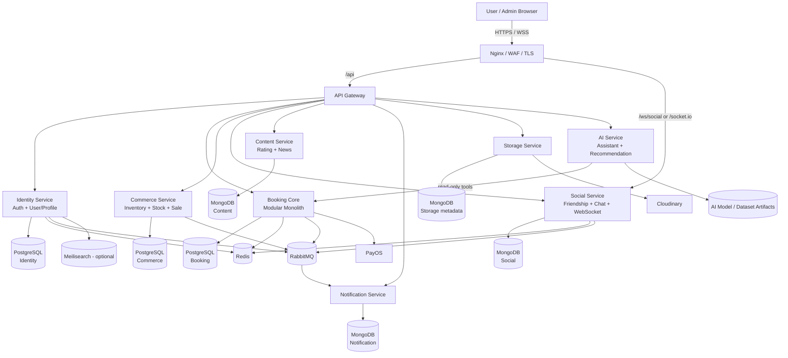
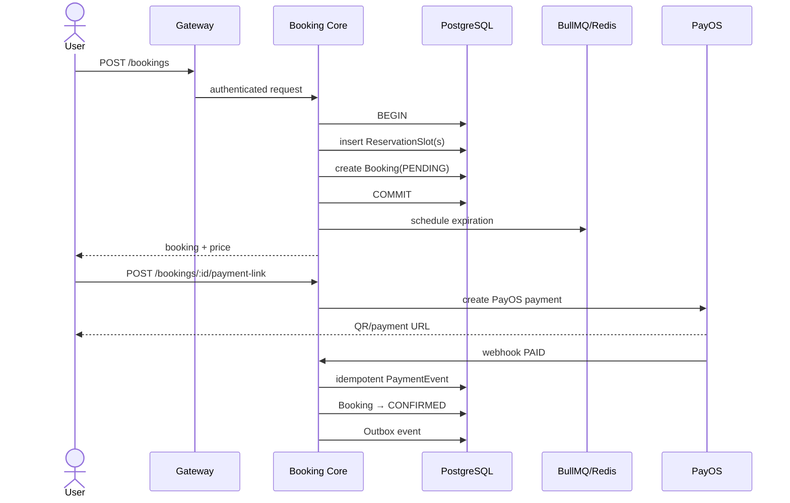
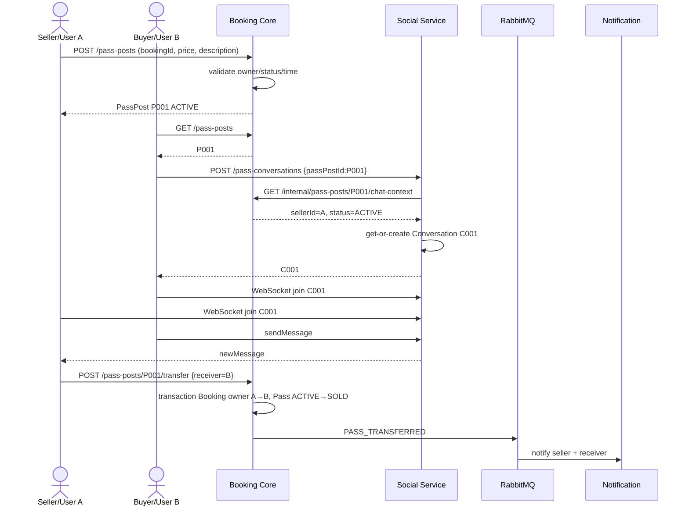
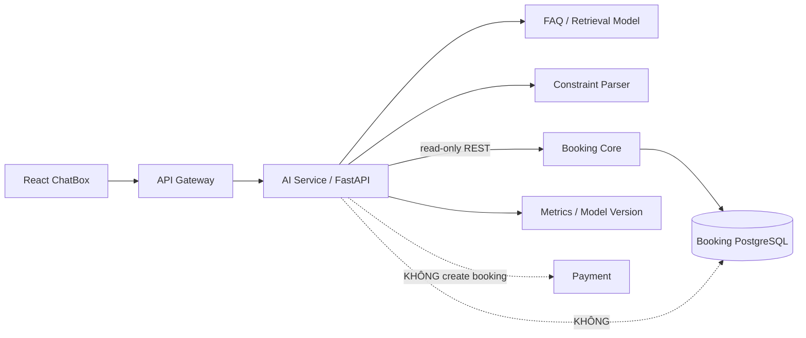
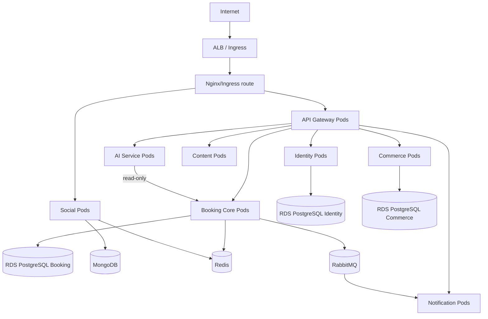

# Badminton Manager V2 — Kiến trúc hệ thống, codebase và kế hoạch triển khai


## Cách đọc và phạm vi áp dụng trong repo mới

Tài liệu này được đưa vào `docs/ARCHITECTURE.md` ngày **19/10/2026**, dùng nội dung kiến trúc V2 do chủ dự án cung cấp làm **tài liệu kiến trúc đích chính**. Nội dung nguồn bên dưới được giữ nguyên; phần hướng dẫn này phân biệt thiết kế đích với trạng thái implementation.

- **Trạng thái: Proposed / kiến trúc đích.** Các đoạn “codebase hiện tại” trong tài liệu nguồn nói về repo legacy `Badminton_manager_microservices`, không có nghĩa toàn bộ thiết kế đã chạy trong repo `badminton_system`.
- **Hiện trạng repo mới:** Gateway, Booking Core, AI và UI tương ứng đã có code; Identity, Commerce, Social, Content, Notification và Storage hiện chỉ có skeleton thư mục. Payment/pass chưa có implementation trong Core. Xem [hiện trạng và khoảng cách](architecture/SYSTEM_ARCHITECTURE.md).
- **Cấu trúc implementation:** Trách nhiệm module, dependency và cây thư mục đang dùng được lưu tại [CODEBASE_ARCHITECTURE](architecture/CODEBASE_ARCHITECTURE.md). Tên thư mục thực tế theo kebab-case (`booking-core`, `identity-service`...), ánh xạ chi tiết ở [SKELETON_MAPPING](architecture/SKELETON_MAPPING.md).
- **AI cần quyết định riêng:** Tài liệu đích yêu cầu read-only; AI hiện tại có execution đặt sân sau xác nhận. [ADR-008](adr/ADR-008.md) vẫn Proposed. Việc cập nhật tài liệu này không đổi workflow hoặc quyền của AI đang chạy.
- **Contract đang chạy và thiết kế:** Contract được tổ chức theo service/API, với nhãn implemented/proposed trên từng operation. Gateway tham chiếu provider cho public proposals; việc kiểm tra contract bằng CI không có nghĩa endpoint Proposed đã chạy. Xem [SYSTEM_CONTRACTS](SYSTEM_CONTRACTS.md) và [chỉ mục contracts](../contracts/README.md).

Nguồn: `kien_truc_va_trien_khai_badminton_manager_v2 (1).md`; SHA256 `0f26023365bbc25d7b487a6d833930adca80872473bb0c5d272df035177b9049`. [Source provenance](source-provenance.json) lưu metadata đầu vào và commit legacy. Các ví dụ, lựa chọn công nghệ, kế hoạch triển khai và Definition of Done trong nội dung nguồn là thiết kế/tham khảo; không phải bằng chứng đã triển khai hoặc nghiệm thu.

---

> Repo nguồn được khảo sát: `https://github.com/chiendz11/Badminton_manager_microservices`
>
> Mục tiêu của tài liệu này là **refactor dần từ codebase hiện tại**, không viết lại toàn bộ từ đầu. Hệ thống phải luôn có một phiên bản chạy được trong suốt quá trình 10 tuần.

---

# 1. Kết luận kiến trúc đề xuất

Codebase hiện tại đang tách khá nhiều service theo tên tính năng (`center_service`, `booking_service`, `inventory_service`, `transaction_service`, `rating_service`, `new_service`...), nhưng một số service thực tế có **transaction/business coupling rất chặt**.

Kiến trúc đích nên là **hybrid architecture**:

- Một số bounded context lớn được tổ chức **modular monolith bên trong một service**.
- Các workload có lý do rõ để độc lập thì vẫn là **microservice riêng**.
- Không cố biến mọi module thành một service.

Kiến trúc đích:



Điểm quan trọng nhất:

```text
Booking Core
├── Center
├── Court
├── Pricing
├── Availability
├── Reservation
├── Booking
├── Payment
└── Pass Marketplace
```

Các phần này ở cùng một deployment unit vì chúng liên quan trực tiếp đến transaction và tính nhất quán của quá trình đặt sân.

Trong khi đó:

```text
Social Service
├── Friendship
├── Conversation
├── Message
└── WebSocket Gateway
```

được giữ riêng vì realtime socket có cách scale, lifecycle và security hoàn toàn khác Booking.

AI cũng phải là một service riêng:

```text
AI Service
├── FAQ / domain assistant
├── Constraint extraction
├── Court recommendation
├── Booking Core tool client (read-only)
└── Evaluation / model versioning / metrics
```

AI **không sở hữu Booking DB và không được tự create booking/payment/transfer**. Nó chỉ hiểu yêu cầu, truy xuất/gợi ý và gọi các API read-only do Booking Core cung cấp.

---

# 2. Codebase hiện tại đang có gì?

Qua repo `master`, hiện tại backend chính trong `BM/` có:

```text
BM/
├── api_gateway/
├── nginx/
├── docker-compose.yml
└── services/
    ├── auth_service/
    ├── user_service/
    ├── center_service/
    ├── booking_service/
    ├── social_service/
    ├── inventory_service/
    ├── transaction_service/
    ├── notification_service/
    ├── storage_service/
    ├── rating_service/
    └── new_service/
```

Frontend và AI prototype:

```text
Frontend/   # user UI
Admin/      # admin/center manager UI
AI/
├── badminton_qa_model/
├── data/Question.csv
└── model.ipynb
```

`Frontend/src/components/ChatBox.jsx` đã có một hội thoại `Trợ lý ảo AI`, nhưng hiện response AI vẫn là **mock bằng `setTimeout`**; chưa có inference service thật, API thật, evaluation gate hay model lifecycle production.

## 2.1 Tech stack hiện tại đáng giữ

Repo hiện đã có nhiều thành phần tốt, không cần thay chỉ để “trông hiện đại hơn”:

- React 19 + Vite cho Frontend/Admin.
- Axios cho REST.
- Socket.IO client/server cho realtime chat.
- NestJS 11 ở Booking/Social/Notification.
- Express 5 ở một số service nhẹ.
- RabbitMQ cho async event/notification.
- Redis + BullMQ cho delayed job/booking expiration.
- PostgreSQL + Prisma đã tồn tại ở `auth_service`.
- MongoDB/Mongoose ở các service document-oriented.
- PayOS cho thanh toán booking.
- Cloudinary cho storage ảnh.
- Meilisearch cho search.
- Nginx + ModSecurity/WAF làm public edge.
- Repo đã có prototype AI gồm notebook, model artifact và `Question.csv`; phần này nên được productionize thành Python/FastAPI service thay vì chạy notebook hoặc mock trong frontend.

Nguồn tham khảo trực tiếp trong repo:

- `BM/docker-compose.yml`
- `BM/services/auth_service/prisma/schema.prisma`
- `BM/services/booking_service/package.json`
- `BM/services/social_service/package.json`
- `BM/nginx/nginx.conf`
- `AI/model.ipynb`
- `AI/data/Question.csv`
- `Frontend/src/components/ChatBox.jsx`

---

# 3. Những vấn đề kiến trúc cần cải tiến từ codebase hiện tại

## 3.1 Booking Service đang phải biết quá nhiều dữ liệu của service khác

`booking_service/src/Service/booking.service.ts` hiện inject trực tiếp các model như:

```text
Booking
Center
Court
User
PassPost
```

Booking còn tự tính `Center.pricing`, tìm court và kiểm tra timeslot.

Điều này cho thấy trong business thực tế:

```text
Center → Court → Pricing → Availability → Reservation → Booking
```

là một bounded context rất chặt.

Nếu `center_service` là service riêng nhưng Booking vẫn phải giữ bản sao Center/Court/Pricing trong DB của mình, ta có thêm vấn đề sync dữ liệu mà không nhận được nhiều lợi ích của microservice.

**Đề xuất:** đưa Center/Court/Pricing vào `booking_core` dưới dạng module.

---

## 3.2 Inventory và Transaction đang bị tách sai transaction boundary

`transaction_service` hiện thực hiện nghiệp vụ:

```text
createStockHistory
createNewStockImport
createSellHistory
getSellHistories
```

Nhưng để trừ/tăng kho, service lại gọi HTTP sang `inventory_service`.

Luồng hiện tại gần giống:

```text
Transaction Service
       |
       | PUT /internal/sell-stock
       v
Inventory Service
       |
       | stock decreased
       v
Transaction Service
       |
       X create SellHistory failed
```

Khi đó phải compensation thủ công.

Nghiệp vụ đúng nên là:

```sql
BEGIN;

check stock;
update inventory quantity;
insert sale;
insert sale items;
insert stock movement;

COMMIT;
```

**Đề xuất:** gộp thành `commerce_service`.

---

## 3.3 Auth + User đang duplicate dữ liệu identity

Hiện tại:

- `auth_service`: PostgreSQL + Prisma, chứa email, username, role, credential, OAuth identity, session, refresh token.
- `user_service`: MongoDB, lại copy email, username, role, isActive và giữ profile.

Việc duplicate này bắt hệ thống phải sync dữ liệu giữa hai service.

**Đề xuất target:** một `identity_service` có PostgreSQL/Prisma làm source of truth.

Có thể vẫn tách logic code thành module:

```text
identity_service/
├── auth/
├── session/
├── oauth/
├── profile/
└── role/
```

Nhưng deployment + DB boundary là một.

---

## 3.4 Social Service hiện đúng là service realtime và nên giữ riêng

Repo đã có:

```text
social_service/
├── Conversation
├── Message
├── Friendship
└── ChatGateway (Socket.IO)
```

`ChatGateway` đã có:

```text
joinConversation
leaveConversation
sendMessage
newMessage
```

Vì vậy không nên gộp Social vào Booking Core.

Tuy nhiên có 3 vấn đề cần sửa ngay:

### Vấn đề A — senderId lấy từ client

Frontend hiện gửi kiểu:

```js
socket.emit('sendMessage', {
  senderId: currentUser.userId,
  conversationId,
  content
});
```

Đây là trust boundary sai. Client có thể tự sửa `senderId`.

**Target:** senderId phải lấy từ JWT đã verify trên WebSocket handshake.

### Vấn đề B — join room chưa kiểm tra membership

Backend hiện có logic kiểu:

```ts
client.join(conversationId)
```

Trước khi join phải kiểm tra:

```text
conversation.memberIds contains authenticatedUserId ?
```

### Vấn đề C — conversation chỉ được tạo sau khi kết bạn

Pass sân yêu cầu hai người lạ có thể chat mà không phải kết bạn.

Phải thêm `ConversationType.PASS_BOOKING`.

---

## 3.5 Pass sân đã có phần lớn code, nhưng cần hoàn thiện transaction và integration

Repo hiện đã có:

- `ModalPassBooking.jsx`
- `PassCourts.jsx`
- `PassPost` schema
- `InterestedUser` schema
- route create/list/my-posts/interest
- `transferOwner`
- notification cho pass

Đây là nền tảng tốt.

Các điểm cần sửa:

1. Frontend từng chỗ dùng `desc`, backend DTO dùng `description` → chuẩn hóa một tên.
2. `updateBookingOwner()` hiện có logic xóa PassPost khi transfer → phải đổi thành `status = SOLD` để giữ audit.
3. Endpoint `PATCH /transfer-owner` quá generic → đổi thành action gắn với PassPost.
4. Chưa có chat trực tiếp từ PassPost.
5. Conversation hiện chưa có `contextId` liên kết PassPost.
6. Seller/buyer authorization phải kiểm tra server-side.
7. Transfer phải là **một DB transaction**.

## 3.6 AI hiện mới là prototype, chưa phải deployable service

Repo hiện có `AI/model.ipynb`, `AI/badminton_qa_model`, `AI/data/Question.csv`, và UI `ChatBox.jsx` đã ghim một AI assistant. Tuy nhiên `ChatBox.jsx` vẫn trả lời giả lập, nên còn thiếu:

1. Inference API thật.
2. Model/data version rõ ràng.
3. Evaluation set và metric chất lượng.
4. Confidence/fallback khi model không chắc.
5. Tích hợp dữ liệu sân thật qua Booking Core.
6. Health/readiness/metrics/container.
7. CI/CD và rollback model/service.
8. Guardrail để AI không tự thực hiện write action.

Do đó AI phải được nâng thành `ai_service`, không để logic ML nằm trong notebook hoặc React component.

---

# 4. Booking Core — kiến trúc chi tiết

## 4.1 Module structure

```text
booking_core/
└── src/
    ├── modules/
    │   ├── center/
    │   │   ├── application/
    │   │   ├── domain/
    │   │   ├── infrastructure/
    │   │   └── center.module.ts
    │   ├── court/
    │   ├── pricing/
    │   ├── availability/
    │   ├── reservation/
    │   ├── booking/
    │   ├── payment/
    │   └── pass-marketplace/
    │       ├── pass-post/
    │       ├── interest/
    │       └── transfer/
    ├── common/
    │   ├── database/
    │   ├── events/
    │   ├── idempotency/
    │   └── errors/
    ├── app.module.ts
    └── main.ts
```

Không được để:

```text
BookingModule → ReservationRepository trực tiếp
```

Nên là:

```text
BookingModule
    |
    v
ReservationService / ReservationPort
    |
    v
ReservationRepository
```

Đây là modular monolith sạch: cùng process nhưng vẫn có module boundary.

---

# 5. Vì sao Booking Core nên dùng PostgreSQL + Prisma?

Booking có dữ liệu quan hệ và constraint mạnh:

```text
Center
  └── Court
       └── Slot Reservation

User
  └── Booking
       ├── Booking Slot
       ├── Payment
       └── PassPost
```

Các rule quan trọng:

- Không được double-booking.
- Một PassPost ACTIVE cho một booking.
- Một booking chỉ có một owner hiện tại.
- Transfer phải atomic.
- Payment event phải idempotent.

PostgreSQL phù hợp hơn vì:

- ACID transaction mạnh.
- unique/composite constraint.
- foreign key.
- row-level locking khi cần.
- reporting tốt.
- Prisma migration/type safety.

Repo đã dùng Prisma/PostgreSQL trong Auth nên team không phải học công nghệ hoàn toàn mới.

---

# 6. Schema Booking Core gợi ý

Không nhất thiết copy y nguyên, nhưng target relational model nên gần như sau.

## 6.1 Center/Court

```prisma
model Center {
  id        String   @id @default(uuid())
  name      String
  address   String?
  isActive  Boolean  @default(true)
  courts    Court[]
  pricing   PricingRule[]
  createdAt DateTime @default(now())
  updatedAt DateTime @updatedAt
}

model Court {
  id        String   @id @default(uuid())
  centerId  String
  center    Center   @relation(fields: [centerId], references: [id])
  name      String
  isActive  Boolean  @default(true)

  @@index([centerId])
}
```

## 6.2 Reservation để chống double-booking

```prisma
model ReservationSlot {
  id          String   @id @default(uuid())
  bookingId   String
  centerId    String
  courtId     String
  playDate    DateTime
  slotStart   Int
  status      ReservationStatus

  @@unique([courtId, playDate, slotStart])
  @@index([centerId, playDate])
}
```

Điểm mấu chốt là:

```text
UNIQUE(court_id, play_date, slot_start)
```

Do đó hai request cùng cố đặt một slot:

```text
Request A → INSERT → success
Request B → INSERT → unique violation → 409 Conflict
```

Không còn phụ thuộc hoàn toàn vào:

```text
SELECT xem trống
rồi mới INSERT
```

vì pattern đó có race condition.

---

# 7. Booking flow chuẩn



---

# 8. Payment không phải một DB transaction dài

Không làm:

```sql
BEGIN;
call_payos();
wait_user_pay();
COMMIT;
```

Vì PayOS là hệ thống bên ngoài.

Dùng state machine:

```text
PENDING
   |
   v
PROCESSING
   |
   +------> FAILED
   |
   +------> EXPIRED
   |
   v
CONFIRMED
```

Webhook phải idempotent:

```text
same orderCode / paymentEventId
        |
        +--> already processed → return 200, no duplicate side-effect
```

Các điểm bắt buộc:

- verify PayOS signature/checksum.
- unique `orderCode`.
- lưu webhook/event ID đã xử lý.
- không cộng point hai lần.
- không phát `BookingConfirmed` hai lần theo cách gây side effect duplicate.

---

# 9. Pass Marketplace — boundary đúng

Pass Marketplace phải nằm trong Booking Core vì nó thay đổi quyền sở hữu Booking.

```text
Booking Core
├── Booking
├── Reservation
├── Payment
└── Pass Marketplace
    ├── PassPost
    ├── Interest
    └── Transfer
```

Social chỉ dùng để chat.

---

# 10. PassPost target schema

```prisma
enum PassPostStatus {
  ACTIVE
  SOLD
  CANCELLED
  EXPIRED
}

model PassPost {
  id             String         @id @default(uuid())
  bookingId      String         @unique
  sellerId       String
  originalPrice  Int
  resalePrice    Int
  description    String?
  status         PassPostStatus @default(ACTIVE)
  expiresAt      DateTime

  soldToUserId   String?
  soldAt         DateTime?
  cancelledAt    DateTime?

  createdAt      DateTime       @default(now())
  updatedAt      DateTime       @updatedAt

  interests      PassInterest[]
}

model PassInterest {
  id        String   @id @default(uuid())
  passPostId String
  userId    String
  createdAt DateTime @default(now())

  @@unique([passPostId, userId])
}
```

Không lưu phone dưới dạng text `[LH: 09...]` trong description.

Profile/contact lấy từ Identity Service khi được phép.

---

# 11. Transfer booking phải là transaction

Endpoint nên đổi từ:

```text
PATCH /booking/transfer-owner
```

thành:

```http
POST /api/booking/pass-posts/{postId}/transfer
```

Body:

```json
{
  "receiverUserId": "USER_B"
}
```

Server tự lấy seller từ JWT.

Pseudo-flow:

```text
BEGIN

SELECT PassPost P001 FOR UPDATE

assert post.status == ACTIVE
assert post.sellerId == authenticatedUserId
assert Booking.ownerId == authenticatedUserId
assert receiver exists and active

UPDATE Booking.ownerId = receiverUserId
UPDATE PassPost
  status = SOLD
  soldToUserId = receiverUserId
  soldAt = now

INSERT TransferAudit
INSERT OutboxEvent(PASS_TRANSFERRED)

COMMIT
```

Nếu bất kỳ bước nào lỗi:

```text
ROLLBACK toàn bộ
```

Không có trạng thái kiểu:

```text
Booking owner đã đổi
nhưng PassPost vẫn ACTIVE
```

---

# 12. Pass sân + Realtime Chat — flow hoàn chỉnh



---

# 13. Social Service target codebase

```text
social_service/
└── src/
    ├── friendship/
    │   ├── friendship.controller.ts
    │   ├── friendship.service.ts
    │   └── friendship.schema.ts
    ├── conversation/
    │   ├── conversation.controller.ts
    │   ├── conversation.service.ts
    │   └── conversation.schema.ts
    ├── message/
    │   ├── message.service.ts
    │   └── message.schema.ts
    ├── gateway/
    │   ├── chat.gateway.ts
    │   ├── ws-auth.guard.ts
    │   └── ws-membership.guard.ts
    ├── clients/
    │   └── booking.client.ts
    └── app.module.ts
```

## 13.1 Conversation schema mở rộng

Current schema có PRIVATE/GROUP.

Target:

```ts
export enum ConversationType {
  PRIVATE = 'private',
  GROUP = 'group',
  PASS_BOOKING = 'pass_booking',
}
```

Thêm:

```text
contextType = PASS_POST
contextId = P001
participantKey = sorted(USER_A,USER_B)
```

Unique logical key:

```text
(type, contextId, participantKey)
```

để user bấm Chat nhiều lần vẫn chỉ có một conversation.

---

# 14. WebSocket authentication đúng

Frontend không gửi `senderId` nữa.

```js
const socket = io(SOCKET_BASE_URL, {
  auth: {
    token: accessToken
  }
});
```

Backend:

```text
Socket handshake
    |
    v
verify JWT
    |
    v
client.data.userId = token.sub
```

Khi send:

```text
sendMessage(conversationId, content)
        |
        v
authenticated userId from socket context
        |
        v
check userId belongs to Conversation.memberIds
        |
        v
save message
        |
        v
emit newMessage
```

Không tin `senderId` do browser gửi.

---

# 15. Scale Social Service

Một replica:

```text
Browser A ─┐
           ├── Social Pod 1
Browser B ─┘
```

ổn.

Nhưng khi scale:

```text
Browser A → Social Pod 1
Browser B → Social Pod 2
```

Socket.IO room state ở memory từng pod sẽ không tự đồng bộ.

Do đó dùng:

```text
Socket.IO Redis Adapter
```

Target:

```text
          Redis
        /       \
Social Pod 1   Social Pod 2
     |             |
  User A         User B
```

Redis ở đây là realtime pub/sub adapter, không phải message persistence. Message vẫn lưu MongoDB.

---

# 16. Commerce Service

Target:

```text
commerce_service/
└── src/modules/
    ├── product/
    ├── inventory/
    ├── stock/
    ├── sale/
    ├── invoice/
    └── reporting/
```

DB: PostgreSQL + Prisma.

Lý do:

```text
Sale
 + stock deduction
 + invoice
```

cần transaction.

Ví dụ:

```sql
BEGIN;

SELECT inventory WHERE product_id = ? FOR UPDATE;
assert quantity >= requested;
UPDATE inventory SET quantity = quantity - requested;
INSERT sale;
INSERT sale_item;
INSERT stock_movement;

COMMIT;
```

Không cần `transaction_service` gọi HTTP sang `inventory_service` nữa.

---

# 17. Identity Service

Target:

```text
identity_service/
├── auth/
├── user/
├── profile/
├── role/
├── session/
├── refresh-token/
└── oauth/
```

Database: PostgreSQL + Prisma.

Reuse phần tốt từ `auth_service/prisma/schema.prisma`:

```text
User
Session
RefreshToken
ExternalIdentity
AuthClient
Role
```

Bổ sung profile fields vào relational schema hoặc bảng `UserProfile`.

Không tiếp tục duplicate:

```text
Auth.email
UserMongo.email
Auth.role
UserMongo.role
```

nếu không có lý do read-model rõ ràng.

Nếu cần migrate an toàn, có thể 2 pha:

```text
Phase A
Auth PostgreSQL = source of truth
User Mongo = read model temporary

Phase B
Move profile to Identity PostgreSQL
Stop Mongo writes
```

---

# 18. Content Service

`rating_service` và `new_service` có thể gộp thành:

```text
content_service/
├── review/
├── rating/
└── news/
```

MongoDB hợp lý vì:

- content/document-oriented.
- transaction cross-module không quan trọng.
- schema thay đổi linh hoạt.

Không cần hai deployment riêng ở quy mô hiện tại.

---

# 19. Notification Service

Giữ service riêng.

Responsibilities:

```text
Notification Service
├── consume RabbitMQ events
├── in-app notification
├── email/push adapter
├── read/unread
└── deep-link metadata
```

Consumer phải idempotent.

Ví dụ event:

```json
{
  "eventId": "uuid",
  "type": "PASS_TRANSFERRED",
  "version": 1,
  "occurredAt": "...",
  "payload": {
    "passPostId": "P001",
    "bookingId": "B001",
    "sellerId": "USER_A",
    "receiverId": "USER_B"
  }
}
```

Notification service lưu `eventId` đã xử lý hoặc dùng unique constraint để không tạo notification duplicate.

---

# 20. AI Service — từ notebook prototype thành production service

## 20.1 Scope AI v1

AI Service nên phục vụ bốn nhóm chức năng, theo thứ tự ưu tiên:

```text
1. FAQ / hướng dẫn hệ thống
2. Hiểu yêu cầu tự nhiên của user
3. Tìm và xếp hạng sân/slot phù hợp
4. Giải thích recommendation và deep-link sang Booking UI
```

Ví dụ user hỏi:

```text
"Tối mai khoảng 7 giờ, 2 tiếng, gần Cầu Giấy, dưới 200k"
```

AI chuyển thành structured constraints:

```json
{
  "date": "2026-10-05",
  "preferred_time": "19:00",
  "duration_minutes": 120,
  "location": "Cầu Giấy",
  "max_price": 200000
}
```

sau đó gọi **Booking Core read-only API** để lấy availability thật.

AI không được tự tạo dữ liệu kiểu:

```text
"Sân A còn trống 19:00"
```

nếu Booking Core chưa trả thông tin đó.

## 20.2 Boundary bắt buộc



Quy tắc:

- AI không truy cập trực tiếp PostgreSQL Booking.
- AI không gọi endpoint create booking, transfer hoặc payment.
- AI chỉ dùng allow-list tool read-only như `searchAvailability`, `getCenter`, `getPricing`.
- Action có side-effect phải quay lại UI để user xác nhận và gọi Booking Core bình thường.

## 20.3 Tech stack đề xuất

```text
services/ai_service/
├── Python 3.11/3.12
├── FastAPI
├── Pydantic
├── Uvicorn/Gunicorn
├── httpx                 # internal Booking Core client
├── prometheus-client     # metrics
├── pytest                # tests/evaluation
├── model adapter
└── retrieval adapter
```

Model strategy cho 10 tuần:

```text
Current badminton_qa_model
        |
        | benchmark
        v
+---------------------------+
| model hiện tại có đủ tốt? |
+---------------------------+
       | yes          | no
       v              v
 dùng adapter     multilingual embedding baseline
                 SentenceTransformers + cosine
                 FAISS chỉ khi corpus đủ lớn
```

Không nên fine-tune chỉ vì “có AI”. Trước tiên phải có **baseline và evaluation**. Với FAQ corpus nhỏ, embedding retrieval + confidence threshold thường đơn giản và dễ kiểm chứng hơn.

Nếu về sau dùng hosted LLM, đặt sau một adapter:

```text
AssistantEngine
├── LocalRetrievalEngine
└── LLMEngine (optional)
```

để không khóa toàn hệ thống vào một provider.

## 20.4 API target

```http
POST /v1/chat
```

Request:

```json
{
  "message": "Tối mai 7h tìm sân dưới 200k",
  "session_id": "optional-session-id"
}
```

Response:

```json
{
  "answer": "Mình tìm thấy 3 lựa chọn phù hợp.",
  "intent": "SEARCH_COURT",
  "constraints": {
    "date": "2026-10-05",
    "preferred_time": "19:00",
    "max_price": 200000
  },
  "recommendations": [],
  "confidence": 0.91,
  "model_version": "faq-retrieval-v1",
  "dataset_version": "question-v1"
}
```

Các endpoint vận hành:

```text
GET /health
GET /ready
GET /metrics
GET /v1/models/info
```

## 20.5 Booking Core tool contract

Thay vì AI đọc DB, Booking Core cung cấp API nội bộ:

```text
GET /internal/ai/centers/search
GET /internal/ai/availability/search
GET /internal/ai/pricing
```

hoặc một endpoint aggregate:

```http
POST /internal/ai/search-options
```

```json
{
  "date": "2026-10-05",
  "preferred_time": "19:00",
  "duration_minutes": 120,
  "location": "Cầu Giấy",
  "max_price": 200000
}
```

Booking Core trả data canonical; AI chỉ rerank/explain.

## 20.6 Evaluation bắt buộc

Không đánh giá AI bằng việc “chat thử thấy có vẻ ổn”. Phải có golden dataset versioned.

Metric gợi ý:

| Bài toán | Metric |
|---|---|
| FAQ retrieval | Top-1 accuracy / hit-rate |
| Intent | Accuracy hoặc macro F1 |
| Constraint extraction | Field-level precision/recall/F1 hoặc exact match |
| Recommendation | Feasible-result rate, top-k relevance |
| Fallback | Tỷ lệ low-confidence được từ chối đúng |
| Runtime | p50/p95 latency, error rate |

Mỗi model/data change phải chạy lại eval trước merge/release.

## 20.7 Data và model versioning

Target:

```text
ai_service/
├── app/
├── tests/
├── eval/
│   ├── golden_faq.jsonl
│   ├── golden_constraints.jsonl
│   └── run_eval.py
├── models/
│   └── manifest.json
└── data/
    └── question_v1.csv
```

Mỗi inference response/log nên có:

```text
model_version
dataset_version
request_id
latency_ms
confidence
fallback_used
booking_tool_status
```

MLflow là **optional**. Với quy mô project 10 tuần, Git + immutable model artifact + manifest + eval report đã đủ. Chỉ thêm MLflow khi team thật sự có nhiều model version/experiment cần quản lý.

## 20.8 Frontend integration

`Frontend/src/components/ChatBox.jsx` hiện có:

```text
AI message
   -> setTimeout
   -> "Đây là câu trả lời tự động từ AI"
```

Target:

```text
ChatBox
   |
   v
/api/ai/v1/chat
   |
API Gateway
   |
AI Service
   |
   +--> FAQ/retrieval
   |
   +--> Booking Core search tool
   |
   v
answer + recommendations
```

AI chat và human chat phải tách transport:

```text
AI assistant  -> HTTPS/REST hoặc streaming HTTP
Human chat    -> Social Service / Socket.IO WebSocket
```

Không biến AI thành một fake user trong Social DB.

## 20.9 Deployment / resource strategy

Giai đoạn đầu:

```text
CPU-only AI Pod
requests: 250-500m CPU
memory: benchmark rồi chốt
replicas: 1-2
HPA: CPU + request rate nếu cần
```

Chỉ dùng GPU khi benchmark chứng minh model thực sự cần. Nếu model inference chậm, ưu tiên theo thứ tự:

```text
smaller model
-> batch/cache
-> quantization
-> tune workers
-> GPU
```

## 20.10 Failure behavior

Nếu AI chết:

```text
Booking/Search/Payment/Social
vẫn phải hoạt động bình thường.
```

Nếu Booking Core timeout:

```text
AI trả:
"Hiện mình chưa kiểm tra được tình trạng sân. Bạn có thể mở trang Đặt sân để thử lại."
```

Không được hallucinate một sân trống để “cố trả lời”.

---

# 21. RabbitMQ dùng ở đâu, không dùng ở đâu?

Dùng RabbitMQ khi:

```text
Một fact đã xảy ra
và consumer có thể xử lý sau
```

Ví dụ:

```text
BookingConfirmed
PassPostCreated
PassInterested
PassTransferred
UserProfileUpdated
SaleCompleted
```

Không dùng RabbitMQ thay cho transaction:

```text
reserve slot
create booking
```

không nên là:

```text
Booking event → Reservation event → hy vọng eventually consistent
```

vì đây là correctness-critical transaction.

---

# 22. Outbox Pattern cho event quan trọng

Vấn đề:

```text
DB commit thành công
        |
        X app crash trước publish RabbitMQ
```

Booking đã CONFIRMED nhưng notification/event mất.

Outbox giải quyết:

```sql
BEGIN;
UPDATE booking ...;
INSERT outbox_event ...;
COMMIT;
```

Worker:

```text
poll unsent outbox
   ↓
publish RabbitMQ
   ↓
mark sent
```

Dùng cho event quan trọng như:

- BookingConfirmed
- PassTransferred
- BookingCancelled

---

# 23. API Gateway

Gateway nên làm:

- verify JWT.
- route request.
- RBAC coarse-grained.
- rate limit/global policy.
- correlation/request ID.

Không làm:

- pricing logic.
- booking transaction.
- inventory calculation.
- transfer ownership logic.

Route map target:

```text
/api/auth/*          → identity_service
/api/users/*         → identity_service
/api/centers/*       → booking_core
/api/courts/*        → booking_core
/api/bookings/*      → booking_core
/api/pass-posts/*    → booking_core
/api/commerce/*      → commerce_service
/api/social/*        → social_service
/api/content/*       → content_service
/api/notifications/* → notification_service
/api/storage/*       → storage_service
```

---

# 24. Nginx và WebSocket

Current `BM/nginx/nginx.conf` đã set WebSocket upgrade headers nhưng chỉ proxy upstream `api_gateway`.

Target nên rõ:

```nginx
location /api/ {
    proxy_pass http://api_gateway:8080;
}

location /socket.io/ {
    proxy_pass http://social_service:8090;
    proxy_http_version 1.1;
    proxy_set_header Upgrade $http_upgrade;
    proxy_set_header Connection "upgrade";
    proxy_set_header Host $host;
}
```

Production:

```text
https://badminton.example.com/api/...
wss://badminton.example.com/socket.io/...
```

Frontend không được hardcode:

```js
http://localhost:8086
```

Hiện `FriendsTab.jsx` đang có hardcode như vậy trong khi compose Social dùng 8090, nên phải chuyển sang env/config chung.

---

# 25. Target source tree toàn repo

```text
Badminton_manager/
│
├── apps/
│   ├── web/
│   │   └── React + Vite
│   └── admin/
│       └── React + Vite
│
├── services/
│   ├── identity_service/
│   │   ├── prisma/
│   │   └── src/
│   │       ├── auth/
│   │       ├── user/
│   │       ├── profile/
│   │       ├── oauth/
│   │       └── role/
│   │
│   ├── booking_core/
│   │   ├── prisma/
│   │   └── src/modules/
│   │       ├── center/
│   │       ├── court/
│   │       ├── pricing/
│   │       ├── availability/
│   │       ├── reservation/
│   │       ├── booking/
│   │       ├── payment/
│   │       └── pass-marketplace/
│   │
│   ├── commerce_service/
│   │   ├── prisma/
│   │   └── src/modules/
│   │       ├── product/
│   │       ├── inventory/
│   │       ├── stock/
│   │       ├── sale/
│   │       └── reporting/
│   │
│   ├── social_service/
│   │   └── src/
│   │       ├── friendship/
│   │       ├── conversation/
│   │       ├── message/
│   │       └── gateway/
│   │
│   ├── content_service/
│   │   └── src/
│   │       ├── review/
│   │       └── news/
│   │
│   ├── notification_service/
│   ├── storage_service/
│   │
│   └── ai_service/
│       ├── app/
│       │   ├── api/
│       │   ├── engines/
│       │   ├── tools/
│       │   └── observability/
│       ├── data/
│       ├── eval/
│       ├── tests/
│       ├── models/
│       └── Dockerfile
│
├── gateway/
│   └── api_gateway/
│
├── monitoring/
│   ├── chart/          # rule/dashboard và templates Kubernetes do app sở hữu
│   ├── local/          # provisioning Grafana/Alertmanager cho Compose
│   └── prometheus.yml  # scrape local
│
├── model-artifacts/
│   └── ai/
│
├── docs/
│   ├── adr/
│   ├── api/
│   ├── architecture/
│   └── runbooks/
│
└── .github/
    └── workflows/
        ├── ci.yml
        ├── integration.yml
        ├── security.yml
        └── release.yml
```

Hạ tầng AWS thuộc repo `badminton-infras`; repo `badminton-gitops` quản lý triển khai ứng dụng và cài stack monitoring. Rule/dashboard và templates ServiceMonitor/PrometheusRule thuộc `monitoring/chart` trong app repo. Compose đọc trực tiếp nguồn chung; Argo Application `application-monitoring` tham chiếu chart bằng commit app đã review. Trước lần phát hành đầu phải commit/push chart và pin SHA thật; chưa có deployment production được xác nhận. Xem [quy ước monitoring](MONITORING.md).

Không bắt buộc đổi ngay toàn bộ folder theo đúng tree trên trong một commit. Có thể tạo `services_v2/` hoặc branch migration rồi cutover dần.

---

# 26. Mapping service cũ → service mới

| Hiện tại | Target | Hành động |
|---|---|---|
| `auth_service` | `identity_service` | Merge logic |
| `user_service` | `identity_service` | Merge profile/data ownership |
| `center_service` | `booking_core` | Chuyển Center/Court/Pricing |
| `booking_service` | `booking_core` | Refactor thành modules |
| `inventory_service` | `commerce_service` | Merge |
| `transaction_service` | `commerce_service` | Merge |
| `social_service` | `social_service` | Giữ, harden và thêm Pass chat |
| `notification_service` | `notification_service` | Giữ |
| `rating_service` | `content_service` | Merge |
| `new_service` | `content_service` | Merge |
| `storage_service` | `storage_service` | Giữ |
| `AI/` notebook + model + data | `ai_service` | Productionize: FastAPI + eval + model/data version + Booking read-only tools |
| `api_gateway` | `api_gateway` | Giữ, route lại |
| `nginx` | `nginx` | Giữ, thêm WSS/TLS route |

---

# 27. Frontend refactor

## 26.1 API client

Hiện API file bị chia theo service cũ.

Target nên theo domain feature:

```text
src/api/
├── auth.api.js
├── booking.api.js
├── pass.api.js
├── social.api.js
├── commerce.api.js
└── notification.api.js
```

Base URL chỉ có một:

```text
VITE_API_BASE_URL=https://host/api
```

Socket:

```text
VITE_SOCKET_BASE_URL=https://host
```

Không biết port nội bộ của service.

---

# 28. Frontend Pass flow target

Booking History:

```text
┌──────────────────────────────────────┐
│ Center ABC                           │
│ Court 2 | 19:00 - 21:00             │
│ Status: CONFIRMED                    │
│                                      │
│ [Chi tiết] [Hủy] [Pass sân]          │
└──────────────────────────────────────┘
```

`Pass sân` chỉ hiện khi backend trả eligibility hoặc booking đủ điều kiện.

Pass Marketplace:

```text
┌──────────────────────────────────────┐
│ Center ABC - Court 2                 │
│ 05/10 | 19:00 - 21:00               │
│ 200k → 150k                          │
│ Seller: User A                       │
│                                      │
│ [Quan tâm] [Chat]                    │
└──────────────────────────────────────┘
```

Seller management:

```text
Tin của tôi
   |
   v
Danh sách người quan tâm
   |
   +--> Chat với từng người
   |
   +--> Chọn receiver
             |
             v
        Confirm transfer
```

---

# 29. Database ownership cuối cùng

```text
Identity PostgreSQL
├── users
├── profiles
├── sessions
├── refresh_tokens
└── external_identities

Booking PostgreSQL
├── centers
├── courts
├── pricing_rules
├── bookings
├── reservation_slots
├── payments
├── payment_events
├── pass_posts
├── pass_interests
├── transfer_audits
└── outbox_events

Commerce PostgreSQL
├── products
├── inventory_balances
├── stock_movements
├── sales
├── sale_items
└── invoices

Social MongoDB
├── friendships
├── conversations
└── messages

Content MongoDB
├── reviews
└── news

Notification MongoDB
└── notifications

Storage MongoDB
└── file_metadata
```

Service A không query trực tiếp DB của Service B.

---

# 30. Internal communication

## Sync REST

Dùng khi caller cần kết quả ngay.

Ví dụ:

```text
Social → Booking Core
GET /internal/pass-posts/:id/chat-context
```

Response:

```json
{
  "postId": "P001",
  "sellerId": "USER_A",
  "status": "ACTIVE"
}
```

Social không được query Booking DB trực tiếp.

## Async event

Dùng cho side-effect:

```text
Booking Core
  |
  +--> RabbitMQ PASS_TRANSFERRED
                 |
                 +--> Notification
                 +--> Analytics (future)
```

---

# 31. Security cần cải tiến

## 30.1 Secrets

Current compose có các value dev như:

```text
guest/guest RabbitMQ
masterKey123 Meilisearch
```

Dev local chấp nhận được nếu documented, nhưng production phải dùng secret store.

Nếu AWS:

```text
AWS Secrets Manager
      |
External Secrets Operator
      |
Kubernetes Secret
      |
Pod
```

Không commit production secret vào repo.

## 30.2 Internal service auth

Không dựa vào một header secret hardcode lâu dài.

Tối thiểu:

- rotate internal secret.
- NetworkPolicy trên Kubernetes.
- service-to-service token/mTLS nếu scope yêu cầu.

## 30.3 WebSocket

Bắt buộc:

- JWT handshake.
- room membership check.
- message length limit.
- rate limit.
- server-derived senderId.
- sanitize/output escape.

## 30.4 Authorization transfer

Không chỉ check `newUserId`.

Phải check:

```text
authenticated user == PassPost.sellerId
PassPost == ACTIVE
Booking.ownerId == sellerId
receiver active
```

---

# 32. Observability

Mỗi backend service nên expose:

```text
/health
/ready
/metrics
```

Metrics quan trọng:

## Booking

- request latency p50/p95/p99.
- booking success/error rate.
- `booking_conflict_total`.
- payment webhook failure.
- expired reservation count.
- pass transfer success/failure.

## Social

- active sockets.
- socket connect/disconnect rate.
- message send latency.
- unauthorized room attempts.
- reconnect rate.

## AI Service

```text
ai_requests_total
ai_request_duration_seconds
ai_errors_total
ai_fallback_total
ai_confidence
ai_booking_tool_errors_total
ai_model_version_info
```

Dashboard phải tách **quality signal** (confidence/fallback/eval version) khỏi **service health** (latency/error/CPU/RAM).

## RabbitMQ

- queue depth.
- publish/consume rate.
- consumer lag.
- DLQ count.

## Database

- connection pool.
- slow query.
- lock wait.

Stack gợi ý:

```text
Prometheus
Grafana
structured JSON logs
OpenTelemetry tracing (khuyến nghị)
Loki hoặc cloud log backend
```

---

# 33. Testing strategy

## Unit

- pricing calculation.
- booking state transition.
- PassPost eligibility.
- Social conversation rules.
- inventory sale calculation.

## Integration

- PostgreSQL transaction.
- Mongo repositories.
- RabbitMQ consumer.
- Redis/BullMQ jobs.
- PayOS webhook verification adapter.

## Concurrency

Bắt buộc test:

```text
20/50/100 requests cùng court/date/slot
```

Expected:

```text
1 success
N-1 conflict
```

Pass transfer:

```text
2 receiver attempts đồng thời
```

Expected:

```text
1 SOLD success
1 conflict
```

## AI evaluation / regression

- golden FAQ queries.
- intent/constraint extraction cases.
- low-confidence/fallback cases.
- Booking tool timeout/unavailable cases.
- model/data version regression.
- load test p50/p95 inference latency.
- guardrail test: AI không thể invoke write action.

## E2E

Playwright scenario quan trọng nhất:

```text
User A login
→ book court
→ payment confirmed
→ History shows CONFIRMED
→ create PassPost
→ User B opens marketplace
→ B clicks Interested
→ B opens Chat
→ A/B exchange message
→ A selects B and transfers
→ B now owns booking
→ PassPost SOLD
→ both receive notification
```

---

# 34. CI/CD đề xuất

Repo `master` được khảo sát chưa thấy `.github/workflows` qua connector ở thời điểm viết tài liệu, nên target nên thêm workflow chuẩn.

```text
Pull Request
   |
   v
Detect changed services
   |
   +--> lint
   +--> unit test
   +--> integration test
   +--> build
   +--> Docker build
   +--> Trivy scan
   |
   v
merge main
   |
   v
build/push image
   |
   v
staging deploy
   |
   v
smoke/E2E
   |
   v
manual/approved production promotion
```

Workflow gợi ý:

```text
.github/workflows/
├── ci.yml
├── reusable-service-ci.yml
├── integration.yml
├── security.yml
└── release.yml
```

Không merge khi gate đỏ.

Riêng `ai_service`, CI phải có thêm:

```text
unit/inference tests
        +
golden evaluation
        +
model/data manifest validation
        +
Docker build/scan
```

Không promote model chỉ vì Docker image build thành công.

---

# 35. Docker Compose development

Dev local vẫn nên dùng Docker Compose vì nhanh hơn Kubernetes.

Target compose:

```text
nginx
api_gateway
identity_service
booking_core
commerce_service
social_service
content_service
notification_service
storage_service
ai_service
postgres_identity
postgres_booking
postgres_commerce
mongo_social
mongo_content
mongo_notification
mongo_storage
redis
rabbitmq
meilisearch
```

Có thể dùng một PostgreSQL server local với nhiều database để giảm container:

```text
postgres
├── identity_db
├── booking_db
└── commerce_db
```

Production mới cân nhắc managed DB / tách instance theo tải.

---

# 36. Kubernetes / EKS target



Nếu project sinh viên muốn tiết kiệm:

```text
Local/CI: Docker Compose
Staging: kind/k3d/k3s
Demo cloud: EKS hoặc EC2+k3s
```

Không bắt buộc EKS nếu chi phí/ops không mang giá trị cho yêu cầu môn học.

---

# 37. Kubernetes config tối thiểu

Mỗi deployment:

```text
Deployment
Service
ConfigMap
Secret reference
readinessProbe
livenessProbe
resources.requests/limits
PodDisruptionBudget nếu cần
HPA nếu có metric/tải phù hợp
```

Social WebSocket cần đặc biệt test:

- connection upgrade qua Ingress.
- timeout đủ dài.
- Redis adapter khi >1 pod.

AI Service cần thêm:

- readiness chỉ green sau khi model load xong.
- resource requests/limits dựa benchmark thực tế.
- HPA không chỉ nhìn CPU nếu inference bị queueing.
- model artifact/version phải immutable hoặc pin rõ.

---

# 38. Migration strategy — không big bang

Không làm:

```text
Friday: tắt 11 service cũ
Monday: hy vọng 6 service mới chạy
```

Dùng Strangler Pattern.

## Phase 1 — tạo target song song

```text
Legacy still serves traffic
New Booking Core runs in parallel
```

## Phase 2 — migrate data + adapter

```text
Gateway
  |
  +--> legacy endpoint
  |
  +--> new endpoint behind feature flag
```

## Phase 3 — shadow/read compare

Ví dụ:

```text
GET centers
 legacy result
 new result
 compare count/key fields
```

## Phase 4 — cutover write

Chuyển write sang service mới trước.

## Phase 5 — cutover read

Sau khi data validation ổn.

## Phase 6 — legacy read-only

Không xóa ngay.

## Phase 7 — decommission

Sau backup/rollback window.

---

# 39. Quản lý migration theo service

Không tạo thư mục data-migration dự phòng ở root khi chưa có công việc chuyển dữ liệu cụ thể. Schema migration thuộc service sở hữu database: Booking Core giữ SQL trong `services/booking-core/prisma/migrations`, AI giữ Alembic trong `services/ai-service/alembic/versions`; Identity/Commerce bổ sung lịch sử tương ứng khi có runtime.

Schema migration đã chia sẻ hoặc đã chạy trên môi trường chung phải được giữ trong Git; sửa schema bằng migration mới. Việc xóa lịch sử sau mỗi lần chạy làm các môi trường mất căn cứ nâng cấp hoặc tạo database mới nhất quán.

Nếu phát sinh script ETL dùng một lần, xác định nguồn/đích, owner, idempotency, backup/rollback và phép đối soát trước khi chạy. Chỉ dọn script khi đợt chuyển dữ liệu đã hoàn tất, các môi trường liên quan không còn cần chạy lại và đã lưu evidence phù hợp. Không coi `script exit 0` là đủ; đối chiếu số bản ghi, business keys và dữ liệu mẫu. Dữ liệu khách hàng thật nằm ngoài Git.

---

# 40. Cải tiến cụ thể theo file hiện tại

## `Frontend/src/components/ModalPassBooking.jsx`

Hiện gọi API với tên field có thể lệch backend.

Chuẩn hóa:

```js
await createPassPost({
  bookingId,
  resalePrice,
  description
})
```

Không encode phone vào `description`.

## `Frontend/src/pages/PassCourts.jsx`

Cải tiến:

- thêm nút Chat.
- không `window.location.reload()` sau transfer.
- use query/state invalidation.
- dùng endpoint transfer theo `passPostId`.
- hiển thị ACTIVE/SOLD/CANCELLED/EXPIRED từ server.

## `BM/services/booking_service/src/Service/booking.service.ts`

Cải tiến:

- bỏ `findOneAndDelete(PassPost)` khi transfer.
- transfer vào Pass Marketplace module.
- không truy cập copy User/Center model lâu dài.
- chuyển reservation correctness sang DB constraint.

## `BM/services/social_service/src/Gateway/chat.gateway.ts`

Cải tiến:

- JWT auth handshake.
- senderId server-side.
- membership guard.
- validate payload.
- rate limit.

## `Frontend/src/components/FriendsTab.jsx`

Cải tiến:

- bỏ hardcode `http://localhost:8086`.
- dùng env/same-origin endpoint.
- tách reusable `useChatSocket` hook.

## `BM/services/transaction_service/src/services/transaction.service.js`

Cải tiến:

- loại việc gọi HTTP để trừ inventory rồi tạo SellHistory.
- chuyển logic vào Commerce transaction.

## `AI/model.ipynb` + `AI/badminton_qa_model/` + `AI/data/Question.csv`

Hiện đây là prototype/training artifact. Cần:

- tách training/evaluation khỏi runtime.
- tạo `services/ai_service`.
- model loader có version.
- golden eval chạy trong CI.
- không load notebook trong production.

## `Frontend/src/components/ChatBox.jsx`

- bỏ response giả lập `setTimeout`.
- gọi `/api/ai/v1/chat`.
- hiển thị loading/fallback/recommendation cards.
- AI chat không dùng Social Socket.IO.

## `BM/docker-compose.yml`

Cải tiến:

- target profiles legacy/v2.
- health checks đầy đủ.
- secret placeholder.
- không expose social/notification port production.
- PostgreSQL cho Booking/Commerce.

---

# 41. Definition of Done chung cho team

Một task backend chỉ được coi là xong khi:

```text
Code implemented
+ lint pass
+ unit test
+ integration test nếu có DB/broker
+ API docs/contract updated
+ migration nếu schema đổi
+ logging/error handling
+ security check
+ PR reviewed
+ main deployable
```

Một frontend feature chỉ xong khi:

```text
happy path
+ loading
+ empty state
+ API error
+ permission error
+ responsive
+ E2E critical flow
```

---

# 42. Những thứ không nên làm

1. Không tạo một microservice cho mỗi module nhỏ.
2. Không cho service query DB của service khác.
3. Không để frontend gọi trực tiếp service port.
4. Không tin `userId/senderId/ownerId` do client gửi khi có thể lấy từ JWT/server state.
5. Không dùng RabbitMQ để né một transaction đáng lẽ phải atomic.
6. Không dùng Redis làm source of truth booking.
7. Không xóa legacy DB ngay sau migration.
8. Không rewrite tất cả trong một branch lớn 10 tuần.
9. Không scale microservice trước khi có metric cho thấy cần scale.
10. Không coi Docker Compose production config là secret management.

---

# 43. Trình tự triển khai thực tế

Nếu bắt đầu ngay từ repo hiện tại, thứ tự tốt nhất là:

```text
1. Baseline/test/ADR
        ↓
2. Booking Core skeleton + PostgreSQL
        ↓
3. Center/Court/Pricing migration
        ↓
4. Reservation unique constraint
        ↓
5. Payment idempotency
        ↓
6. Pass Marketplace transaction
        ↓
7. Social JWT + Pass conversation
        ↓
8. Commerce consolidation
        ↓
9. Identity/Content consolidation
        ↓
10. Gateway/Nginx cutover
        ↓
11. Staging Kubernetes
        ↓
12. E2E/security/load/rollback
        ↓
13. Release + legacy decommission
```

Không bắt đầu bằng Kubernetes trước khi business boundary còn chưa ổn.

---

# 44. Liên hệ với file kế hoạch Excel

File Excel đi kèm chia ownership như sau:

```text
Người 1 — Tech Lead / Booking Core
Người 2 — Pass Marketplace Full-stack
Người 3 — Social Realtime / Notification
Người 4 — Identity / Commerce / Content
Người 5 — AI Service / MLOps / Platform
```

Mỗi tuần mỗi người có một work package chính, cùng:

- effort dự kiến.
- deliverable.
- dependency.
- priority P0/P1/P2.
- Definition of Done.
- risk/gate liên quan.

Không nên hiểu “Người 1 chỉ code Booking” tuyệt đối. Ownership nghĩa là người đó chịu trách nhiệm chính về design/review/quality của khu vực đó; các PR cross-module vẫn cần review chéo.

QA/release gate là trách nhiệm chung của cả 5 người; Người 5 điều phối platform/MLOps nhưng từng owner phải cung cấp unit/integration/evidence cho service của mình.

---

# 45. Tóm tắt lựa chọn cuối cùng

Kiến trúc đề xuất không phải “quay về monolith”, cũng không phải “microservice càng nhiều càng tốt”.

Nó là:

```text
System-level Microservices
        +
Modular architecture inside each bounded context
```

Cụ thể:

```text
Identity Service

Booking Core
  ├── Center
  ├── Court
  ├── Pricing
  ├── Availability
  ├── Reservation
  ├── Booking
  ├── Payment
  └── Pass Marketplace

Commerce Service
  ├── Inventory
  ├── Stock
  ├── Sale
  └── Reporting

Social Service
  ├── Friendship
  ├── Conversation
  ├── Message
  └── WebSocket

Content Service
  ├── Rating
  └── News

Notification Service
Storage Service

AI Service
  ├── FAQ / Retrieval
  ├── Constraint Extraction
  ├── Booking Recommendation
  └── Read-only Booking Tools

API Gateway
Nginx
```

Phần Pass sân được thiết kế theo rule quan trọng nhất:

> **Booking Core sở hữu PassPost và transfer quyền booking. Social Service chỉ sở hữu conversation/message phục vụ thương lượng. AI Service chỉ hiểu/gợi ý và đọc dữ liệu thông qua Booking Core tools; không sở hữu transaction.**

Nhờ vậy:

- transaction booking vẫn chắc chắn.
- chat scale độc lập.
- data ownership rõ.
- code dễ test hơn.
- sau này nếu hệ thống lớn, từng bounded context vẫn có thể scale/deploy riêng mà không phải phá transaction core.

---

# 46. Nguồn codebase đã đối chiếu

Các path chính được dùng để đưa ra đề xuất:

```text
https://github.com/chiendz11/Badminton_manager_microservices/blob/master/BM/docker-compose.yml
https://github.com/chiendz11/Badminton_manager_microservices/blob/master/BM/nginx/nginx.conf
https://github.com/chiendz11/Badminton_manager_microservices/blob/master/BM/services/auth_service/prisma/schema.prisma
https://github.com/chiendz11/Badminton_manager_microservices/blob/master/BM/services/booking_service/src/Service/booking.service.ts
https://github.com/chiendz11/Badminton_manager_microservices/blob/master/BM/services/booking_service/src/Service/payment.service.ts
https://github.com/chiendz11/Badminton_manager_microservices/blob/master/BM/services/booking_service/src/Service/pass-booking.service.ts
https://github.com/chiendz11/Badminton_manager_microservices/blob/master/BM/services/booking_service/src/Schema/pass-booking.schema.ts
https://github.com/chiendz11/Badminton_manager_microservices/blob/master/BM/services/social_service/src/Gateway/chat.gateway.ts
https://github.com/chiendz11/Badminton_manager_microservices/blob/master/BM/services/social_service/src/Service/conversation.service.ts
https://github.com/chiendz11/Badminton_manager_microservices/blob/master/BM/services/social_service/src/Service/message.service.ts
https://github.com/chiendz11/Badminton_manager_microservices/blob/master/BM/services/transaction_service/src/services/transaction.service.js
https://github.com/chiendz11/Badminton_manager_microservices/blob/master/Frontend/src/components/HistoryTab.jsx
https://github.com/chiendz11/Badminton_manager_microservices/blob/master/Frontend/src/components/ModalPassBooking.jsx
https://github.com/chiendz11/Badminton_manager_microservices/blob/master/Frontend/src/pages/PassCourts.jsx
https://github.com/chiendz11/Badminton_manager_microservices/blob/master/Frontend/src/components/FriendsTab.jsx

https://github.com/chiendz11/Badminton_manager_microservices/tree/master/AI
https://github.com/chiendz11/Badminton_manager_microservices/blob/master/AI/data/Question.csv
https://github.com/chiendz11/Badminton_manager_microservices/blob/master/Frontend/src/components/ChatBox.jsx
```
