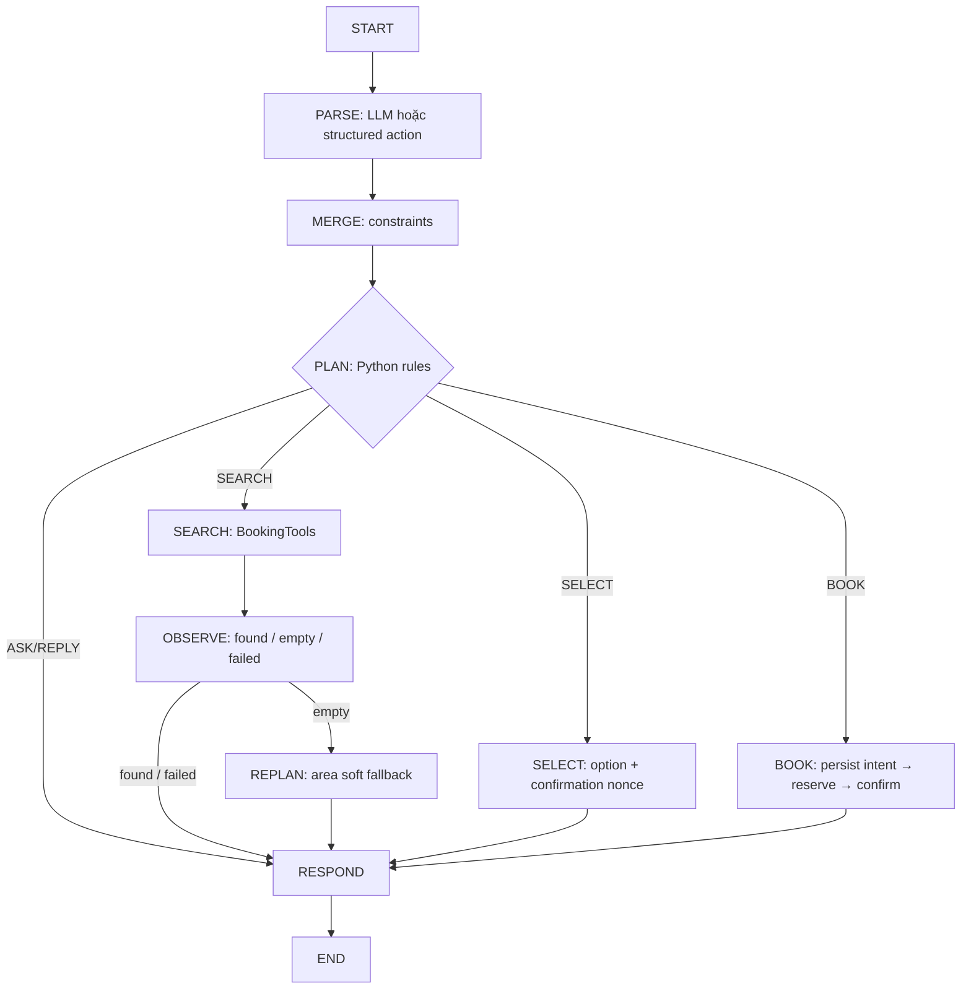
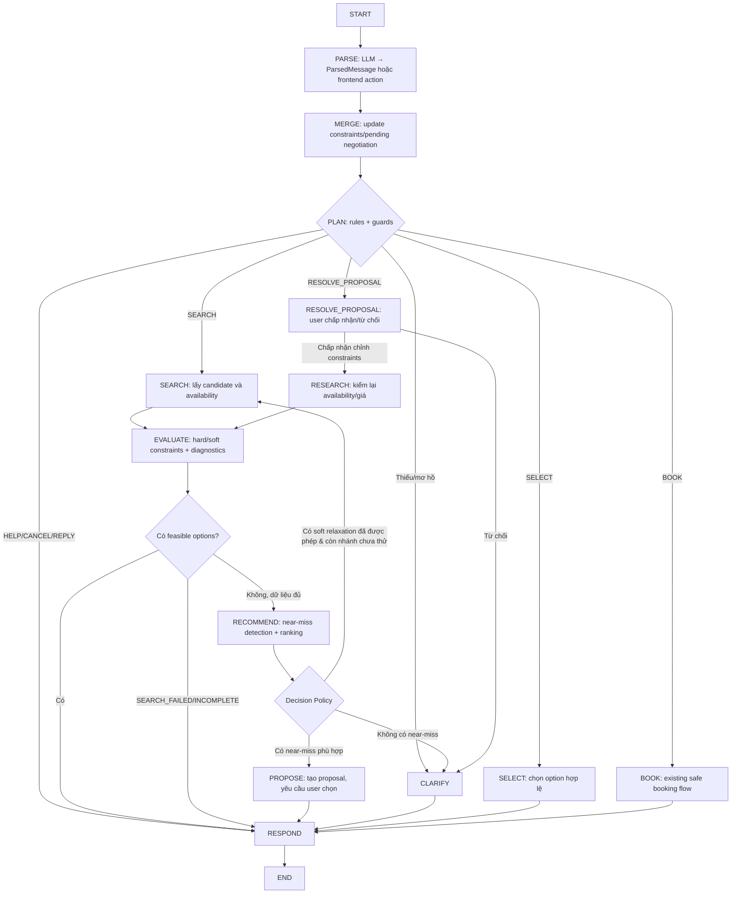

# ĐẶC TẢ NÂNG CẤP AI SERVICE

**Từ AI Service đặt sân hiện tại → Conversational Constraint-Aware Booking Assistant**  
**Phiên bản tài liệu:** v1.0 · 27/10/2026  
**Trạng thái:** Đề xuất thiết kế, **chưa phải các chức năng đã được triển khai**  
**Phạm vi:** AI Service của hệ thống đặt sân cầu lông, tích hợp Booking Core.

> **Quy ước đọc:**
> - **AS-IS:** Hành vi đã được mô tả trong tài liệu/source snapshot AI Service gốc (19/10/2026).
> - **TO-BE:** Hành vi đề xuất bổ sung hoặc thay đổi.
> - Các ví dụ số, ngưỡng, payload và pseudo-code là **thiết kế tham khảo**, cần đối chiếu model/API thực tế trước khi code.
> - Không có chuyện LLM được tự động phép đặt sân, nới hard constraints, hoặc khẳng định có sân khi Booking Core không xác nhận.

---

## 1. Tóm tắt quyết định kiến trúc

AI Service gốc đã có **LLM Parser + LangGraph workflow + tìm sân theo constraints + lựa chọn + xác nhận đặt sân + persistence/retry**. Hệ thống đã xử lý việc tìm kiếm rỗng qua một fallback đơn giản, nhưng chưa có giải thích có cấu trúc về nguyên nhân *không có nghiệm* và chưa chủ động tìm những sân *gần đáp ứng* (`near-miss`) để hỏi ý kiến người dùng.

**Mục tiêu bản nâng cấp:**

1. **Không thay đổi phần booking an toàn**: Core vẫn là nguồn sự thật về availability, giá, reservation và booking; xác nhận rõ ràng trước mọi mutation.
2. SEARCH cung cấp được **kết quả tìm kiếm và chẩn đoán constraints**, thay vì chỉ `options=[]`.
3. Khi không có nghiệm, một **Constraint-Aware Recommendation** tìm các phương án gần thỏa mãn theo định nghĩa định lượng, có giới hạn và xếp hạng.
4. **Decision Policy** quyết định: tìm lại trong phạm vi soft constraints đã được user cho phép, trình bày near-miss để xin ý kiến, hoặc hỏi người dùng đổi điều kiện.
5. **LLM Response/Clarification** (tùy chọn) giúp diễn đạt tự nhiên dựa trên dữ liệu đã xác minh; không được tự suy đoán giá, availability hoặc thay đổi state.
6. Nếu user chấp nhận một near-miss, AI Service **cập nhật constraints có chủ đích, tìm/kiểm tra lại availability và giá**, rồi mới cho SELECT → CONFIRM → BOOK.

### Quyết định phạm vi theo hai mức

- **MVP không recommendation:** Nếu tìm không có sân (kể cả relaxation đã được phép), trả một câu hỏi có cấu trúc: muốn đổi giờ, ngày, khu vực hay ngân sách? Đây là phương án đơn giản, hoàn toàn hợp lệ.
- **MVP có recommendation (mục tiêu của đặc tả này):** Thêm near-miss + diagnostics + ranking + negotiation. Nếu không có near-miss phù hợp/đáng tin cậy, **quay về hỏi user**. Không bắt buộc phải dùng LLM để quyết định đường đi.

---

## 2. Đối chiếu hệ thống gốc (AS-IS) và bản nâng cấp (TO-BE)

| Thành phần | AS-IS | TO-BE |
|---|---|---|
| `providers.py` | LangChain `ChatOpenAI` → `ParsedMessage` bằng `with_structured_output(..., method="function_calling")`; có FakeParser | Giữ parser; bổ sung cách hiểu `pending_negotiation` / câu trả lời lựa chọn near-miss; có thể thêm LLM Response tách biệt |
| `schemas.py` | `Constraints`, `Change`, `ParsedMessage`, `Option`, `MessageRequest`... | Mở rộng **schema kết quả tìm kiếm**, `ConstraintViolation`, `NearMissOption`, `NegotiationContext`; đề xuất action chấp nhận/từ chối suggestion |
| `domain.py` | `merge_state`, `clarification`, `search_options` kiểm slot cùng court, giá, ranking | Bổ sung candidate evaluation, lý do loại, độ lệch từng constraint, eligibility/ranking near-miss; giữ rules thuần Python |
| `tools.py` | `BookingTools` / `search_availability`; có wrapper `StructuredTool` | Có thể giữ interface, nhưng không cần LangChain cho các lời gọi Python cố định; bổ sung kiểu `SearchResult` chi tiết |
| `core_client.py` | HTTPX tới Booking Core; token/request ID/idempotency | **Giữ nguyên hợp đồng booking**, chỉ mở rộng truy vấn khi đủ quyền và dữ liệu để xét near-miss |
| `workflow.py` | PARSE → MERGE → PLAN → SEARCH → OBSERVE → [REPLAN] → RESPOND; SELECT/BOOK theo nhánh | Thêm DIAGNOSE / RECOMMEND / DECIDE_NEGOTIATION (node hoặc hàm); RESOLVE_PROPOSAL khi user trả lời; LLM_RESPOND tùy chọn |
| `service.py`, `db/models.py`, `db/store.py` | Conversation lock, dedupe, 3 bảng `ai_conversations`, `ai_turns`, `ai_execution_traces` | Giữ nguyên; mở rộng JSON business state và versioning, trace/outcome; không nhất thiết cần bảng riêng |
| LangGraph checkpointer | `AsyncPostgresSaver`, `thread_id=conversation_id` | Giữ; **không thay** business-state persistence và durable pending booking |
| Evaluation | Golden scenarios Parser, unit/contract/integration | Bổ sung diagnostics, near-miss safety/ranking, multi-turn negotiation, end-to-end và fault injection |
| Monitoring | HTTP, agent action, tool call, LLM tokens, log/trace | Bổ sung no-match/near-miss/proposal/acceptance/revalidation và guard violation metrics |

### 2.1. Flow gốc (AS-IS)



**Giới hạn AS-IS**:
- Nếu một ứng viên bị loại, `search_options()` không xuất ra bộ `ConstraintViolation` có cấu trúc để Planner so sánh.
- `preferred_start` mềm được xử lý ngay khi tìm trong **khoảng giờ được phép**; `area` mềm có fallback ở REPLAN. **Không có near-miss tổng quát**.
- Không có `PROPOSE/NEGOTIATE` tách biệt để xin phép user nới hard constraints.
- `OBSERVE` là bước ghi nhận/kết nối routing, **không phải LLM phân tích nguyên nhân**.

---

## 3. Từ vựng nghiệp vụ cần thống nhất

| Thuật ngữ | Định nghĩa |
|---|---|
| **Candidate** | Một lịch chơi khả thi **về mặt vật lý/nghiệp vụ Core**: sân active, các slot trống liên tiếp trên cùng court, ngày hợp lệ, có giá kiểm chứng được. Chưa chắc đáp ứng preferences của user. |
| **Feasible option** | Candidate đáp ứng mọi **hard constraint hiện hành** và mọi giới hạn user đã cho phép. Có thể trình bày như một option có khả năng chọn. |
| **Soft constraint** | Ràng buộc user **đã cho phép dao động** trong phạm vi xác định, ví dụ 19h ±60 phút. Không được nới vượt phạm vi này nếu chưa hỏi lại. |
| **Hard constraint** | Điều kiện **bắt buộc đối với tìm kiếm/booking hiện tại**. Có thể hỏi user có muốn thay đổi, nhưng chưa được âm thầm coi như đã thay đổi. |
| **Non-negotiable / locked** | Điều kiện user đã nói rõ không đổi: *chỉ 19h*, *tuyệt đối không quá 200k*. **Không đề xuất phương án vi phạm** khi chưa có thay đổi ý kiến rõ ràng. Đây là metadata mở rộng, không được suy ra tùy tiện. |
| **Near-miss option** | Candidate **không thỏa constraints hiện tại** nhưng sai lệch nằm trong **ngưỡng đề xuất an toàn**, có căn cứ, không vi phạm non-negotiable; chỉ được đưa ra để **xin phép**. |
| **Constraint diagnostics** | Thông tin do Python evaluator sinh ra về lý do không đáp ứng: field nào, độ lệch bao nhiêu, có bao nhiêu ứng viên liên quan, độ phủ tìm kiếm. |
| **Negotiation** | Trao đổi để user quyết định có muốn sửa một hay nhiều constraints; user từ chối thì giữ nguyên constraints. |
| **Recommendation** | Chọn/rank một số near-miss phù hợp để đề nghị user cân nhắc, **không phải một lệnh BOOK**. |

### Hai loại “không có đáp án” không được nhầm lẫn

1. **NO_MATCH**: Lấy dữ liệu Core thành công, có độ phủ tìm kiếm xác định nhưng **không có candidate đáp ứng toàn bộ constraints**. Có thể chẩn đoán và đề xuất.
2. **SEARCH_FAILED / INCOMPLETE**: Timeout, lỗi mạng, dữ liệu không đủ, hết giới hạn search hoặc thiếu giá/availability; **không được tuyên bố hết sân hoặc tạo near-miss giả**. Báo lỗi/thử lại hoặc mô tả rõ phạm vi kết quả.

---

## 4. Flow LangGraph mục tiêu (TO-BE)



**Chú ý:** Đây là **logical flow**, không yêu cầu tạo node riêng cho mọi ô. Có thể triển khai `EVALUATE` và `RECOMMEND` thành hàm thuần Python được gọi trong SEARCH/REPLAN; chỉ tách LangGraph nodes nếu việc routing, tracing, retry hoặc test độc lập đem lại lợi ích. Phải có **giới hạn tối đa số vòng search** để tránh lặp vô hạn. Cần có cờ/khóa mode truy vấn tránh từ `RESEARCH → EVALUATE → RECOMMEND → RESEARCH` lặp lại không kiểm soát.

### 4.1. Chức năng từng giai đoạn

| Giai đoạn | Input | Output | Ai quyết định? |
|---|---|---|---|
| PARSE | Message + constraints + negotiation context | `ParsedMessage` / structured action | LangChain + LLM nếu là tin nhắn tự nhiên |
| MERGE | Old business state + changes | New state, changed fields, invalidations | Python Domain |
| PLAN | State, confidence, intent, pending mutation | `SEARCH`, `ASK`, `RESOLVE_PROPOSAL`, `SELECT`, `BOOK`, `RESPOND` | Python rules |
| SEARCH | Search scope và constraints | Candidate pool + thông tin coverage/errors | BookingTools + HTTPX |
| EVALUATE | Candidates + constraints | Feasible, violations, diagnostics | Python Domain |
| RECOMMEND | Violations + bounded scope | Near-miss Top-K + scores | Python algorithm |
| DECIDE | Feasible/near-miss/errors + guard flags | Retry allowed soft / Propose / Clarify / Error | Python Decision Policy |
| PROPOSE | Near-miss + policy | Proposal IDs, pending negotiation | Python; LLM chỉ tạo wording nếu cần |
| RESOLVE_PROPOSAL | User acceptance/rejection | Revised constraints hoặc giữ nguyên | Python validation, có thể LLM hỗ trợ hiểu tin nhắn |
| RESEARCH | Revised constraints | Fresh options từ Core | Python + Booking Core |
| SELECT/BOOK | Validated options, consent/nonce | Booking receipt | Workflow gốc, giữ guard |
| RESPOND | Verified facts + action | UI response, tùy chọn friendly text | Python template hoặc constrained LLM |

### 4.2. Decision policy sau SEARCH (ưu tiên)

1. **Technical failure/incomplete:** Không tạo phán đoán “hết sân”; trả lỗi/thử lại hoặc báo giới hạn độ phủ.
2. **Có feasible options:** Trả `SEARCH_RESULTS` như cũ.
3. **Không có feasible nhưng còn nhánh soft đã được user cho phép và chưa tìm:** Thử lại trong phạm vi cho phép, có budget/iteration cap.
4. **Không có feasible, có near-miss thỏa policy:** Trả `ALTERNATIVES_PROPOSED` để user cân nhắc. Không mutate original hard constraints.
5. **Không có near-miss / không đủ tin cậy:** Trả `ASK_CONSTRAINT_CHANGE` với câu hỏi gợi ý user chỉnh giờ, ngày, ngân sách hoặc khu vực (các lựa chọn dựa trên dữ liệu biết được).
6. **Đã nhận sự đồng ý user:** Cập nhật các field được đồng ý, **re-search và tạo lại option/nonce mới**. Tuyệt đối không biến proposal thành booking trực tiếp.

---

## 5. Định nghĩa Near-miss có thể đo lường

### 5.1. Các bất biến không được relax tự động

Dù module đề xuất linh hoạt hơn, **Candidate luôn phải đúng**:

- Court/center active, dữ liệu availability có độ tin cậy và chưa quá hạn theo policy.
- Có đủ các slot giờ liên tiếp trên **cùng một court** để đáp ứng `duration_minutes` hiện hành.
- Không chọn slot đã qua, không phá quy định booking time/horizon.
- Giá option lấy từ Booking Core và được tính cho toàn khoảng chơi; không tự bịa giá.
- User ownership, consent, nonce, booking idempotency vẫn giữ nguyên.
- Không đề xuất vi phạm field đã đánh dấu `locked`/non-negotiable.

**Ngày** và **thời lượng** đề xuất giữ nguyên ở bản near-miss V1. Nếu tương lai muốn đổi ngày/thời lượng, hãy thiết kế vùng tìm mở rộng và xin phép riêng.

### 5.2. Ngưỡng mặc định minh họa V1 (PHẢI CHỐT bằng thực nghiệm/policy)

| Field | Đo sai lệch | Ngưỡng gợi ý chỉ cho *đề xuất* |
|---|---|---|
| `preferred_start` | `abs(candidate.start - requested_start)` | ≤ 60 phút, cùng ngày và đúng khung giờ có dữ liệu |
| `max_total_price_vnd` | `(candidate.price - budget) / budget` nếu vượt | ≤ 20% (chỉ áp dụng khi budget > 0) |
| `area` | Sai khác khu vực / khoảng cách địa lý | V1: chỉ dùng **danh sách khu vực lân cận được cấu hình**; nếu có tọa độ có thể dùng ≤3 km, **không suy diễn từ text address** |
| `date` | Số ngày chênh lệch | Không cho near-miss V1 |
| `duration_minutes` | Phút chênh lệch | Không cho near-miss V1 |

Các ngưỡng là **ví dụ nghiên cứu**, không phải ràng buộc được user mặc nhiên chấp thuận. Nếu user nói “chỉ 19h” hoặc “không quá 200k”, field tương ứng cần coi là locked theo evidence đáng tin cậy hoặc yêu cầu xác nhận khi không chắc.

### 5.3. Chính sách phân loại V1: một vi phạm được phép đề xuất

Để giảm nguy cơ đề xuất quá xa:

- Candidate đạt **near-miss** nếu: (a) đúng mọi invariant; (b) **chỉ vi phạm tối đa một** hard preference có thể thương lượng; (c) sai lệch của field đó nằm trong ngưỡng; (d) field không locked; (e) giá/giờ/availability có căn cứ.
- Candidate vi phạm hai field chỉ được thêm vào **V2** khi có hàm chấm điểm và đánh giá thực nghiệm.
- `soft_fields` đã được user cho phép trong range có thể coi **feasible theo chính sách soft**, **không phải near-miss cần xin phép lại**.

Ví dụ yêu cầu 19h, ≤200k, Cầu Giấy; xét dữ liệu giả định đã được Core xác minh:

| Sân | Giờ | Giá | Khu vực | Đánh giá |
|---|---|---:|---|---|
| A | 19h | 220k | Cầu Giấy | Near-miss: vượt ngân sách 10% |
| B | 20h | 180k | Cầu Giấy | Near-miss: lệch giờ +60 phút |
| C | 19h | 300k | Cầu Giấy | Reject: vượt 50% |
| D | 22h | 180k | Cầu Giấy | Reject: lệch 180 phút |
| E | 20h | 250k | Cầu Giấy | Reject V1: vi phạm 2 fields |

### 5.4. Constraint Violation Vector

Thay vì bỏ candidate khi sai hard preference, evaluator trả các phép đo có đơn vị:

```json
{
  "candidate_id": "candidate-A",
  "violations": [
    {
      "field": "max_total_price_vnd",
      "requested": 200000,
      "actual": 220000,
      "delta": 20000,
      "relative_delta": 0.10,
      "severity": "within_near_miss_threshold",
      "negotiable": true
    }
  ]
}
```

Lợi ích:
- Trả lời được **vì sao bị loại**.
- Tính điểm/ranking mà không cần LLM tự suy đoán.
- Có dữ liệu cho câu hỏi thương lượng: “Giữ 19h và thêm 20k, hay chuyển sang 20h để giữ ngân sách?”

### 5.5. Ranking near-miss V1

Cần định nghĩa thang chuẩn hóa vì không thể cộng trực tiếp “60 phút + 20.000 VND + 3 km”.

Một baseline đơn giản:

```text
normalized_time_violation = abs(start - preferred_start) / 60
normalized_price_violation = max(0, price - budget) / (0.20 * budget)
normalized_area_violation = configured_area_penalty_or_normalized_distance

score = w_time * normalized_time_violation
      + w_price * normalized_price_violation
      + w_area * normalized_area_violation
```

- Giá trị `score` **càng nhỏ càng gần**, với `w_*` không âm, tổng bằng 1.
- Với V1 một vi phạm, chỉ một hạng mục khác 0; vẫn dùng stable tie-breaker (giá thực tế, độ gần giờ, center/court ID) để tái lập kết quả.
- Không tự gán preference weights cho user như một sự thật; có thể dùng cấu hình minh họa, hỏi user về ưu tiên, rồi đo hiệu quả qua evaluation.
- **Không rank nếu dữ liệu thiếu**. Những option chưa được Core xác minh không được đưa vào recommendation.

### 5.6. Candidate Generation quan trọng hơn khâu filter

Để tìm near-miss, **không thể** chỉ lấy `options=[]` từ SEARCH cũ rồi phân tích. Cần có dữ liệu ứng viên rộng hơn:

1. Lấy centers/courts trong **phạm vi discovery giới hạn** có thể kiểm soát.
2. Truy vấn lịch trống và giá cho **phạm vi giờ đủ rộng** để xem xét ngưỡng near-miss.
3. Tạo các **chuỗi slot liên tiếp cùng court** với thời lượng yêu cầu.
4. Với mỗi candidate, đánh giá constraints và tạo violation vector.
5. Phân loại `feasible`, `near_miss`, `rejected`.
6. Rank Top-K, lưu search coverage/attempt để biết kết luận tới đâu.

**Cảnh báo về coverage:** Nếu `max_search_centers`, số trang Core hoặc API availability khiến chỉ khảo sát được một phần trung tâm, response phải ghi nhận `coverage=partial`; không khẳng định chắc chắn không có sân trên toàn khu vực. Nếu chưa có tọa độ/travel time thì không gán nhãn “cách 3 km”.

---

## 6. Schema/API contract đề xuất

> Đề xuất sử dụng tên bảng/class kỹ thuật bằng tiếng Anh để tương thích code Python hiện có; phần mô tả và dữ liệu nghiệp vụ cho người dùng bằng tiếng Việt.

### 6.1. SearchResult: tách domain result khỏi UI response

```json
{
  "status": "NO_MATCH",
  "feasible_options": [],
  "near_miss_options": [
    {
      "proposal_id": "proposal-A",
      "court_id": "court-01",
      "center_id": "center-01",
      "start": "2026-10-28T19:00:00+07:00",
      "end": "2026-10-28T21:00:00+07:00",
      "price_vnd": 220000,
      "violations": [
        {
          "field": "max_total_price_vnd",
          "requested": 200000,
          "actual": 220000,
          "delta": 20000,
          "relative_delta": 0.1
        }
      ],
      "score": 0.5,
      "requires_constraint_change": true
    }
  ],
  "diagnostics": {
    "feasible_count": 0,
    "candidate_count": 32,
    "near_miss_count": 1,
    "dominant_violations": ["max_total_price_vnd"],
    "coverage": "complete_within_queried_scope"
  },
  "search_metadata": {
    "source": "booking_core",
    "constraints_version": 4,
    "searched_at": "2026-10-27T16:50:00+07:00"
  }
}
```

Các loại `status` đề xuất:

- `FOUND`: Có feasible options.
- `NO_MATCH`: Không có feasible; có thể có near-miss; đã hoàn thành tìm kiếm trong phạm vi xác định.
- `SEARCH_INCOMPLETE`: Thiếu coverage hoặc dữ liệu, chưa được phép kết luận không có sân.
- `SEARCH_FAILED`: API/Core/network/validation failure.

Tránh dùng `NO_AVAILABILITY` chỉ vì `options=[]`; chỉ khẳng định không có slot trống nếu dữ liệu Core đủ để kết luận.

### 6.2. Phân biệt `Option` và `Proposal`

- **Option**: đáp ứng constraints hiện tại (bao gồm soft đã cho phép), có thể SELECT theo flow booking gốc.
- **Proposal**: **chưa đáp ứng** ít nhất một hard preference, `requires_constraint_change=true`, **không thể SELECT/BOOK như một Option**.
- Mỗi proposal gắn `constraints_version`, `search_id`, `expires_at`, `violations`, `suggested_changes`, `verified_at` để không chấp nhận dữ liệu cũ.
- UI phải thể hiện rõ “giờ khác” hoặc “cao hơn ngân sách”, không hiển thị proposal như sân đã đặt/giữ.

### 6.3. Mở rộng conversation state JSON

```json
{
  "constraints": {
    "date": "2026-10-28",
    "preferred_start": 1140,
    "duration_minutes": 120,
    "max_total_price_vnd": 200000,
    "area": "Cầu Giấy",
    "soft_fields": []
  },
  "version": 4,
  "options": [],
  "pending_negotiation": {
    "search_id": "search-123",
    "constraints_version": 4,
    "proposal_ids": ["proposal-A", "proposal-B"],
    "proposals": [],
    "expires_at": "2026-10-27T17:00:00+07:00",
    "question": "Bạn muốn tăng ngân sách hay đổi giờ?"
  },
  "selected_option_id": null,
  "confirmation_id": null,
  "pending_booking": null,
  "booking": null
}
```

`proposals: []` ở ví dụ là nơi lưu snapshot chi tiết theo schema mới (có thể là JSON riêng, nhưng mỗi `proposal_id` phải resolve được vào snapshot phía server). Phải đặt kích thước tối đa cho state và checkpoint, lưu Top-K thay vì toàn bộ candidates.

**Invariant state**:

- Thay đổi constraints → tăng version → invalidates `options`, selection, confirmation nonce và `pending_negotiation` cũ.
- Khi đang có `pending_booking` chưa rõ kết quả, giữ guard cũ, **không cho luồng negotiation tạo mutation cạnh tranh**.
- User từ chối đề xuất → xóa proposal đang chờ hoặc tiếp tục câu hỏi khác, **không thay đổi constraints**.
- Chấp nhận proposal → tạo thay đổi **chỉ cho những field user đồng ý**, xóa nonce/options cũ, tìm/kiểm tra lại.
- `booking` chỉ được cập nhật bằng receipt được Booking Core xác nhận hợp lệ.

### 6.4. Action frontend đề xuất

Bản gốc có `select`, `confirm`, `retry`. Bản nâng cấp có thể thêm:

```json
{
  "action": "accept_proposal",
  "proposal_id": "proposal-B",
  "client_message_id": "msg-000004",
  "text": "Tôi chấp nhận đổi sang 20h"
}
```

Phương án từ chối:

```json
{
  "action": "reject_proposal",
  "proposal_id": "proposal-B",
  "client_message_id": "msg-000005",
  "text": "Không, giữ giờ 19h"
}
```

`action` mới phải được bổ sung vào schema, endpoint và tests. Nếu giữ hoàn toàn giao diện chat text, PARSE có thể suy ra `accept/reject` từ message trong `pending_negotiation`, nhưng vẫn cần validate evidence và không được tự coi `"được"` là consent booking.

### 6.5. Response type đề xuất

- `SEARCH_RESULTS`: Feasible options, như gốc.
- `ALTERNATIVES_PROPOSED`: Danh sách proposals + violations + câu hỏi xin phép.
- `ASK_CONSTRAINT_CHANGE`: Không có đề xuất đáng tin cậy, hỏi user đổi điều kiện nào.
- `SEARCH_INCOMPLETE` / `SEARCH_FAILED`: Không diễn giải thành hết sân.
- `CONFIRM_BOOKING`, `BOOKED`, `RETRY_BOOKING`, `SLOT_UNAVAILABLE`: Giữ semantics gốc.

---

## 7. Diễn giải tự nhiên bằng LLM: nên và không nên

### 7.1. Chế độ không dùng LLM ở RESPOND

Dùng Python templates cũng đủ cho V1:

- Có options → “Tìm được N phương án đáp ứng yêu cầu.”
- Có proposals → “Chưa có sân thỏa tất cả điều kiện. Sân A cao hơn 20.000đ; sân B muộn hơn 60 phút. Bạn muốn cân nhắc phương án nào?”
- Không có near-miss → “Trong phạm vi đã kiểm tra chưa tìm được sân phù hợp. Bạn muốn đổi giờ, khu vực, ngày hay ngân sách?”

### 7.2. Chế độ dùng LLM để tạo câu thân thiện (tùy chọn)

Tạo một `ResponseComposer` nhận **verified facts** từ SearchResult/NegotiationContext.

Input ví dụ:

```json
{
  "status": "ALTERNATIVES_PROPOSED",
  "facts": [
    {
      "proposal_id": "proposal-A",
      "start": "19:00",
      "price_vnd": 220000,
      "difference": "Vượt ngân sách 20.000đ"
    },
    {
      "proposal_id": "proposal-B",
      "start": "20:00",
      "price_vnd": 180000,
      "difference": "Muộn hơn 60 phút"
    }
  ],
  "allowed_goal": "Explain and ask user to choose or reject"
}
```

**Các giới hạn bắt buộc**:

1. LLM **không được** thay đổi `constraints`, `proposal_id`, giá, giờ, availability.
2. LLM **không được** tạo option mới không có trong tool results.
3. LLM **không được** gửi Core reserve/confirm.
4. Sau generation, frontend vẫn hiển thị số tiền/giờ/violations từ **structured data** do backend cấp; text do LLM viết chỉ là lớp trình bày.
5. Nếu LLM lỗi/timeout, fallback ngay sang Python template; không ảnh hưởng SEARCH hay BOOK.

**Khuyến nghị:** Chỉ thêm LLM ở phần này sau khi pipeline deterministic có tests đủ tốt; không bắt buộc cho thuật toán recommendation.

---

## 8. Quy trình hội thoại khi user chấp nhận hoặc từ chối Near-miss

### Trường hợp A — Có near-miss, user đồng ý đổi giờ

1. User: “Tìm sân 19h–21h, dưới 200k ở Cầu Giấy.”
2. SEARCH: không có feasible; RECOMMEND phát hiện sân B lúc 20h–22h, 180k.
3. RESPOND: “Chưa có sân 19h; sân B lúc 20h–22h, giá 180k. Bạn có muốn đổi sang 20h?”
4. User: “Được, lấy 20h.”
5. PARSE/RESOLVE_PROPOSAL: Xác định user chỉ đồng ý `preferred_start: 19h → 20h`, không phải xác nhận booking.
6. MERGE: Cập nhật constraints, tăng version; xóa proposals/options/nonce cũ.
7. RESEARCH: Gọi Booking Core **kiểm lại** sân B, giá và slot với constraints mới. Availability có thể đã đổi.
8. Nếu hợp lệ → trả Option có thể SELECT; nếu không còn slot → báo thay đổi và tìm phương án khác/hỏi tiếp.
9. User SELECT → sinh **nonce mới** → user CONFIRM → thực hiện BOOK flow gốc.

### Trường hợp B — User từ chối đề xuất

- User: “Không, tôi chỉ muốn 19h.”
- Domain giữ các constraints hiện tại, đánh dấu ý định giữ giờ nếu có đủ evidence; không tiếp tục gợi ý sân 20h trong vòng thương lượng đó.
- Hỏi user muốn đổi ngân sách/khu vực hay kết thúc tìm kiếm; không lặp lại đề xuất vừa bị từ chối.

### Trường hợp C — Không có near-miss

- Trả `ASK_CONSTRAINT_CHANGE`: “Trong phạm vi đã kiểm tra, chưa có phương án phù hợp hoặc đủ gần. Bạn muốn nới giờ, tăng ngân sách, đổi khu vực hay ngày?”
- User cho thay đổi → PARSE → MERGE → PLAN → SEARCH mới.
- Nếu user muốn giữ tất cả constraints → kết thúc lượt lịch sự, không tự gợi ý option tùy tiện.

### Trường hợp D — Core lỗi

- Trả technical failure/retry thay vì `NO_MATCH`.
- Không tạo near-miss từ dữ liệu thiếu hoặc lỗi.

---

## 9. Thiết kế modules/files đề xuất

Giữ các file gốc và thêm đúng trách nhiệm. Một phương án:

```text
services/ai-service/
├── app/
│   ├── main.py                    # Giữ: FastAPI endpoints
│   ├── schemas.py                 # Mở rộng Pydantic contracts
│   ├── providers.py               # Giữ LLM Parser, bổ sung negotiation context
│   ├── domain.py                  # Giữ merge/clarification/search_options
│   ├── workflow.py                # LangGraph routing & guards
│   ├── tools.py                   # BookingTools / bounded candidate queries
│   ├── core_client.py             # Giữ Core HTTP contract
│   ├── service.py                 # Giữ transaction, lock, dedupe
│   ├── recommendation/
│   │   ├── candidates.py          # Candidate generation/scope
│   │   ├── constraints.py         # Violation evaluator, invariants
│   │   ├── near_miss.py           # Threshold/policy + eligibility
│   │   ├── ranking.py             # Top-K near-miss, explanations
│   │   └── decision.py            # Propose / clarify / authorized retry
│   ├── response_composer.py       # Optional LLM + safe template fallback
│   └── db/
│       ├── models.py              # Giữ 3 AI tables; JSON state mở rộng
│       └── store.py
├── evaluation/
│   ├── evaluate.py                # Giữ Parser evaluator
│   ├── scenarios.jsonl
│   ├── evaluate_recommendation.py # Mới
│   ├── evaluate_conversations.py  # Mới
│   └── fixtures/                 # Availability/core snapshots
└── tests/
    ├── unit/
    ├── contract/
    ├── integration/
    └── e2e/
```

**Lưu ý:** Đường dẫn là gợi ý tổ chức; tùy repository thực tế các file có thể nằm dưới `app/` hoặc package khác. Không nên tạo quá nhiều lớp chỉ để “đúng sơ đồ”. Nếu thuật toán còn nhỏ, gom `recommendation` vào 1–2 file rồi tách sau.

---

## 10. Pseudocode thuật toán nâng cấp

### 10.1. Đánh giá candidate

```python
# PSEUDOCODE – minh họa, chưa phải patch chạy được

def evaluate_candidate(candidate, constraints, policy):
    if not physically_bookable(candidate):
        return Rejected(reason="INVALID_SLOT_OR_UNVERIFIED_CORE_DATA")

    violations = []

    if hard_time_mismatch(candidate, constraints):
        violations.append(make_time_violation(candidate, constraints))

    if exceeds_budget(candidate, constraints):
        violations.append(make_budget_violation(candidate, constraints))

    if area_mismatch(candidate, constraints):
        violations.append(make_area_violation(candidate, constraints))

    if len(violations) == 0:
        return Feasible(candidate)

    if policy.near_miss_eligible(violations, constraints):
        return NearMiss(candidate, violations, policy.score(violations))

    return Rejected(reason="OUTSIDE_POLICY", violations=violations)
```

`hard_time_mismatch` phải xét chính sách soft fields: một giờ lệch nhưng **đã nằm trong soft window user cho phép** được coi hợp lệ, không bị tính thành vi phạm hard constraint.

### 10.2. Chọn hành động sau khi đánh giá

```python
# PSEUDOCODE

def decide(search_result, conversation, retry_budget):
    if search_result.status in {"SEARCH_FAILED", "SEARCH_INCOMPLETE"}:
        return "REPORT_SEARCH_PROBLEM"

    if search_result.feasible_options:
        return "SHOW_RESULTS"

    if authorized_soft_retry_exists(conversation, retry_budget):
        return "RETRY_WITH_APPROVED_SOFT_SCOPE"

    if search_result.near_miss_options:
        return "PROPOSE_ALTERNATIVES"

    return "ASK_CONSTRAINT_CHANGE"
```

### 10.3. Nhận chấp thuận proposal

```python
# PSEUDOCODE

async def accept_proposal(state, proposal_id, user_action):
    proposal = resolve_server_side_proposal(state, proposal_id)
    assert proposal is not None
    assert not proposal.is_expired()
    assert proposal.constraints_version == state["version"]
    assert not state.get("pending_booking")
    assert user_has_explicitly_approved_changes(user_action, proposal)

    new_state = merge_approved_changes_only(state, proposal.suggested_changes)
    invalidate_old_options_and_confirmation(new_state)

    # BẮT BUỘC: query Booking Core lại; không tự BOOK proposal
    return await search_again(new_state)
```

---

## 11. Evaluation: từ Parser-only đến Conversational Recommendation

### 11.1. Các bộ kiểm thử cần xây thêm

| Dataset/test set | Nội dung | Expected |
|---|---|---|
| Parser regression | Intent, date/time/duration, evidence, soft/locked parsing | `ParsedMessage` đúng |
| Feasibility unit tests | Chuỗi slot cùng court, thời lượng, giá, cutoff | Không nhận ứng viên invalid |
| Violation diagnostics | Candidate vi phạm thời gian/giá/khu vực | Đúng field + delta + reason |
| Near-miss eligibility | Trong/ngoài threshold, >1 vi phạm, locked field | Đúng near-miss/reject |
| Ranking fixtures | Nhiều near-miss cùng thời điểm | Thứ tự ổn định, điểm nhất quán |
| Multi-turn negotiation | Đồng ý, từ chối, sửa một field, phát biểu mơ hồ | State/version/nonce đúng |
| Booking safety | Click proposal, confirmation cũ, change price | Không book khi chưa revalidate/consent |
| Failure injection | Core timeout/partial result, stale availability | Không bịa sân / không duplicate booking |
| LLM response checks | Output generated text vs verified facts | Không thêm dữ kiện, fallback an toàn |

### 11.2. Metrics đánh giá

**Feasibility và an toàn**:
- **Hard Constraint Violation Rate của booked options = 0** trong test suite (phải xác nhận trực tiếp Core).
- **Unauthorized Relaxation Rate = 0** trên test set: không tự đổi hard/locked constraints.
- **Invalid Proposal Acceptance Rate = 0**: không cho `proposal_id` cũ/giả/khác version được SELECT/BOOK.
- **Duplicate Booking Rate = 0** trong fault-injection tests.

**Chất lượng recommendation**:
- **Near-miss Precision@K**: tỷ lệ Top-K thực sự thỏa định nghĩa gần và có thể cân nhắc (cần nhãn/policy).
- **Constraint Violation Cost**: mức độ lệch được chuẩn hóa của các phương án đề xuất.
- **Ranking quality**: NDCG@K / pairwise preference accuracy **nếu có nhãn sở thích người dùng**; không tính bừa khi chưa có ground truth.
- **Recommendation Coverage**: tỷ lệ tình huống `NO_MATCH` có được ít nhất một near-miss hợp lệ với dữ liệu đủ.
- **Search Latency** / **Core Calls per Request**: kiểm soát chi phí candidate expansion.
- **Negotiation Turns to Feasible Option**: số lượt hỏi-đáp để có phương án hợp lệ (không được tối ưu bằng cách tự ý đổi constraints).

**Các baseline nghiên cứu nên so sánh**:
1. **B0 – No Recommendation:** `NO_MATCH → ASK_CONSTRAINT_CHANGE`.
2. **B1 – Simple Threshold:** Một vi phạm, ngưỡng cố định, sắp xếp theo độ lệch.
3. **B2 – Weighted Near-miss Ranking:** Chuẩn hóa độ lệch và tối ưu Top-K bằng trọng số.
4. **B3 (tùy chọn) – Preference-Aware / Adaptive Negotiation:** Sử dụng ưu tiên do user khai báo hoặc suy ra có kiểm chứng qua các lượt.

Chỉ nên coi phần này là **đóng góp nghiên cứu** khi có bài toán rõ, baseline, dữ liệu kiểm thử, các số đo và phân tích sự đánh đổi (latency/coverage/quality), không chỉ vì đã tạo một class `Recommendation`.

---

## 12. Monitoring/Observability bổ sung

Giữ các metrics/log/trace gốc; bổ sung chỉ số theo workflow mới:

| Metric đề xuất | Ý nghĩa |
|---|---|
| `ai_search_outcomes_total{outcome}` | FOUND / NO_MATCH / SEARCH_FAILED / SEARCH_INCOMPLETE |
| `ai_near_miss_candidates_total` | Số near-miss hợp lệ được tìm thấy (không gắn user ID làm label) |
| `ai_proposals_total{outcome}` | Đã đề xuất / user chấp nhận / từ chối / hết hạn |
| `ai_negotiation_turns` (histogram) | Số lượt đến khi tìm được feasible option hoặc user dừng |
| `ai_revalidation_failures_total{reason}` | Proposal được chấp nhận nhưng giá/slot thay đổi |
| `ai_constraint_guard_rejections_total{reason}` | Chặn thao tác trái policy, stale nonce hoặc locked constraints |
| `ai_search_duration_seconds{stage}` | Latency tìm kiếm / candidate generation / ranking |
| `ai_llm_response_failures_total` | LLM ResponseComposer thất bại, fallback template |

**Logging/Traces** nên ghi `conversation_id`, `turn_id`, `request_id`, `search_id`, `constraints_version`, `proposal_id`, `decision_reason`; tránh log prompt/transcript đầy đủ hoặc các secrets không cần thiết. **Không dùng ID cardinality cao làm Prometheus label.**

### Những alert đáng ưu tiên

- Search/Core error rate tăng đột ngột.
- Pending booking quá lâu hoặc booking uncertain liên tục.
- Revalidation failures tăng (slot/giá stale).
- Không có outcome `FOUND` trong phạm vi traffic đủ lớn sau release — có thể regression trong filtering, không nhất thiết hết sân thật.
- Parsing/schema failure tăng sau khi đổi model/prompt.

---

## 13. Kế hoạch triển khai theo pha và tiêu chí hoàn thành

### Phase 0 — Khóa contract, giữ nguyên nghiệp vụ hiện có

- [ ] Chụp baseline test và golden scenarios hiện tại.
- [ ] Xác định schema Core thực tế cho centers, price, calendar, slot, update freshness.
- [ ] Giữ nguyên `pending_booking`, idempotency, reserve/confirm/release và confirmation TTL.
- [ ] Viết rõ giới hạn center/date/time search hiện có và chính sách incomplete coverage.

**Done khi:** Tests booking gốc vẫn pass và không có thay đổi mutation semantics.

### Phase 1 — Diagnostics (chưa cần recommendation)

- [ ] Bổ sung `Candidate`, `ConstraintViolation`, `SearchResult`.
- [ ] Viết evaluator trả lý do loại từng candidate, tách `NO_MATCH` và `SEARCH_FAILED/INCOMPLETE`.
- [ ] Bổ sung coverage metadata, cap số candidates và bounded Core calls.
- [ ] Viết unit fixtures cho time/price/area, same-court contiguous slots, expired data.

**Done khi:** Với dữ liệu test, SEARCH giải thích được chính xác vì sao không có nghiệm; không khẳng định quá mức so với phạm vi tìm kiếm.

### Phase 2 — Near-miss Recommendation V1

- [ ] Chốt ngưỡng V1 (±60 phút, +20% ngân sách, policy area) như **tham số có thể cấu hình**, không hardcode tùy tiện.
- [ ] Thực hiện bounded candidate expansion cho các constraints có thể thương lượng.
- [ ] Viết near-miss eligibility (tối đa một vi phạm, không vi phạm locked constraints).
- [ ] Ranking Top-K có tie-break ổn định và giải thích sai lệch.
- [ ] Bổ sung LangGraph routing `NO_MATCH → RECOMMEND → PROPOSE/CLARIFY`.

**Done khi:** Với fixtures, mọi đề xuất đều có verified slot/price và violation vector đúng; nếu không có near-miss thì hỏi user.

### Phase 3 — Multi-turn Negotiation và Revalidation

- [ ] Mở rộng conversation state với `pending_negotiation` / proposal snapshots + expiry/version.
- [ ] FE action `accept_proposal`/`reject_proposal` hoặc natural-language intent mapping có guard.
- [ ] Đồng ý proposal chỉ cập nhật những constraints user chấp thuận.
- [ ] Re-query Booking Core, tạo **Option mới**; không dùng `proposal_id` như `option_id` để BOOK.
- [ ] Test đồng ý/từ chối, stale proposal, constraint thay đổi, price change, concurrent booking.

**Done khi:** Không thể BOOK bằng near-miss hoặc dữ liệu stale; toàn bộ flow SELECT/CONFIRM/BOOK gốc vẫn hoạt động an toàn.

### Phase 4 — Natural Response + Evaluation/Monitoring

- [ ] Template trả lời rõ difference và lựa chọn.
- [ ] Tùy chọn LLM response composer, có grounded prompt và fallback.
- [ ] Evaluation offline cho B0/B1/B2, multi-turn negotiation và reliability.
- [ ] Dashboard/search/proposal/error/latency monitoring và alerts.

**Done khi:** Có báo cáo đo coverage, violation cost, latency, negotiation outcomes; không có regression ở Parser và Booking Core integration.

---

## 14. Quyết định còn mở (cần được đo/thiết lập rõ trước khi phát hành)

1. **Near-miss thresholds:** ±60 phút, +20% giá có thực sự phù hợp người dùng không? Có phân cấp mức nới theo sở thích không?
2. **Area matching:** Có đủ dữ liệu tọa độ và giới hạn tìm kiếm để dùng khoảng cách không? Nếu không, chỉ dùng vùng/khu vực lân cận được cấu hình và mô tả trung thực.
3. **Locked constraint:** Lưu như field độc lập hay metadata bổ sung từ parser? Cần golden test để phân biệt “tôi muốn 19h” với “chỉ 19h, không đổi”.
4. **Near-miss V2:** Có cho phép nhiều vi phạm đồng thời không; chọn Pareto/frontier hay weighted sum?
5. **Proposal TTL:** Thời gian bao lâu là phù hợp trước khi buộc revalidation? Dù TTL còn, vẫn cần re-query trước SELECT.
6. **Tối ưu Core calls:** Lần tìm kiếm mở rộng cần cap số centers, lịch/ngày, concurrency, timeout để không gây tải quá mức.
7. **LLM Response:** Có cần hay template là đủ? Đánh giá groundedness và token/latency trước khi bật.
8. **Research baseline/data:** Ai gán nhãn phương án nào “tốt hơn” nếu muốn đo nDCG/Preference metrics? Nên tránh tự tạo ground truth bằng chính heuristic đang đánh giá.

---

## 15. Những điều tuyệt đối không thay đổi so với bản gốc

- **Booking Core** là authority về giá, lịch trống, reservation/booking.
- **No booking without explicit consent**; không đồng nhất việc đồng ý *đổi giờ* với đồng ý *đặt sân*.
- **Confirmation nonce + TTL**, selection validation vẫn bắt buộc.
- **Persist intent trước side effect**, retry dùng cùng idempotency key khi trạng thái chưa rõ.
- **No automatic price/date/duration hard change** nếu user chưa chấp thuận.
- **No unsafe fallback on tool failure**; không bịa sân khi API lỗi.
- **Conversation lock và client_message_id deduplication** vẫn giữ nguyên.
- LLM được dùng để **hiểu ngôn ngữ và diễn đạt câu trả lời**, không quyết định quy tắc eligibility hoặc tự chạy Core mutation.

---

## 16. Ví dụ nghiệm thu end-to-end

**Input ban đầu:** “Tìm sân ở Cầu Giấy ngày 28/10 lúc 19h, 2 tiếng, giá tối đa 200k.”

**Fixture của Booking Core:**

| Candidate | Thời gian | Giá | Khu vực | Dự kiến |
|---|---|---:|---|---|
| A | 19–21h | 220k | Cầu Giấy | Near-miss giá +20k |
| B | 20–22h | 180k | Cầu Giấy | Near-miss giờ +60 phút |
| C | 19–21h | 270k | Cầu Giấy | Reject (ngoài threshold) |

**Kịch bản thành công mong muốn:**

1. PARSE → MERGE → PLAN; SEARCH không thấy feasible.
2. EVALUATE xác định violations; RECOMMEND trả A/B với `score` và difference.
3. RESPOND nêu rõ **không có sân thỏa tất cả điều kiện**, đề xuất A/B **và hỏi user chọn thay đổi nào**.
4. User: “Giữ ngân sách, đổi sang 20h.”
5. State thay `preferred_start: 1140 → 1200`, giữ ngày/giá/duration/area; version tăng; proposals cũ bị invalidated.
6. AI re-query Booking Core. Nếu B vẫn còn → trả **Option mới**; nếu không còn → hỏi lại/tìm phương án khác.
7. User SELECT option mới → AI tạo nonce và hỏi CONFIRM.
8. User xác nhận booking riêng → BOOK persist pending → Core reserve → kiểm giá → Core confirm → receipt verified → BOOKED.
9. Không được có BOOK trước bước 8; không được dùng proposal như option đã confirmed.

**Kịch bản không có gần đúng:** RECOMMEND trả `[]` → ASK_CONSTRAINT_CHANGE; hỏi user có muốn đổi giờ/khu vực/ngân sách/ngày, không tự thay đổi state.

**Kịch bản lỗi kỹ thuật:** Booking Core timeout → SEARCH_FAILED; trả trạng thái lỗi có thể retry, không tạo near-miss và không báo “hết sân”.

---

## 17. Kết luận / đề xuất chốt

Nếu chỉ cần **AI Service đặt sân hoạt động đúng**, giữ kiến trúc gốc và xử lý `NO_MATCH → ASK_CONSTRAINT_CHANGE` là đủ.

Nếu mục tiêu là **AI Service biết chủ động đề xuất và thương lượng** khi yêu cầu không khả thi, nâng cấp cốt lõi cần nghiên cứu là:

**Constraint Diagnostics → Bounded Near-miss Candidate Generation → Constraint-aware Ranking → Interactive Negotiation → Revalidation**.

Ở hướng này:
- **LangChain/LLM**: hiểu message và (tùy chọn) viết response thân thiện.
- **LangGraph**: chạy luồng, quản lý state/branch và đưa user quay lại đúng bước ở lượt tiếp theo.
- **Python Domain/Recommendation**: định nghĩa “near” bằng policy, tính vi phạm, rank, quyết định an toàn.
- **Booking Core**: cung cấp dữ liệu authoritative và thực thi booking sau khi có consent hợp lệ.

**Tên hướng nghiên cứu gợi ý:** *Constraint-Aware Recommendation and Interactive Constraint Relaxation for Conversational Badminton Booking*.

