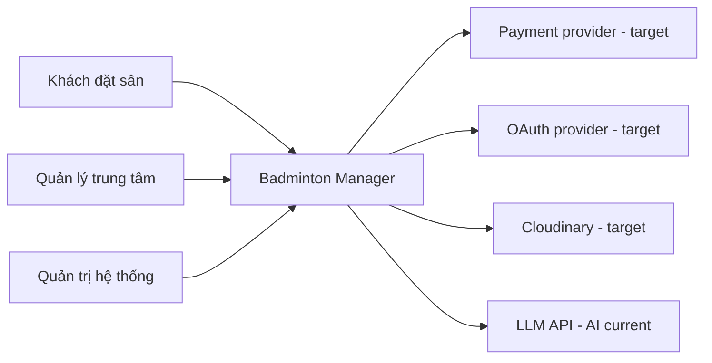
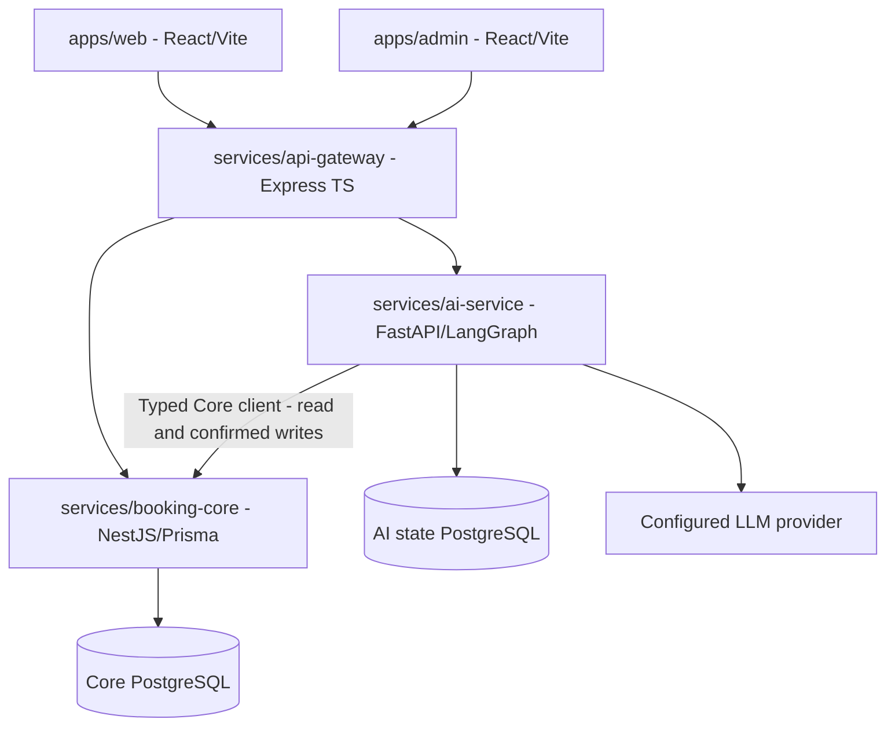
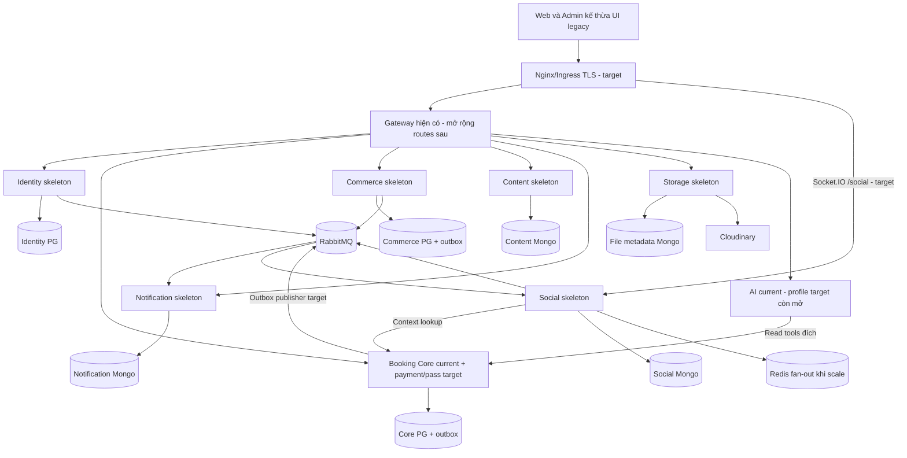
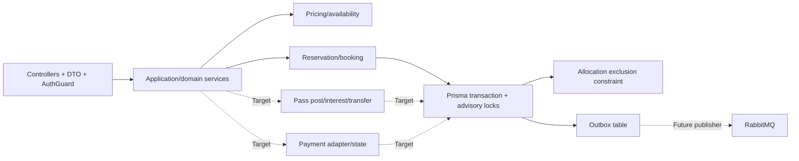

# Hiện trạng và khoảng cách so với kiến trúc V2

> Kiến trúc đích chính nằm ở [docs/ARCHITECTURE.md](../ARCHITECTURE.md). Tài liệu này là bản đối chiếu implementation tại mốc ghi bên dưới; các sơ đồ đích ở đây là hình minh họa cho việc đối chiếu. Khi thay đổi thiết kế, cập nhật tài liệu kiến trúc chính và ADR liên quan, rồi đồng bộ phần đối chiếu.

## Trạng thái và cách đọc

Ngày 18/10/2026, baseline repo mới fbd3d4d538692b8ae383f561165c844fdf9d0bf2. Tài liệu đính kèm “kien_truc_va_trien_khai_badminton_manager_v2 (1).md” là thiết kế đích dựa trên legacy, không mô tả nguyên trạng repo mới. Sơ đồ dưới ghi rõ current/target; skeleton không phải service chạy được. [Source provenance](../source-provenance.json), [mapping](SKELETON_MAPPING.md), [ADRs](../adr/README.md) và [contract](../SYSTEM_CONTRACTS.md) cung cấp căn cứ.

## C4 — system context

Hệ thống cung cấp booking, Web/Admin và AI hiện tại; identity/payment/pass/chat/POS/content/notification/storage là mở rộng đích. Không có deployment public production được kiểm chứng trong lần này.

## C4 — container đang có

Gateway expose8081, Core3000, AI8000 trong container theo Compose baseline. Shared `auth-contracts` chứa Actor/Role, `booking-contracts` và executable JSON/OpenAPI làm contract hiện tại, `observability` hỗ trợ telemetry. Gateway giữ routes/payload legacy bằng adapter, Core dùng UUID/minutes, UI giữ booking layouts từ legacy.

## C4 — container đích V2 (Proposed)

Các stores/broker mới là thiết kế, chưa được tạo trong Compose bằng skeleton. Có thể dùng chung instance local nhưng credentials/database ownership tách; không share ORM model hoặc query qua DB service khác. Redis là fan-out/cache, không authoritative slot lock hoặc message persistence.

## C4 — component Core và transaction

Core modules hiện có center/court/pricing/availability/reservation/booking và development demo; payment/pass chưa thêm vào code. Khi triển khai, payment/pass-marketplace nằm cùng Core vì thay đổi booking/allocation/owner phải nhất quán.

Current Core constraint GiST `slot_no_overlap`, advisory lock theo center/actor/idempotency, TTL cleanup, fixed booking all-or-nothing. Reservation HELD→CONFIRMED/CANCELLED/EXPIRED; Booking CONFIRMED/CANCELLED. Outbox confirmed/cancelled đã có; chưa có publisher/consumer. Payment không giữ transaction xuyên provider request. Pass transfer đổi owner+post+audit+outbox local commit, sau đó Social/Notification eventual.

## Database map và data boundaries

| Store | Data owner / invariant | Status |
| --- | --- | --- |
| Core PG | Center,Court,PricingBand,Reservation,Allocation,Booking,Series,Outbox | Current |
| Core PG additions | PaymentAttempt,PassPost,PassInterest,TransferAudit | Target |
| AI PG | Conversation/workflow checkpoints/idempotency state | Current |
| Identity PG | Accounts,session,refresh,OAuth,roles/assignments | Skeleton, conceptual ERD W05-N4 |
| Commerce PG | Product,balance,movement,sale,items,invoice,outbox | Skeleton, one sale/stock transaction |
| Mongo service DBs | Social/Content/Notification/Storage documents | Skeleton; riêng DB/credential |

Schema migrations được giữ cùng service (Prisma cho Core, Alembic cho AI); không xóa lịch sử đã chia sẻ sau mỗi lần chạy. Skeleton data-migration ở root đã được bỏ vì chưa có ETL cụ thể. Nếu cần chuyển dữ liệu, phải có mapping/reconciliation và backup/rollback trước khi thực hiện. Không đưa dữ liệu khách hàng và model weights vào repo.

## Luồng người dùng, thời gian và money

Web chọn center/date/court/slots, Gateway adapter giữ payload cũ và gọi Core `/api/v1`. Slot60phút dùng phút từ đầu ngày, timestamp UTC, ngày Việt Nam UTC+7; business validate giờ mở cửa. Availability là snapshot, allocation khi ghi quyết định conflict. Giá được server snapshot và tổng tiền nguyên VND.

Đích payment: hold → attempt/provider → verified callback → local booking/payment/outbox; callback muộn phải reconcile. Đích pass: history/modal legacy → post/interest → chat contextual → seller-confirmed transfer atomic → Social close/Notification async. Đích POS: Admin legacy form → Commerce sale atomic, không Inventory HTTP giữa transaction. Các chi tiết ACL/retry/errors nằm trong system contract, không được tự bỏ vì source cũ chưa làm.

## Security hiện tại và lộ trình Identity

Gateway kiểm HS256/issuer/audience/sub/role/exp khi có bearer và authorize theo route; Core verify lại, kiểm booking owner/managerId. Demo development chỉ là token mint local có feature flag; không là Auth service production. AI giữ conversation ownership và dùng Core API, không trực tiếp DB Core.

Identity skeleton chưa cấp token. Cần claims migration legacy userId/uppercase→sub/lowercase, hashed refresh/client secrets, rotation/revocation, center assignments, workload auth cho internal API. Source chat legacy có nguy cơ sender spoof/join room nên chỉ dùng tham khảo UI/model; target bắt JWT+member guard. Nginx/WebSocket origin allowlist/TLS/private networking là target, chưa được triển khai bởi skeleton.

## Observability, CI và deployment

Current có JSON logs/metrics và contract/unit/integration/golden checks theo components.yml; không thực thi lại test ứng dụng cho lần docs/folder này. Component CI mới chỉ bật sau implementation thật. Không đánh dấu thư mục `tests/` rỗng là test passed.

Target metrics: HTTP throughput/error/p95, DB pool/slow queries, slot/transfer conflict, POS stock reject, outbox age/backlog, broker retry/DLQ, socket connections/message latency, AI extraction/schema/tool errors/tokencost. Log correlation requestId/traceId/eventId; redact secrets/PII; không userId/conversationId metric labels. Retention/SLO/thresholds cần tải thật để chốt.

Hạ tầng AWS thuộc `badminton-infras`; GitOps quản lý manifests triển khai và cài stack monitoring. Repo app sở hữu nguồn rule/dashboard và templates ServiceMonitor/PrometheusRule trong `monitoring/chart`. Profile Compose `monitoring` đọc cùng nguồn; GitOps tham chiếu chart bằng app commit đã review thay vì giữ bản rule riêng. Skeleton platform ở root đã bỏ. Staging/K8s vẫn cần image digest, secret delivery, migrations job và rollout/rollback/backup evidence. [Quy ước monitoring](../MONITORING.md) mô tả nguồn cấu hình và giới hạn kiểm chứng.

## Migration và trạng thái bàn giao

Đi từng context: target song song → ETL/mapping → shadow/read compare → một writer cutover → read cutover → legacy read-only → decommission khi có reconcile. Backup và rollback trước thay đổi dữ liệu; không xóa source legacy hoặc migrate dữ liệu thật trong lần này.

Skeleton hiện chỉ cây thư mục/README/.gitkeep. Không đạt gate W6 full Compose/health/FE stub APIs. ADR-001..009 Proposed, G01/G02 chưa ký. Xung đột lớn nhất là AI read-only theo kiến trúc so với execution current; payment CONFIRMED≠paid và Web thiếu Idempotency-Key cũng chưa được sửa. [Danh mục bàn giao](../DELIVERY_W04_W05.md) có đủ task/owner/file và các bước review tiếp theo.
