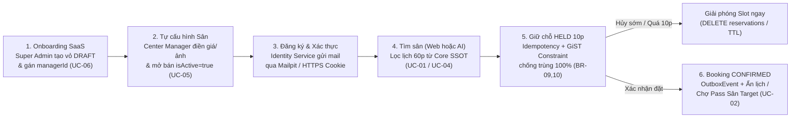

# 1. Phân tích Nghiệp vụ (Business Analysis — BA)

> Tài liệu này tổng hợp và hệ thống hóa bài toán nghiệp vụ của **Badminton Manager V2** theo chuỗi lập luận khép kín: **Bối cảnh → Vấn đề nghiệp vụ (`PB`) → Tác nhân & Stakeholder → KPI → Phạm vi MVP → Quy trình To-Be → Quy tắc nghiệp vụ (`BR`) → Rủi ro & Khoảng trống**. Toàn bộ nội dung đối chiếu trực tiếp với [BRD v2.0](../week-4/BRD.md), [Báo cáo Tuần 7](../week-7/README.md) và mã nguồn thực tế sau **PR #32** trên `main`.

---

## 1.1. Bối cảnh và Bài toán Nền tảng

### Mô hình vận hành: B2B SaaS Subscription (Đặt sân Cầu lông Đa trung tâm)

**Badminton Manager V2** là nền tảng SaaS đa người thuê (multi-center) kết nối người chơi cầu lông với các cụm/trung tâm sân cầu lông:
- **Mô hình thương mại (D-07 — Đã chốt):** Nền tảng vận hành theo mô hình **B2B SaaS Subscription** (thu phí thuê bao phần mềm định kỳ 3/6/12 tháng từ đối tác quản lý sân). Nền tảng **không thu hộ / chi hộ tiền đặt sân** giữa khách hàng và chủ sân; mọi chi phí đặt sân được chốt minh bạch tại thời điểm giữ chỗ và thanh toán trực tiếp theo chính sách của trung tâm.
- **Một Cổng Web Khách hàng (`apps/web`) + Một Cổng Admin Hợp nhất (`apps/admin`):** Duy trì một giao diện đặt sân thống nhất cho khách hàng (`user`) và một portal quản trị hợp nhất phân quyền động theo vai trò (`center_manager` chỉ thấy trung tâm phụ trách; `super_admin` quản trị toàn sàn).
- **Quy ước miền thời gian & slot cốt lõi:** Múi giờ chuẩn `Asia/Ho_Chi_Minh` (UTC+7); đơn vị đặt sân là **60 phút tròn giờ**; khung giờ phục vụ mặc định `05:00–24:00` (`openMinute=300`, `closeMinute=1440`); đặt trước tối đa **90 ngày** ở Booking Core.

### Thực trạng quy trình cũ (As-Is)

Trước khi có nền tảng tập trung:
1. Khách hàng phải gọi điện / nhắn tin thủ công cho từng chủ sân để hỏi giờ trống, dễ sai lệch hoặc bị nhận trùng slot giờ vàng (`17:00–21:00`).
2. Các dịch vụ legacy tách rời thiếu ranh giới giao dịch: dịch vụ đặt sân, giỏ hàng/kho dụng cụ, xác thực và hồ sơ người dùng gọi HTTP chéo nhau không có transaction boundary hoặc idempotency.
3. Thông tin giá theo khung giờ (giờ thường/giờ vàng, ngày thường/cuối tuần) thiếu minh bạch; dễ bị client can thiệp hoặc thay đổi sau khi giữ chỗ.
4. Chủ sân/quản lý trung tâm thiếu bảng kiểm soát grid trực quan, phải đặt lịch cố định nhiều ngày bằng tay hoặc Excel rời rạc.

---

## 1.2. Sáu Vấn đề Nghiệp vụ Cốt lõi (`PB-01..PB-06`)

| Mã vấn đề | Mô tả vấn đề nghiệp vụ (As-Is) | Tác động nếu không giải quyết | Ánh xạ Use Case (`UC`) |
| :--- | :--- | :--- | :--- |
| **PB-01** | **Tranh chấp đặt trùng slot (Double Booking) & quá tải giờ cao điểm** | Nhiều người chơi cùng chọn 1 sân vào 19:00 trên app hoặc gửi lại request khi mạng chập chờn gây ghi trùng đơn hoặc treo chỗ ảo. | `UC-01`, `UC-04` |
| **PB-02** | **Lệch giá chốt & thiếu nhất quán trong thao tác nhiều bước / nhiều ngày** | Tổng tiền tính ở browser có thể bị giả mạo; lịch cố định 1–60 ngày nếu ghi dở dang sẽ làm hỏng lịch trung tâm. | `UC-01`, `UC-03`, `UC-05` |
| **PB-03** | **Khách hủy đơn đột ngột / hoàn tiền phức tạp & rào cản chuyển nhượng slot** | Hệ thống không làm trung gian hoàn tiền (refund); nếu cho phép hủy bừa bãi tạo điều kiện bot giữ/hủy trục lợi. | `UC-02` (Khóa hủy 403 + Chợ Pass Sân) |
| **PB-04** | **Tìm sân thủ công qua nhiều trung tâm & rào cản hỏi đáp quy định** | Khách phải bấm từng sân, từng ngày; không có trợ lý hỏi đáp nhanh chính sách giá, giữ chỗ, hoặc gợi ý cặp slot liên tiếp. | `UC-04` (AI Conversational Planner) |
| **PB-05** | **Phân tán quyền hạn & rủi ro bảo mật danh tính / đa trung tâm** | Quản lý trung tâm A có nguy cơ truy cập dữ liệu trung tâm B; thiếu xác thực email, refresh session an toàn và audit chuẩn. | `UC-05`, `UC-06`, `UC-08`, Auth & RBAC |
| **PB-06** | **Vận hành thủ công giữa chủ nền tảng, chủ sân và kênh truyền thông** | Super Admin phải nhập ảnh/bảng giá hộ từng cơ sở; tin tức giải đấu và đánh giá xấu thiếu quy trình kiểm duyệt tập trung. | `UC-05`, `UC-06`, `UC-07`, `UC-08` |

---

## 1.3. Stakeholder và Tác nhân Hệ thống

| Stakeholder / Tác nhân | Nhu cầu & Mục tiêu chính | Vai trò hệ thống (`JWT role`) | Kênh tương tác |
| :--- | :--- | :--- | :--- |
| **Khách hàng / Người chơi** | Xem trung tâm/lịch trống công khai, giữ chỗ 10 phút, xác nhận đặt sân, xem/ẩn lịch sử, hỏi Trợ lý AI, sang nhượng slot qua Chợ Pass Sân | `user` | `apps/web` (`https://web.badminton.local`) |
| **Quản lý Trung tâm / Chủ sân** | Tự hoàn thiện hồ sơ sân, ảnh, tiện ích, cấu hình bảng giá, khóa/bảo trì sân, đặt lịch cố định CLB, xem grid check-in & doanh thu sân mình, đề xuất sự kiện | `center_manager` (ràng buộc `Center.managerId`) | `apps/admin` (`https://admin.badminton.local`) |
| **Quản trị viên Nền tảng** | Ký/gia hạn hợp đồng B2B SaaS, khởi tạo vỏ cơ sở (`DRAFT`), điều chuyển `managerId`, tạm dừng cơ sở quá hạn, duyệt sự kiện, kiểm duyệt đánh giá, gửi thông báo toàn sàn | `super_admin` | `apps/admin` (`https://admin.badminton.local`) |
| **Khách chưa đăng nhập** | Xem danh mục trung tâm, chi tiết tiện ích, tin tức/đánh giá công khai và bảng lịch trống (không lộ danh tính người đã đặt) | `anonymous` | `apps/web` |
| **Trợ lý AI (LangGraph Agent)** | Thu thập ràng buộc, kiểm tra lịch/giá từ Core, đề xuất phương án, chỉ đặt sân thay mặt user sau khi user xác nhận cuối (`consent`) | Thực thi **on-behalf-of user** (không tự có quyền vượt user) | `services/ai-service` (qua `api-gateway`) |
| **Hệ thống bên ngoài** | Xác thực email/OTP sandbox (`Mailpit`), nhà cung cấp LLM (`Gemini`/provider), Payment/Pass Escrow (`PayOS` — Target), Media (`Cloudinary` — Target) | External Systems | SMTP / HTTPS API / Webhook |

---

## 1.4. Mục tiêu Kinh doanh & KPI Thành công (`OBJ-01..OBJ-05`)

| Mã mục tiêu | Mô tả mục tiêu | Chỉ số đo (KPI) & Ngưỡng chấp nhận | Trạng thái kiểm chứng hiện tại |
| :--- | :--- | :--- | :--- |
| **OBJ-01** | Đảm bảo **không bao giờ đặt trùng slot** và **giá chốt tin cậy 100% ở backend** | `0` trường hợp 2 booking/hold còn hiệu lực giao nhau; **19/19 concurrency tests** (20 request cùng mili-giây → đúng 1 `201`, 19 `409`) | **Đạt** (PostgreSQL GiST `slot_no_overlap` + Vitest ACID suite) |
| **OBJ-02** | Trải nghiệm đặt trực tiếp mượt mà, retry an toàn bằng `Idempotency-Key`, khóa hủy đơn confirmed | Retry cùng key/payload trả nguyên booking cũ; hủy `CONFIRMED` bị chặn **`HTTP 403`** 100%; tự hủy `HELD` thành công 100% | **Đạt ở Core/Gateway** (Web booking trực tiếp cần `GAP-02` key ổn định) |
| **OBJ-03** | Quản lý trung tâm tự vận hành cơ sở theo cơ chế **Self-serve Onboarding 2 bước** | Cô lập chéo trung tâm **`100%`** (`403` khi sửa trung tâm khác); chuỗi cố định 1–60 ngày atomic all-or-nothing | **Đạt** (`assertCenterManager` + `BookingSeries`) |
| **OBJ-04** | Trợ lý AI hội thoại tiếng Việt giúp tìm cặp slot liên tiếp chính xác, không đặt bừa | Không tự làm tròn slot 60p; **0 hành động ghi khi chưa có explicit consent**; Golden schema validity `100%`, constraint F1 `>= 0.90` | **Đạt** (LangGraph 11-node + Golden eval CI gate) |
| **OBJ-05** | Hệ thống vận hành chuẩn Production-parity: HTTPS TLS, Auth Session thật, CI/CD & Observability | `23/23` CI checks xanh; Kubernetes GitOps sync 100% Healthy; Secure refresh cookies qua TLS Ingress + Mailpit verification | **Đang hoàn tất xác minh cụm `k3d-badminton-local` (Post-PR #32)** |

---

## 1.5. Phạm vi MVP (Scope Definition)

### Trong phạm vi (In-Scope — V2 Baseline + Post-PR #32)
1. **Identity & Session thật (`services/identity`):** Đăng ký, xác thực email qua token (`Mailpit` SMTP ở local/test), đăng nhập, cấp phát JWT Access Token, Refresh Token rotation lưu Cookie `HttpOnly; SameSite=Lax; Secure` qua TLS Ingress, đăng xuất, thu hồi session, khóa tài khoản vi phạm.
2. **Quản lý Trung tâm, Sân & Bảng giá (`services/booking-core`):** Onboarding 2 bước (`super_admin` tạo vỏ `DRAFT` → `center_manager` cấu hình profile, giờ mở/đóng, số sân, bảng giá ngày thường/cuối tuần và mở bán `isActive: true`). Khóa tạm dừng sân/trung tâm mà không làm mất lịch sử hoặc allocation tương lai.
3. **Đặt sân, Giữ chỗ 10 phút & Concurrency ACID (`services/booking-core`):** Tìm lịch trống (`05:00–24:00`), giữ chỗ `HELD`, tự hủy `HELD` (`DELETE /api/v1/reservations/:id`), xác nhận `CONFIRMED`, chặn hủy `CONFIRMED` (`HTTP 403`), ẩn lịch cá nhân đã kết thúc/hủy, chuỗi cố định 1–60 ngày atomic transaction.
4. **Trợ lý AI Q-Style Drawer (`services/ai-service`):** Phân tích ý định tiếng Việt, giữ state hội thoại & checkpoint PostgreSQL (`AsyncPostgresSaver`), kiểm tra lịch/giá Core, đề xuất tối đa 5 phương án cùng sân liên tiếp, re-validate trước khi ghi theo consent.
5. **Truyền thông, Tin tức & Đánh giá (`services/content-service` + Gateway):** CRUD tin tức/sự kiện, đánh giá sao cơ sở.
6. **Hạ tầng Cloud-Native & GitOps Parity:** AWS EKS (Terraform) + Kubernetes Local (`k3d-badminton-local`), Argo CD GitOps, External Secrets Operator (AWS Secrets Manager / LocalStack), Prometheus + Grafana, TLS Ingress (`cert-manager`).

### Ngoài phạm vi hiện tại (Out-of-Scope / Target Phase 2+)
- **Thu hộ/chi hộ trực tuyến & Đối soát T+7/T+15 (`PayOS` Adapter):** Mới có hợp đồng OpenAPI `Proposed` và secret placeholder; tiền sân thanh toán trực tiếp/chuyển khoản theo trung tâm.
- **Chợ Pass Sân & Chat 1-1 Realtime (`Pass module`, `social-service`, `notification-service`, `commerce-service`, `storage-service`):** Hiện nằm ở mức kiến trúc, OpenAPI/Socket/Event contracts và thư mục skeleton/module kiến thức AI; chưa bật runtime chính thức trên production pipeline.
- **Native Mobile App, GPS km chính xác, Bốc thăm Elo giải đấu.**

---

## 1.6. Quy trình Nghiệp vụ Mới (To-Be End-to-End Flow)

---

## 1.7. Danh mục Quy tắc Nghiệp vụ Cốt lõi (`BR-01..BR-22`)

| Mã BR | Quy tắc nghiệp vụ | Hệ quả thiết kế & thực thi bắt buộc |
| :--- | :--- | :--- |
| **BR-01, BR-02** | Đơn vị đặt sân là **60 phút tròn giờ**; AI đặt "2 tiếng" phải là 2 slot **liên tiếp cùng 1 sân** | Schema dùng `startsAt/endsAt` tròn giờ; AI từ chối tự làm tròn giờ lẻ (`19:30`, `90p`) và hỏi lại. |
| **BR-03, BR-04** | Múi giờ `Asia/Ho_Chi_Minh`; chỉ đặt slot tương lai trong giờ mở cửa, không xuyên ngày; Core cho đặt trước **90 ngày** | Kiểm tra server-side UTC ↔ VN timezone (`date`, `openMinute`, `closeMinute`, horizon `90` ngày). |
| **BR-05..BR-08** | Bảng giá `WEEKDAY`/`WEEKEND` phủ kín giờ mở cửa; giá chốt integer VND tính bởi Core; **Price Snapshot** cố định khi giữ chỗ; giảm tối đa **15%** (nhiều sân +5%, loyalty 2k/4k +5%/+10%) | Không nhận giá/điểm từ browser; `Reservation` lưu `totalPrice`, `basePrice`, `discountAmount` ngay lúc reserve. |
| **BR-09, BR-10** | Giữ chỗ mặc định `300s` (cấu hình `30–900s` / tài liệu UI 10p), tối đa **5 hold** đang hoạt động/actor; tại mọi thời điểm chỉ có tối đa 1 allocation `HELD`/`CONFIRMED` cho 1 sân/slot | PostgreSQL `EXCLUDE USING gist (courtId WITH =, tstzrange(startsAt, endsAt) WITH &&)` (`slot_no_overlap`) + TTL cleanup. |
| **BR-11, BR-12** | **Idempotency nghiêm ngặt**: cùng `actor + idempotencyKey + payload fingerprint` trả kết quả cũ; cùng key nhưng khác nội dung bị từ chối | Bảng `Reservation` (`@@unique([userId, idempotencyKey])`) & `BookingSeries` (`@@unique([createdBy, idempotencyKey])`). |
| **BR-13, BR-14** | **Strict No-Cancel Policy**: Mọi vai trò gọi hủy booking `CONFIRMED` bị chặn **`HTTP 403 Forbidden`** (chuyển sang Chợ Pass Sân); chỉ tự hủy giữ chỗ `HELD`; "xóa lịch" chỉ set `hiddenAt` | `bookings-command.service.ts` từ chối cancel confirmed 403; `DELETE /reservations/:id` giải phóng allocation khi `HELD`. |
| **BR-15, BR-16** | **Lịch cố định (Series)** 1–60 ngày atomic all-or-nothing; đóng sân/trung tâm bị chặn nếu còn allocation tương lai | `BookingSeries` trong cùng `$transaction`; kiểm tra future allocations trước khi `isActive: false`. |
| **BR-17..BR-21** | AI không tự nới điều kiện cứng; khu vực so theo tên/địa chỉ (tối đa 5 trung tâm/5 phương án); **mọi thay đổi điều kiện/giá làm mất hiệu lực consent cũ** | LangGraph `Workflow` dùng `constraints_version`, `search_id`, revalidate báo giá trước khi gọi Core `confirm`. |
| **BR-22** | `CONFIRMED` là trạng thái giữ lịch đã xác nhận, **chưa đồng nghĩa đã thanh toán / hoàn thành buổi chơi** | Phân tách trạng thái Booking vs Payment (PayOS Target) và Check-in thực tế tại quầy. |

---

## 1.8. Rủi ro Nghiệp vụ và Hiện trạng Xử lý

| Mã | Rủi ro / Khoảng trống được ghi nhận | Ảnh hưởng | Trạng thái sau PR #30 & PR #32 |
| :--- | :--- | :--- | :--- |
| **GAP-01** | Trước PR #15/#32 chưa có Identity issuer thật, Cookie `Secure` bị tắt do thiếu HTTPS local | Không chạy được luồng auth & session refresh chuẩn production | **Đã giải quyết căn bản:** `services/identity` thật + Email Verification (`Mailpit`) + TLS Ingress `*.badminton.local` bật `COOKIE_SECURE=true` + `TRUST_PROXY=1`. |
| **GAP-02** | Hàm đặt ngày trên Web (`apps/web`) nhận `idempotencyKey` nhưng chưa gắn header ổn định khi retry | Nhấn lại nút đặt sau timeout mạng trên Web có thể tạo request key mới | **Còn mở (P0 Frontend):** Gateway/Core đã thực thi chuẩn idempotency; cần chốt key ổn định cho 1 lượt xác nhận trên `apps/web`. |
| **GAP-03** | Horizon Core là 90 ngày nhưng date picker Web & adapter preview lịch cố định hiện giới hạn ~30–31 ngày | Sai lệch biên ngày giữa UI và Core | **Còn mở (P1):** Cần đồng bộ giới hạn ngày hiển thị/preview theo quyết định `D-03`. |
| **GAP-04..06** | Thiếu bộ Golden tiếng Việt đại diện cho model thật, chưa có diễn tập Backup/Restore RPO/RTO chính thức, chưa chốt SLO chính thức trên Cloud | Khó định lượng độ ổn định AI & khôi phục thảm họa ở quy mô lớn | **Đang theo dõi (P1):** Đã dựng nền tảng Golden eval CI, `monitoring/chart`, `runbooks/`; cần diễn tập trước go-live AWS EKS. |
