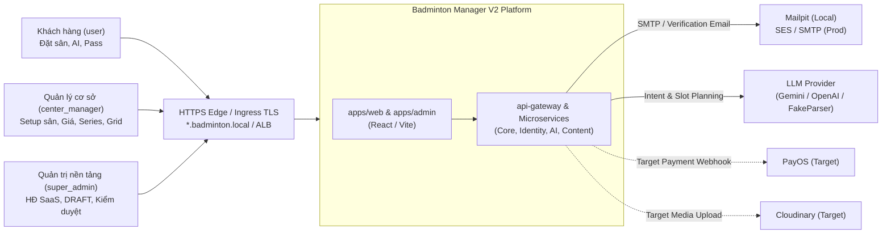
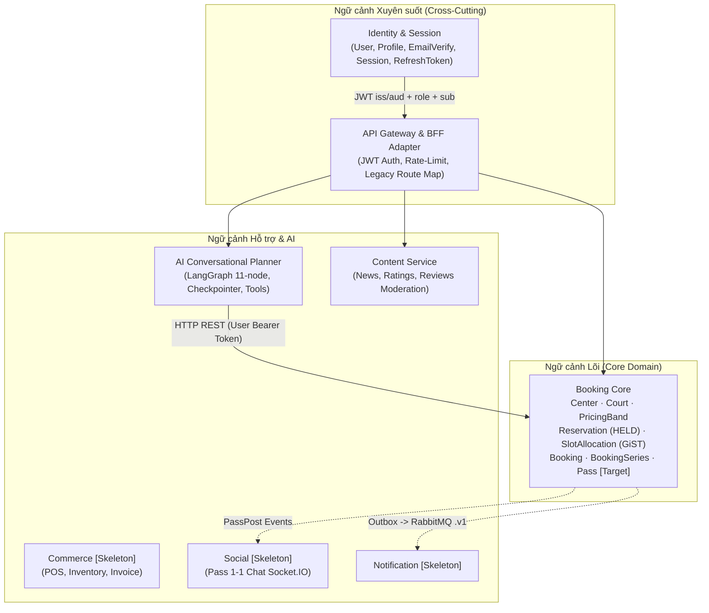
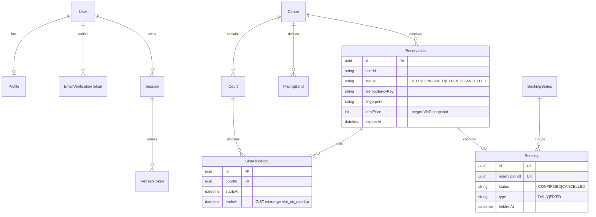
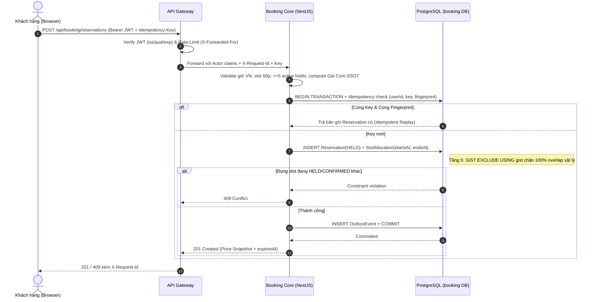
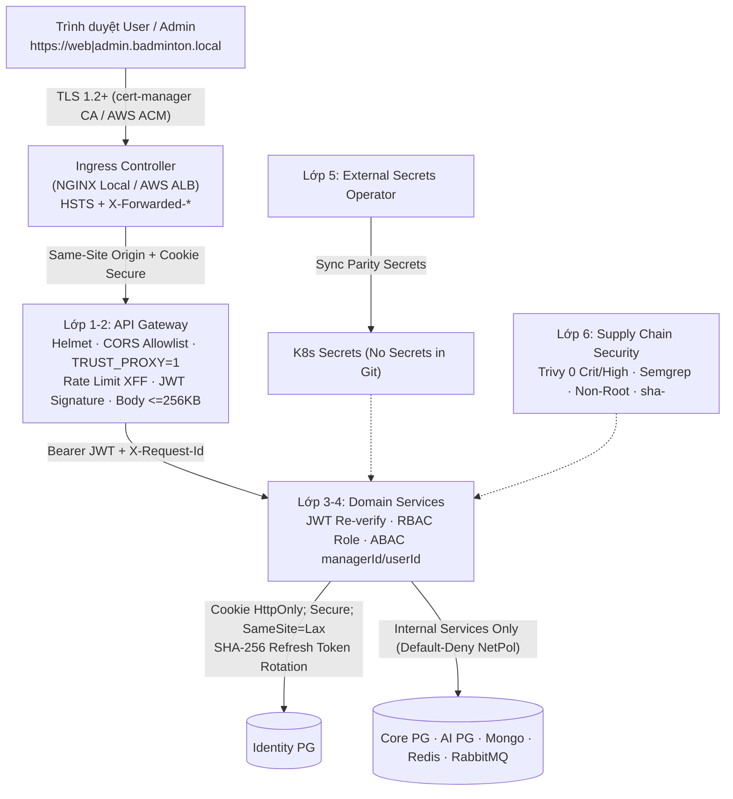
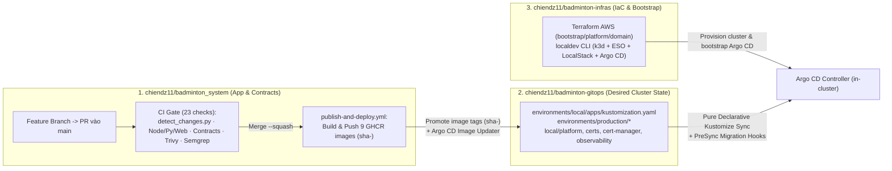

# 3. Kiến trúc Hệ thống (10 Góc nhìn & Architecture Decision Records)

> Tài liệu trình bày kiến trúc **Badminton Manager V2** từ bản chất nghiệp vụ đi xuống chi tiết triển khai: **Đặc thù nghiệp vụ → Thuộc tính chất lượng → ADR → 10 Góc nhìn kiến trúc (Context, Bounded Contexts, Logical, Data & Polyglot, Communication/ACID, AI LangGraph, Security 6-Layer, Deployment EKS/k3d Parity, CI/CD 3-Repo GitOps, Observability)**.

---

## 3.1. Đặc thù Nghiệp vụ Dẫn ra Yêu cầu Kiến trúc

| Đặc thù nghiệp vụ cầu lông | Yêu cầu kiến trúc bắt buộc | Quyết định kỹ thuật áp dụng |
| :--- | :--- | :--- |
| **1 sân / 1 slot 60p chỉ thuộc tối đa 1 người; tranh chấp cao điểm 17:00–21:00 (`BR-10`)** | Nhất quán mạnh (`Strong Consistency`) ở tác vụ giữ chỗ/đặt lịch; chống retry tạo đơn trùng | Service `booking-core` sở hữu trọn dữ liệu lịch/giá, giao dịch ACID Prisma + khóa idempotency + **PostgreSQL GiST `slot_no_overlap`** (`ADR-002`). |
| **Lịch cố định 1–60 ngày (`BR-15`) & giá snapshot (`BR-08`)** | Hoặc thành công toàn chuỗi, hoặc rollback sạch; client không tự áp giá | `BookingSeries` trong 1 `$transaction`; giá & discount tính 100% ở Core và đóng băng trên `Reservation`. |
| **Khóa hủy đơn `CONFIRMED` (`403`) & mở đường cho Chợ Pass (`BR-13`)** | Chuyển nhượng slot (Pass) phải bảo toàn booking + allocation cùng owner | Không tách Pass microservice riêng; đặt Pass module bên trong `booking-core` (`ADR-001`, `ADR-004`). |
| **AI tìm sân tiếng Việt phải linh hoạt nhưng không được "đặt bừa" (`BR-17..21`)** | LLM timeout không được làm sập đặt sân; AI không được giữ quyền DB Core | Tách `ai-service` (Python FastAPI + LangGraph), checkpoint PostgreSQL riêng (`ai` DB), gọi `booking-core` bằng token của chính user sau consent (`ADR-008`). |
| **Multi-role (`user`, `center_manager`, `super_admin`) & cô lập cơ sở** | Danh tính tập trung, Session Refresh an toàn, kiểm tra `managerId` ở server | `services/identity` phát hành JWT (`iss/aud`), Refresh Cookie `HttpOnly; Secure; SameSite=Lax`, Edge TLS & RBAC/ABAC tại Gateway/Core (`ADR-006`). |
| **Tối ưu chi phí nhóm nhỏ nhưng vẫn đạt chuẩn Production Cloud-Native** | Ít dịch vụ lõi cần thiết chạy thật trước, triển khai đồng nhất Local & AWS | Kiến trúc Hybrid Bounded Context (`ADR-001`) + 3 Repo tách biệt (`system` / `infras` / `gitops`) + Parity `AWS EKS <-> k3d` (`ADR-009`). |

### Thứ tự Ưu tiên Thuộc tính Chất lượng
1. **Tính đúng đắn dữ liệu & Concurrency ACID** (`0%` double booking, `Idempotency-Key`, rollback lịch cố định).
2. **Bảo mật & Cách ly quyền hạn** (`SEC1..SEC9`: JWT/HttpOnly Secure Cookies, `TRUST_PROXY`, ABAC `managerId`, Default-Deny NetworkPolicy, ESO).
3. **Tính sẵn sàng & Cô lập lỗi** (Web/Booking Core hoạt động độc lập khi AI lỗi; `PreSync` migrations an toàn).
4. **Hiệu năng & Khả năng mở rộng theo tải** (Tách đọc công khai vs ghi ACID vs I/O LLM; Horizontal Scaling per service).
5. **Khả chuyển Cloud–Local Parity & DevOps GitOps** (Kubernetes chuẩn, Helm/Kustomize, zero-drift `badminton-gitops`).

---

## 3.2. Danh mục Quyết định Kiến trúc (`ADR-001..ADR-009` & Post-W5 Updates)

| Mã ADR | Chủ đề | Quyết định cốt lõi | Trạng thái | Nguồn |
| :--- | :--- | :--- | :--- | :--- |
| **ADR-001** | Hybrid bounded contexts | Tối ưu biên giao dịch: `booking-core` ôm center/court/pricing/reservation/booking/payment/pass; `identity` tách riêng; `commerce`, `social`, `content`, `notification`, `storage`, `ai` tách theo tải | Proposed Baseline (Core/Identity/Content/AI đang chạy) | [ADR-001](../week-5/adr/ADR-001.md) |
| **ADR-002** | DB ownership & local ACID | Polyglot per domain; không cross-DB join hay distributed 2PC; local ACID + `OutboxEvent` table | Đang áp dụng ở Core & Identity | [ADR-002](../week-5/adr/ADR-002.md) |
| **ADR-003** | REST, events, errors & versioning | Giữ legacy adapter Gateway + OpenAPI 3.1 contract theo service; Idempotency (`actor+op+key+fingerprint`); event `.v1` | Đang áp dụng | [ADR-003](../week-5/adr/ADR-003.md) |
| **ADR-004** | Pass eligibility, lifecycle & transfer | Pass module nằm trong `booking-core`; `ACTIVE -> SOLD/CANCELLED/EXPIRED`; chuyển chủ atomic cùng `Booking` & `OutboxEvent` | Contract & Architecture (Target W8) | [ADR-004](../week-5/adr/ADR-004.md) |
| **ADR-005** | Socket auth, context & ACL | Socket.IO namespace `/social`, handshake JWT + origin check + server-derived senderId; Redis chỉ fan-out | Skeleton / Target W8 | [ADR-005](../week-5/adr/ADR-005.md) |
| **ADR-006** | Identity, JWT & RBAC | `services/identity` gộp account/profile/verification/session/refresh rotation hash; role `user/center_manager/super_admin` | **Implemented (PR #15, #32)** | [ADR-006](../week-5/adr/ADR-006.md) |
| **ADR-007** | Commerce sale-stock transaction | Gom Inventory + Invoice + StockMovement vào 1 Commerce PostgreSQL ACID TX | Skeleton / Target | [ADR-007](../week-5/adr/ADR-007.md) |
| **ADR-008** | AI read-only vs execution & eval | Hiện tại chạy LangGraph execution có explicit consent (`D-01` mở); bắt buộc Golden Eval CI (`schema=1.0`, `F1>=0.9`) | **Baseline Execution Live / Eval Gated** | [ADR-008](../week-5/adr/ADR-008.md) |
| **ADR-009** | Platform, secrets & telemetry | 3-Repo tách biệt (`system` / `infras` / `gitops`); App sở hữu `monitoring/chart`; ESO đồng bộ secret ngoài Git | **Implemented & Parity Active** | [ADR-009](../week-5/adr/ADR-009.md) |
| **Post-PR30/32** | Local–Prod Parity (TLS + Mailpit + Cookies) | Bật **TLS Ingress (`cert-manager` CA)** trên `*.badminton.local`, `Mailpit` SMTP verification sandbox, `COOKIE_SECURE=true`, `TRUST_PROXY=1`, single-flight frontend refresh & `identity-service-migrations` PreSync Job | **Accepted & Verified Live (PR #32)** | [GitOps commit `ab58460`](../../../) |

---

## 3.3. Mười Góc nhìn Kiến trúc (Architecture Views 1..10)

### Góc nhìn 1 — Bối cảnh Hệ thống (System Context)

---

### Góc nhìn 2 — Bounded Contexts (Ranh giới Nghiệp vụ)

---

### Góc nhìn 3 — Kiến trúc Logic (Logical Layers & Entry Point)

- **Một điểm vào duy nhất (Single Entry Point):** Client chỉ giao tiếp với Web/Admin UI và API Gateway (`api.badminton.local`) qua HTTPS. Không service nội bộ nào mở NodePort hay public Internet trực tiếp.
- **Đồng bộ cho luồng cần câu trả lời tức thì:** REST (`JSON`) & GraphQL (`/graphql` cho danh mục sân) đi qua Gateway.
- **Bất đồng bộ cho luồng phụ:** `OutboxEvent` ghi cùng transaction PostgreSQL, chuẩn bị đẩy qua `RabbitMQ` (`domain-event.schema.json` / `booking-event.schema.json`) để không làm chậm giao dịch giữ chỗ.
- **Tài nguyên tách biệt theo đặc tính:** Service sở hữu dữ liệu độc lập, không cho service ngoài truy vấn trực tiếp database của domain khác.

---

### Góc nhìn 4 — Kiến trúc Dữ liệu & Polyglot Persistence

#### 4a. Mô hình Dữ liệu Lõi (`Booking Core` & `Identity` — Thực tế Prisma)

#### 4b. Vòng đời Trạng thái (`Reservation`, `Booking`, `Center`)
- **Center Onboarding (`BR-16`, `UC-05`, `UC-06`):** `DRAFT (isActive: false)` do `super_admin` tạo → `center_manager` điền hotline/giờ/sân/giá → `ACTIVE (isActive: true)` mở bán → `SUSPENDED (isActive: false)` khi hết hạn HĐ SaaS.
- **Reservation & Allocation:** `HELD` (giữ `300s`, tối đa `5` hold/user) → `CONFIRMED` (sinh `Booking`) hoặc `EXPIRED` (job dọn TTL giải phóng slot) hoặc `CANCELLED` (user tự hủy qua `DELETE /api/v1/reservations/:id`).
- **Booking (`BR-13, BR-14`):** `CONFIRMED` (cấm hủy bởi mọi role — HTTP `403`, chuyển sang Chợ Pass Sân) → thuộc tính `hiddenAt` cho phép chủ đơn ẩn khỏi UI sau khi kết thúc.

#### 4c. Bản đồ Polyglot Storage (Thực tế Repo)

| Service | Dữ liệu sở hữu | Công nghệ lưu trữ | Ràng buộc / Index nổi bật |
| :--- | :--- | :--- | :--- |
| **`booking-core`** | Center, Court, PricingBand, Reservation, SlotAllocation, Booking, BookingSeries, OutboxEvent | **PostgreSQL 16 + Prisma** | `EXCLUDE USING gist` `slot_no_overlap`; `@@unique([userId, idempotencyKey])`; `@@index([status, expiresAt])` |
| **`identity`** | User, Profile, EmailVerificationToken, Session, RefreshToken | **PostgreSQL 16 + Prisma** | Unique `email`, `Char(64)` SHA-256 token hashes; cascading FK deletion |
| **`ai-service`** | Conversations, Turns, Intent State, LangGraph Checkpoints | **PostgreSQL 16 + psycopg / SQLAlchemy** | `AsyncPostgresSaver` checkpoint tables; `vector` / state tables tách biệt khỏi `booking` DB |
| **`content-service`** | News, Events, Center Ratings & Text Moderation Reviews | **MongoDB 8** | Document schema linh hoạt cho tin tức/đánh giá |
| **`social-service` *(Target)*** | PASS_BOOKING 1-1 Chat Rooms, Messages | **MongoDB 8 + Redis** | Unique `(postId, seller, buyer)`, Redis dùng cho Socket.IO fan-out |
| **Cache / Broker / Sandbox** | Rate limit/Cache, Async Domain Events, Email Verify Testing | **Redis 7 · RabbitMQ · Mailpit** | `amqp://rabbitmq:5672`, SMTP `mailpit:1025` |

---

### Góc nhìn 5 — Giao tiếp, Độ tin cậy & Chống Double-Booking Nhiều lớp

**5 Lớp phòng thủ Đặt trùng & Trùng lặp (Defense in Depth):**
1. **Lớp 1 — Gateway & Client Idempotency:** Truyền `Idempotency-Key` & `X-Request-Id` để phát hiện retry mạng.
2. **Lớp 2 — Unique Composite `(userId, idempotencyKey)` + `fingerprint`:** Cùng key + khác nội dung bị từ chối; cùng key + cùng nội dung trả kết quả cũ.
3. **Lớp 3 — Soft Cap Guard:** Giới hạn tối đa **5 giữ chỗ `HELD` còn hiệu lực** trên mỗi user (`BR-09`), ngăn bot khóa toàn sân.
4. **Lớp 4 — Advisory Lock & Transaction Atomic:** Gom kiểm tra giờ, tính giá, ghi `Reservation`, `SlotAllocation`, `Booking` (hoặc `BookingSeries`) và `OutboxEvent` vào cùng Prisma `$transaction`.
5. **Lớp 5 — PostgreSQL GiST Exclusion Constraint (`slot_no_overlap`):** Chốt chặn vật lý tại kernel CSDL với `tstzrange(startsAt, endsAt)` theo `courtId`, bất khả xâm phạm kể cả khi `N` replica `booking-core` chạy song song.

---

### Góc nhìn 6 — Kiến trúc AI & Conversational Planning (`services/ai-service`)

`ai-service` vận hành dựa trên **LangGraph StateGraph** (`services/ai-service/app/workflow.py`) tách biệt hoàn toàn khỏi luồng đặt trực tiếp:
- **Kiểm soát chặt chẽ đầu vào & trạng thái:** `MessageRequest` giới hạn payload `8192 bytes`, rate-limiter theo `userId` (`20 req/60s` mặc định), lưu checkpoint bền vững vào PostgreSQL (`AsyncPostgresSaver`) để khôi phục hội thoại sau khi F5 (`AC-15`).
- **Chuỗi xử lý hội thoại & Ràng buộc cứng (`BR-01,02,17..21`):**
  1. `parse`: Trích xuất ý định (`FakeParser` cho CI deterministic / `LLMParser` cho model thật).
  2. `clarify`: Phát hiện thiếu ngày/giờ/thời lượng hoặc giờ lẻ (`19:30`, `90 phút`) → **hỏi lại**, tuyệt đối không tự làm tròn.
  3. `search` & `rank`: Gọi API `booking-core` (`core_client.py` với token của chính user) tìm slot **60p liên tiếp cùng 1 sân** trên tối đa `5` trung tâm, trả tối đa `5` phương án.
  4. `negotiate` & `consent gate`: Hiển thị tóm tắt báo giá; đánh dấu `constraints_version` & `search_id`. Khi user sửa bất kỳ điều kiện nào, mọi `pending_booking`/consent cũ lập tức **bị hủy hiệu lực** (`BR-20`).
  5. `execute` & `revalidate`: Chỉ khi nhận explicit consent khớp phiên bản mới gọi Core giữ chỗ & xác nhận; kiểm tra lại tổng tiền không vượt ngân sách cứng.
- **Đánh giá chất lượng tự động (Golden Evaluation Gate):** `.github/ci/components.yml` khóa cứng ngưỡng **`schema_validity = 1.0`**, **`constraint_f1 >= 0.90`**, **`critical_field_accuracy >= 0.95`** trước khi merge PR.

---

### Góc nhìn 7 — Kiến trúc Bảo mật (6 Lớp Phòng vệ & Cô lập Mạng)

---

### Góc nhìn 8 — Kiến trúc Triển khai & Cloud–Local Parity

| Thành phần Hạ tầng | Môi trường Production (`AWS EKS` via `badminton-infras/terraform`) | Môi trường Local (`k3d-badminton-local` via `localdev` & `badminton-gitops`) | Trạng thái Parity |
| :--- | :--- | :--- | :---: |
| **Kubernetes Runtime** | AWS EKS (`terraform/platform/eks.tf`) | `k3d` (`badminton-local` k3s v1.31+) map host `80->30080`, `443->30444` | **Tương đương** |
| **Ingress & Routing** | AWS Load Balancer Controller (`ALB IngressGroup`, TLS Redirect) | `ingress-nginx` NodePort (`80/443`, `ssl-redirect: true`) | **Parity Đầy đủ** |
| **TLS Certificates** | AWS ACM Wildcard / Domain Certs | `cert-manager` Internal Self-Signed CA (`badminton-local-ca` ký SAN `*.badminton.local`) | **Parity Đầy đủ** |
| **Identity Cookie Security** | `COOKIE_SECURE=true`, `TRUST_PROXY=1` | `COOKIE_SECURE=true`, `TRUST_PROXY=1`, `FRONTEND_ORIGIN=https://web.badminton.local` | **Parity 100%** |
| **Email Verification / SMTP** | SMTP Provider / SES | **`Mailpit`** (`https://mailpit.badminton.local`, SMTP `1025`) | **Parity 100%** |
| **Secrets Management** | AWS Secrets Manager + IRSA + **ESO** | **LocalStack Secrets Manager** + **ESO (`ClusterSecretStore aws-secrets-manager`)** | **Parity 100%** |
| **Database & Cache/Broker** | Amazon RDS PostgreSQL 16, DocumentDB/Mongo, ElastiCache Redis, Amazon MQ | In-cluster PostgreSQL 16 (3 DB: `booking`, `ai`, `identity`), MongoDB 8, Redis 7, RabbitMQ | **Parity Đầy đủ** |
| **DB Schema Migrations** | Argo CD `PreSync` Hook Jobs (`booking-core-migrations`, `identity-service-migrations`) | Argo CD `PreSync` Hook Jobs chạy tự động trước rollout Deployment | **Parity 100%** |
| **Network Security** | VPC Private Subnets + Security Groups + Kubernetes `NetworkPolicy` | `Default-Deny Ingress` + Explicit Allow rules (`badminton-gitops/local/platform/network-policies.yaml`) | **Parity 100%** |

---

### Góc nhìn 9 — Kiến trúc CI/CD & Multi-Repo GitOps (3 Repositories)

---

### Góc nhìn 10 — Kiến trúc Quan sát Hệ thống (Observability)

- **Single Source of Truth (`monitoring/chart`):** Toàn bộ `ServiceMonitor`, `PrometheusRule` và Grafana JSON dashboards nằm trong app repo (`badminton-system/monitoring/chart`), dùng chung cho cả Docker Compose local (`monitoring/local`) và Kubernetes GitOps (`badminton-local-observability` — Prometheus + Grafana).
- **HTTP & Health Contracts:**
  - Mọi backend service chuẩn hóa 2 probe tách biệt: `/health/live` (liveness nhẹ) và `/health/ready` (readiness kiểm tra kết nối thật PostgreSQL / Downstream Core / LangGraph Checkpointer).
  - Header **`X-Request-Id`** sinh mới hoặc kế thừa xuyên `Web -> Gateway -> Core/Identity/AI`, ghi vào JSON log từng dòng để trace 1 request end-to-end.
- **Metrics Protection (`SEC9`):** Endpoint `/metrics` bị khóa bằng Constant-time token comparison (`timingSafeEqual` / `hmac.compare_digest` với `METRICS_TOKEN`), tuyệt đối không dùng JWT người dùng cuối cho scraping.
- **Alerting Thresholds Baseline:** Cảnh báo mặc định khi HTTP `5xx > 5%`, `p95` Booking Core / Gateway `> 1s`, `p95` AI Service `> 2s` (tối thiểu 20 req / cửa sổ 5 phút).
