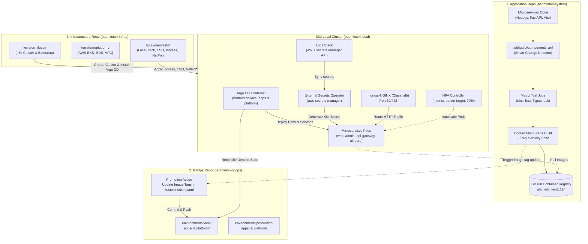
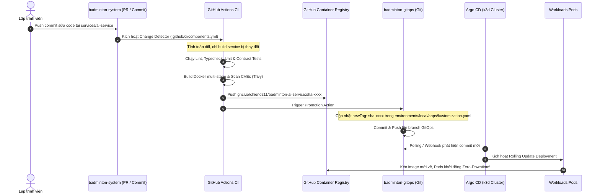

# Framework & Hướng Dẫn Tổng Quát: Cấu Hình k3d Local, Argo CD GitOps và Luồng CI/CD Đa Repository

Tài liệu này đóng vai trò là **khung chuẩn hóa (DevOps Framework)** và **sổ tay vận hành kỹ thuật (Engineering Runbook)** cho toàn bộ hệ sinh thái **Badminton Manager V2**. Framework này quy định cách thức phối hợp giữa 3 repositories, quy trình cài đặt cụm Kubernetes cục bộ (`k3d`), cơ chế đồng bộ khai báo qua GitOps (`Argo CD`), và luồng tự động hóa tích hợp/phát hành liên tục (`CI/CD`).

---

## 1. Kiến Trúc Tổng Thể 3-Tier Multi-Repository

Hệ thống được tổ chức theo mô hình phân tách trách nhiệm tuyệt đối giữa Mã nguồn ứng dụng, Cấu hình trạng thái khai báo và Mã nguồn hạ tầng:



### Bảng Trách Nhiệm Từng Repository

| Repository | Công nghệ chính | Trách nhiệm cốt lõi |
| :--- | :--- | :--- |
| **`badminton-system`** | Node.js (TypeScript), Python 3.12, Vite, Docker, GitHub Actions | Chứa business logic, shared contracts, database migrations (Prisma, Alembic), thực thi CI matrix, quét bảo mật Trivy và đẩy Docker images lên GHCR. |
| **`badminton-gitops`** | Kustomize, Argo CD Applications | Single Source of Truth lưu trữ cấu hình mong muốn (Desired State) của toàn bộ cụm k8s (Deployments, Services, ConfigMaps, HPAs, PDBs, Monitoring). |
| **`badminton-infras`** | Terraform, k3d, Helm, LocalStack, External Secrets Operator | Tự động hóa hạ tầng (IaC): dựng cụm k3d local, cấu hình LocalStack, Ingress ALB controller, bootstrap Argo CD, và cung cấp Terraform scripts cho AWS Cloud. |

---

## 2. Thiết Lập & Cấu Hình Cụm `k3d` Local

Cụm k3d được thiết kế để tái tạo chính xác các dịch vụ AWS Production ngay trên máy trạm thông qua Docker.

### 2.1. Cấu hình Mạng & Volume Mounts (`local/config/k3d.yaml`)
- **Docker Bridge Network**: `k3d-badminton-local` cấp dải IP riêng `172.24.0.0/16` cho node ảo (`172.24.0.2`).
- **Volume Bind Mount**:
  ```yaml
  volumes:
  - volume: local/.local/state:/var/lib/rancher/k3s/storage
    nodeFilters:
    - server:0
  ```
  Mount thư mục cục bộ vào Rancher `local-path-provisioner` để duy trì dữ liệu PostgreSQL/Mongo ngay cả khi dừng container.
- **Tắt dịch vụ thừa**: Khai báo `--disable=traefik` và `--disable=servicelb` trong k3s args để giải phóng cổng 80/443 cho Ingress-NGINX mô phỏng ALB chuyên dụng.

### 2.2. Khởi tạo 1-Click bằng Terraform
Đứng tại thư mục `badminton-infras`:
```bash
# 1. Khởi tạo cụm k3d, cấu hình mạng và cài đặt Argo CD
cd terraform/local
terraform init
terraform apply -auto-approve

# 2. Áp dụng Database Migrations và Seed Data
cd ../..
make local-migrate
```

### 2.3. Cài Đặt Các Thành Phần Mở Rộng AWS Parity

Sau khi cụm k3d khởi động, các thành phần mô phỏng AWS được nạp tự động thông qua thư mục `badminton-infras/local/manifests/`:

1. **LocalStack (AWS Secrets Manager Simulation)**:
   - Triển khai trong namespace `localstack`, lắng nghe trên cổng `4566`.
   - Lưu trữ an toàn các bí mật nhạy cảm (`badminton/prod/llm`, `badminton/prod/ai-service-runtime`, v.v.).
2. **External Secrets Operator (ESO)**:
   - Cài đặt qua Helm chart trong namespace `external-secrets`.
   - `ClusterSecretStore` tên `aws-secrets-manager` trỏ tới `http://localstack.localstack.svc.cluster.local:4566`.
   - Tự động sinh ra và duy trì các Kubernetes Secrets như `ai-service-secrets`, `booking-core-secrets`.
3. **Ingress-NGINX (AWS ALB Simulation)**:
   - Cấu hình với `ingressClassName: alb` lắng nghe trên cổng 80/443 của node `172.24.0.2`.
   - Định tuyến domain ảo: `web.badminton.local`, `admin.badminton.local`, `api.badminton.local`.
4. **Horizontal Pod Autoscaler (HPA) & Zero-Trust NetworkPolicies**:
   - Tự động co giãn Pods từ 2 đến 6 replicas dựa theo số liệu từ `metrics-server`.
   - Cách ly phân vùng mạng Pod-to-Pod, bảo vệ cơ sở dữ liệu và mở egress 443 cho AI suy luận ra Groq Cloud.

---

## 3. Kiến Trúc & Vận Hành Argo CD GitOps

Argo CD vận hành theo mô hình khai báo khai thác Kustomize, đóng vai trò đồng bộ liên tục giữa Git repository và Kubernetes cluster.

### 3.1. Các Ứng Dụng Khai Báo (Argo Applications)
Trong namespace `argocd`, hệ thống quản lý 2 ứng dụng cấp phát:

1. **`badminton-local-platform`**:
   - Git Path: `environments/local/platform`
   - Quản trị: PostgreSQL StatefulSet/Service, MongoDB, init-scripts, và các storage configurations.
2. **`badminton-local-apps`**:
   - Git Path: `environments/local/apps`
   - Quản trị: Toàn bộ microservices (`web`, `admin`, `api-gateway`, `booking-core`, `content-service`, `ai-service`).

### 3.2. Cấu Hình Tự Động Đồng Bộ & Tự Khắc Phục (Self-Healing)
```yaml
spec:
  syncPolicy:
    automated:
      prune: false       # Không xóa nhầm tài nguyên stateful khi chưa kiểm soát
      selfHeal: true     # Tự động ghi đè mọi can thiệp thủ công (manual drift) về đúng Git
    syncOptions:
    - CreateNamespace=false
    - FailOnSharedResource=true
```

### 3.3. Cơ chế Thứ Tự Triển Khai (Sync Waves)
Nhằm tránh tình trạng Pod ứng dụng khởi động trước khi Secret hoặc Database sẵn sàng, hệ thống áp dụng K8s Annotations:
- `argocd.argoproj.io/sync-wave: "-20"`: ExternalSecrets, ConfigMaps khởi tạo trước.
- `argocd.argoproj.io/sync-wave: "-10"`: Database Migration Jobs khởi chạy.
- `argocd.argoproj.io/sync-wave: "0"`: Deployments của microservices khởi động.

---

## 4. Luồng Tự Động Hóa CI/CD Xuyên Suốt (End-to-End Workflow)



### 4.1. Bước 1: Change Detection Thông Minh tại `badminton-system`
File cấu hình `.github/ci/components.yml` định nghĩa ranh giới Bounded Context cho 21 components (5 deployables, 13 contract groups, 3 shared packages):
- Khi dev sửa code trong `services/ai-service/**`, CI chỉ build và kiểm thử duy nhất `ai-service`.
- Khi dev sửa shared package `packages/booking-contracts/**`, change detector tự động duyệt ngược đồ thị phụ thuộc (reverse dependency graph) để test cả `booking-core`, `api-gateway`, và `ai-service`.

### 4.2. Bước 2: Bảo Mật Container & Tiêu Chuẩn Docker
Mỗi microservice bắt buộc phải đóng gói theo tiêu chuẩn:
- **Base image an toàn**: `node:22-alpine` hoặc `python:3.12-slim`.
- **Non-root user**: Chạy bằng user `appuser` (UID: 10001), không bao giờ dùng `root`.
- **Quét lỗ hổng (Trivy Scanner)**: Pipeline CI quét bảo mật image trước khi push, tự động chặn merge nếu phát hiện lỗ hổng `CRITICAL` hoặc `HIGH`.

### 4.3. Bước 3: Đẩy Image & Quảng Bá GitOps (Promotion)
- Image được gắn nhãn theo commit SHA: `ghcr.io/chiendz11/badminton-<service>:sha-<git_sha>`.
- Workflow CD tự động commit cập nhật file `environments/local/apps/kustomization.yaml` trong repo `badminton-gitops`:
  ```yaml
  images:
  - name: registry.invalid/badminton-local/ai-service
    newName: ghcr.io/chiendz11/badminton-ai-service
    newTag: sha-5a7ec07...
  ```

### 4.4. Bước 4: Triển Khai Tự Động Không Gián Đoạn (Zero-Downtime Reconcile)
- Argo CD phát hiện commit mới, so sánh Desired State với Live State trong k3d cluster.
- Tạo ReplicaSet mới, kéo image mới từ GHCR, đợi Readiness Probe `/health/ready` trả về `200 OK` mới chuyển lưu lượng và chấm dứt Pod cũ.

---

## 5. Quy Chuẩn Bổ Sung Microservice Mới Vào Hệ Thống (Onboarding Checklist)

Khi một thành viên trong nhóm phát triển bổ sung một microservice mới (ví dụ: `payment-service` hoặc `notification-service`), cần thực hiện đúng 5 bước sau:

### Bước 1: Khai báo Component trong `badminton-system`
Mở `.github/ci/components.yml` và bổ sung định nghĩa:
```yaml
components:
  notification_service:
    path: services/notification-service
    runtime: node
    enabled: true
    depends_on:
      - auth_contracts
      - event_contracts
```

### Bước 2: Tạo Dockerfile Chuẩn Production
Đặt `Dockerfile` trong thư mục gốc của service, đảm bảo có healthcheck probe và chạy bằng non-root user.

### Bước 3: Tạo Kubernetes Manifests trong `badminton-gitops`
Tạo thư mục `local/workloads/<service>/`:
- `deployment.yaml`: Có đầy đủ `startupProbe`, `readinessProbe`, `livenessProbe` và `resources.requests/limits`.
- `service.yaml`: ClusterIP service cho nội bộ.
- `kustomization.yaml`: Khai báo ConfigMap và image placeholder.

### Bước 4: Khai báo ExternalSecret & NetworkPolicy
- Khai báo secret lấy từ LocalStack: `local/workloads/<service>/external-secret.yaml`.
- Khai báo chính sách phân vùng mạng an toàn: Chỉ cho phép `api-gateway` gửi request đến service mới.

### Bước 5: Đăng ký Service vào Argo CD
Thêm đường dẫn service vào `environments/local/apps/kustomization.yaml`:
```yaml
resources:
- ../../../local/workloads/notification-service
```
Commit và push lên Git. Argo CD sẽ tự động phát hiện và triển khai Pod mới lên cụm!

---

## 6. Sổ Tay Vận Hành & Khắc Phục Sự Cố (Troubleshooting Runbook)

| Hiện tượng | Nguyên nhân phổ biến | Lệnh kiểm tra & Cách khắc phục |
| :--- | :--- | :--- |
| **`ImagePullBackOff`** | Tag image không tồn tại trên GHCR hoặc image đang ở chế độ Private. | Chạy `kubectl describe pod <pod_name> -n badminton`. Kiểm tra xem GitHub Actions CI đã build và push thành công lên GHCR chưa; đảm bảo package settings trên GitHub là **Public**. |
| **`SecretSyncedError`** | LocalStack chưa có key secret tương ứng hoặc ClusterSecretStore mất kết nối. | Chạy `kubectl describe externalsecret <name> -n badminton`. Kiểm tra LocalStack pod: `kubectl get pods -n localstack`. Nạp lại secret bằng lệnh `awslocal secretsmanager put-secret-value`. |
| **Ingress trả về `404 Not Found`** | Header `Host` không khớp với rules Ingress, hoặc Service backend chưa sẵn sàng. | Kiểm tra Ingress rules: `kubectl get ingress -n badminton -o yaml`. Thử nghiệm curl với flag `--resolve <domain>:80:172.24.0.2` hoặc kiểm tra file `/etc/hosts`. |
| **Argo CD `OutOfSync` liên tục** | Can thiệp sửa ConfigMap/Deployment trực tiếp trong k8s làm kích hoạt cơ chế `selfHeal`. | Không sửa trực tiếp trong cụm bằng `kubectl edit`. Hãy commit thay đổi vào repo `badminton-gitops`, Argo CD sẽ tự động đồng bộ sạch sẽ. |
| **HPA hiển thị `cpu: <unknown>/70%`** | `metrics-server` chưa kịp thu thập dữ liệu (mới bật < 30s) hoặc Deployment thiếu `resources.requests.cpu`. | Kiểm tra `kubectl top pods -n badminton`. Đảm bảo `deployment.yaml` có khai báo `resources.requests.cpu`. |
