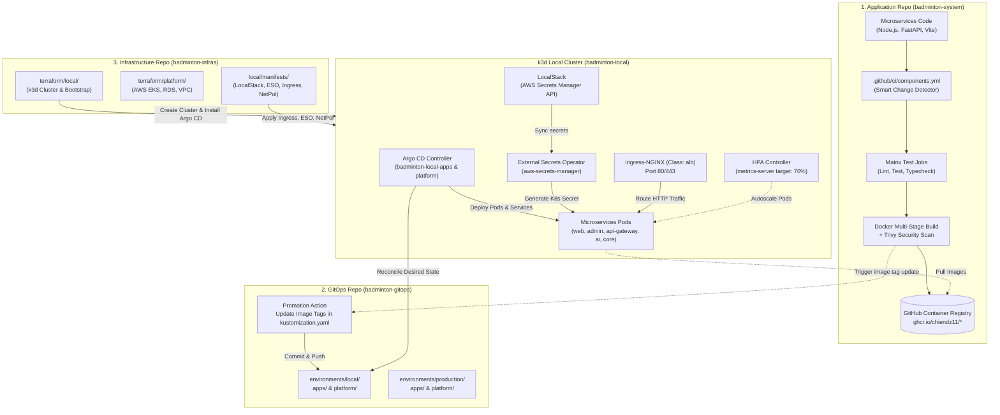
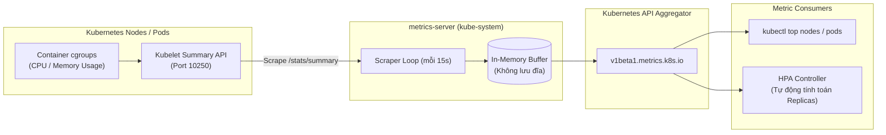
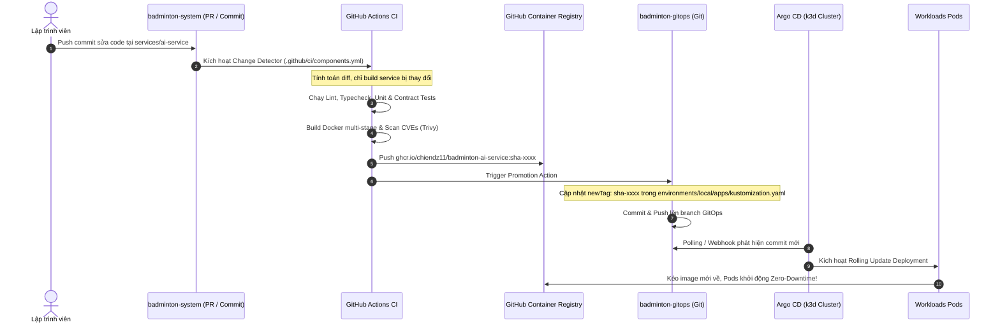
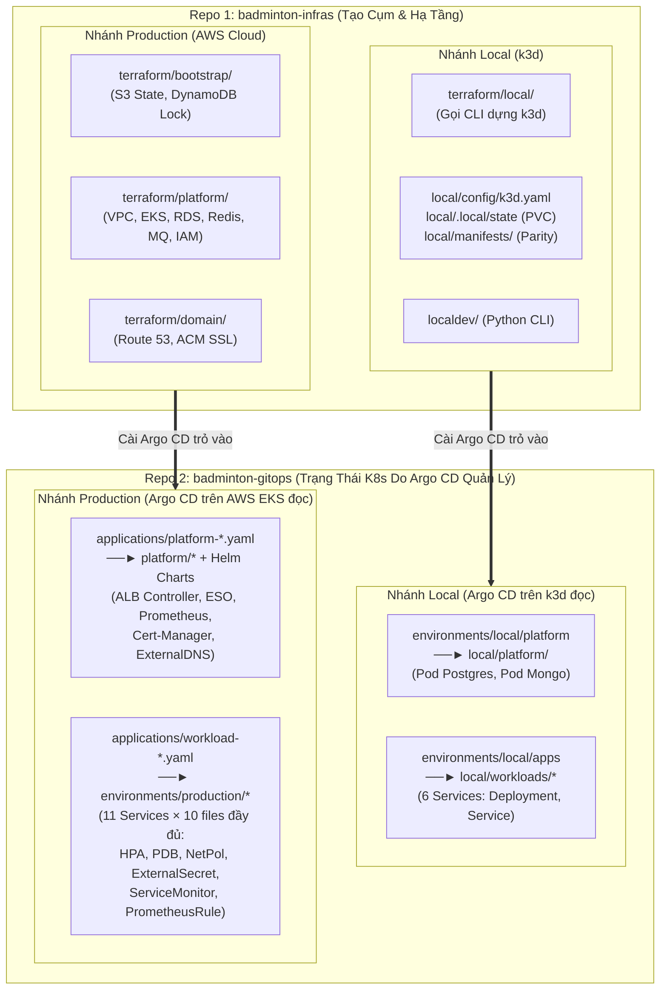

# Framework & Hướng Dẫn Tổng Quát: Cấu Hình k3d Local, Argo CD GitOps và Luồng CI/CD Đa Repository

Tài liệu này đóng vai trò là **khung chuẩn hóa (DevOps Framework)** và **sổ tay vận hành kỹ thuật (Engineering Runbook)** cho toàn bộ hệ sinh thái **Badminton Manager V2**. Framework này quy định cách thức phối hợp giữa 3 repositories, quy trình cài đặt cụm Kubernetes cục bộ (`k3d`), cơ chế đồng bộ khai báo qua GitOps (`Argo CD`), và luồng tự động hóa tích hợp/phát hành liên tục (`CI/CD`).

---

## 1. Kiến Trúc Tổng Thể 3-Tier Multi-Repository

Hệ thống được tổ chức theo mô hình phân tách trách nhiệm tuyệt đối giữa Mã nguồn ứng dụng, Cấu hình trạng thái khai báo và Mã nguồn hạ tầng:



### Bảng Trách Nhiệm Từng Repository

| Repository | Công nghệ chính | Trách nhiệm cốt lõi |
| :--- | :--- | :--- |
| **`badminton-system`** | Node.js (TypeScript), Python 3.12, Vite, Docker, GitHub Actions | Chứa business logic, shared contracts, database migrations (Prisma, Alembic), thực thi CI matrix, quét bảo mật Trivy và đẩy Docker images lên GHCR. |
| **`badminton-gitops`** | Kustomize, Argo CD Applications | Single Source of Truth lưu trữ cấu hình mong muốn (Desired State) của toàn bộ cụm k8s (Deployments, Services, ConfigMaps, HPAs, PDBs, Monitoring). |
| **`badminton-infras`** | Terraform, k3d, Helm, LocalStack, External Secrets Operator | Tự động hóa hạ tầng (IaC): dựng cụm k3d local, cấu hình LocalStack, Ingress ALB controller, bootstrap Argo CD, và cung cấp Terraform scripts cho AWS Cloud. |

---

## 2. Thiết Lập & Cấu Hình Cụm `k3d` Local

Cụm k3d được thiết kế để tái tạo chính xác các dịch vụ AWS Production ngay trên máy trạm thông qua Docker.

### 2.1. Cấu hình Mạng & Volume Mounts (`local/config/k3d.yaml`)
- **Docker Bridge Network**: `k3d-badminton-local` cấp dải IP riêng `172.24.0.0/16` cho node ảo (`172.24.0.2`).
- **Volume Bind Mount**:
  ```yaml
  volumes:
  - volume: local/.local/state:/var/lib/rancher/k3s/storage
    nodeFilters:
    - server:0
  ```
  Mount thư mục cục bộ vào Rancher `local-path-provisioner` để duy trì dữ liệu PostgreSQL/Mongo ngay cả khi dừng container.
- **Tắt dịch vụ thừa**: Khai báo `--disable=traefik` và `--disable=servicelb` trong k3s args để giải phóng cổng 80/443 cho Ingress-NGINX mô phỏng ALB chuyên dụng.

### 2.2. Khởi tạo 1-Click bằng Terraform
Đứng tại thư mục `badminton-infras`:
```bash
# 1. Khởi tạo cụm k3d, cấu hình mạng và cài đặt Argo CD
cd terraform/local
terraform init
terraform apply -auto-approve

# 2. Áp dụng Database Migrations và Seed Data
cd ../..
make local-migrate
```

### 2.3. Cài Đặt Các Thành Phần Mở Rộng AWS Parity

Sau khi cụm k3d khởi động, các thành phần mô phỏng AWS được nạp tự động thông qua thư mục `badminton-infras/local/manifests/`:

1. **LocalStack (AWS Secrets Manager Simulation)**:
   - Triển khai trong namespace `localstack`, lắng nghe trên cổng `4566`.
   - Lưu trữ an toàn các bí mật nhạy cảm (`badminton/prod/llm`, `badminton/prod/ai-service-runtime`, v.v.).
2. **External Secrets Operator (ESO)**:
   - Cài đặt qua Helm chart trong namespace `external-secrets`.
   - `ClusterSecretStore` tên `aws-secrets-manager` trỏ tới `http://localstack.localstack.svc.cluster.local:4566`.
   - Tự động sinh ra và duy trì các Kubernetes Secrets như `ai-service-secrets`, `booking-core-secrets`.
3. **Ingress-NGINX (AWS ALB Simulation)**:
   - Cấu hình với `ingressClassName: alb` lắng nghe trên cổng 80/443 của node `172.24.0.2`.
   - Định tuyến domain ảo: `web.badminton.local`, `admin.badminton.local`, `api.badminton.local`.
4. **Horizontal Pod Autoscaler (HPA) & Zero-Trust NetworkPolicies**:
   - Tự động co giãn Pods từ 2 đến 6 replicas dựa theo số liệu từ `metrics-server`.
   - Cách ly phân vùng mạng Pod-to-Pod, bảo vệ cơ sở dữ liệu và mở egress 443 cho AI suy luận ra Groq Cloud.

### 2.4. Phân Hệ Thu Thập Số Liệu Hạ Tầng: Metrics Server & Resource Metrics API

`metrics-server` là mắt xích thiết yếu nhưng thường bị xem nhẹ trong cụm Kubernetes. Nếu không có thành phần này, HPA hoàn toàn bị "mù" và không thể thực hiện co giãn tự động.



#### 1. Bản chất & Cơ chế Hoạt động của Metrics Server
- **In-Memory Aggregator**: `metrics-server` thu thập số liệu tài nguyên tính toán (CPU cores và Memory bytes) từ Kubelet Summary API trên từng Worker Node (thông qua cgroups của container).
- **Không phải cơ sở dữ liệu**: Dữ liệu chỉ được lưu trữ tạm thời trong bộ nhớ đệm RAM (chu kỳ scrape 15 giây – 60 giây). Nó không có ổ đĩa lưu trữ (non-persistent) và không lưu dữ liệu lịch sử.
- **Đăng ký Aggregated API**: Cung cấp API endpoint `v1beta1.metrics.k8s.io` trực tiếp vào API Server của Kubernetes. Khi người dùng gõ `kubectl top` hoặc HPA Controller truy vấn, Kubernetes API Server sẽ ủy quyền (proxy) yêu cầu đến `metrics-server`.

#### 2. Vai trò đối với Horizontal Pod Autoscaler (HPA)
HPA không thể tự đọc CPU của Pod. Controller Manager định kỳ (mặc định 15 giây một lần) gọi `metrics.k8s.io` để lấy giá trị CPU thực tế của từng Pod trong Deployment. Sau đó đối chiếu với ngưỡng `averageUtilization`:

$$\text{Tỷ lệ sử dụng CPU (\%)} = \frac{\text{CPU thực tế đo bởi metrics-server}}{\text{resources.requests.cpu khai báo trong Deployment}} \times 100\%$$

Nếu tỷ lệ thực tế vượt qua ngưỡng mục tiêu (ví dụ: `70%`), HPA Controller sẽ tự động tính toán số Pod cần thiết và gọi API scale Deployment lên:

$$\text{Replicas mong muốn} = \left\lceil \text{Replicas hiện tại} \times \frac{\text{Tỷ lệ CPU hiện tại}}{\text{Tỷ lệ CPU mục tiêu}} \right\rceil$$

> [!IMPORTANT]
> **Điều kiện tiên quyết để HPA hoạt động**:
> Mọi Deployment muốn co giãn theo CPU/RAM **bắt buộc phải khai báo trường `resources.requests.cpu` (hoặc `memory`)**. Nếu thiếu trường này, `metrics-server` dù có đo được CPU cũng không thể tính ra tỷ lệ phần trăm, dẫn đến trạng thái lỗi `TARGETS: cpu: <unknown>/70%`.

#### 3. So sánh: `metrics-server` (k3d Local) vs `metrics-server` (AWS EKS Production)

| Tiêu chí | k3d Local Cluster (`badminton-infras`) | AWS EKS Production Cluster |
| :--- | :--- | :--- |
| **Nguồn gốc cài đặt** | Tích hợp sẵn mặc định trong bản phân phối k3s (`rancher/mirrored-metrics-server:v0.8.1`). | EKS **không cài sẵn**; phải triển khai qua Helm chart hoặc EKS Managed Add-on (`badminton-gitops/applications/platform-metrics-server.yaml`). |
| **Namespace** | `kube-system` | `kube-system` |
| **Cấu hình chứng chỉ TLS** | Tự động tin cậy chứng chỉ Kubelet nội bộ của k3s container qua `--secure-port=10250` và `--cert-dir=/tmp`. | Cần cấu hình chứng chỉ TLS hợp lệ hoặc cờ `--kubelet-insecure-tls` (chỉ dùng khi dev) / xác thực Kubelet CA chính quy trên AWS EC2. |
| **Quyền truy cập K8s** | ServiceAccount `metrics-server` gắn `ClusterRole: system:aggregated-metrics-reader`. | Cấp quyền RBAC tương đương, gắn IAM Role nếu cần audit log qua CloudWatch. |
| **Tần suất Scrape** | Mặc định 15 giây (`--metric-resolution=15s`). | Tùy biến từ 15s đến 60s tùy quy mô cụm node. |

#### 4. Phân Biệt Rạch Ròi: Metrics Server vs Prometheus

Rất nhiều kỹ sư mới tiếp cận thường nhầm lẫn giữa `metrics-server` và `Prometheus`. Bảng sau phân định rõ ranh giới kiến trúc:

| Đặc tính | Metrics Server | Prometheus Stack (`kube-prometheus-stack`) |
| :--- | :--- | :--- |
| **Bản chất** | Công cụ đo lường lõi nhẹ (Lightweight Core Aggregator). | Nền tảng giám sát phân tán toàn diện (Enterprise Observability Platform). |
| **Lưu trữ** | **Ngắn hạn trong RAM** (In-memory, xóa sạch khi restart). | **Dài hạn trên đĩa** (Time-Series Database - TSDB, lưu nhiều tuần/tháng). |
| **Số liệu đo đạc** | **Duy nhất 2 chỉ số**: CPU và Memory của Node/Pod. | **Hàng ngàn chỉ số**: HTTP requests/s, p99 latency, DB connections, AI token count, OS metrics, custom app counters. |
| **Mục đích sử dụng** | Phục vụ trực tiếp cho `kubectl top` và **HPA cơ bản** (Resource Metrics). | Phục vụ **Grafana Dashboards**, **Alertmanager Cảnh báo**, và **Custom Metrics HPA** (thông qua Prometheus Adapter). |
| **Tải tài nguyên** | Cực kỳ thấp (~100m CPU, 70Mi RAM). | Trung bình đến cao (Cần 1Gi+ RAM và Persistent Volume gp3). |

#### 5. Các Lệnh Vận Hành & Kiểm Tra Metrics Server

```bash
export KUBECONFIG="local/.local/kubeconfig"

# 1. Kiểm tra trạng thái sẵn sàng của Metrics API Service
kubectl get apiservice v1beta1.metrics.k8s.io
# Kết quả mong đợi: AVAILABLE = True

# 2. Xem trực tiếp mức tiêu thụ CPU/RAM của Worker Node
kubectl top nodes

# 3. Xem mức tiêu thụ CPU/RAM của các Pods trong dự án
kubectl top pods -n badminton

# 4. Kiểm tra xem HPA đã nhận số liệu đo đạc hay chưa
kubectl get hpa -n badminton
# Kết quả mong đợi: Cột TARGETS hiển thị rõ % (ví dụ: cpu: 2%/70%), không được là <unknown>
```

---

## 3. Kiến Trúc & Vận Hành Argo CD GitOps

Argo CD vận hành theo mô hình khai báo khai thác Kustomize, đóng vai trò đồng bộ liên tục giữa Git repository và Kubernetes cluster.

### 3.1. Các Ứng Dụng Khai Báo (Argo Applications)
Trong namespace `argocd`, hệ thống quản lý 2 ứng dụng cấp phát:

1. **`badminton-local-platform`**:
   - Git Path: `environments/local/platform`
   - Quản trị: PostgreSQL StatefulSet/Service, MongoDB, init-scripts, và các storage configurations.
2. **`badminton-local-apps`**:
   - Git Path: `environments/local/apps`
   - Quản trị: Toàn bộ microservices (`web`, `admin`, `api-gateway`, `booking-core`, `content-service`, `ai-service`).

### 3.2. Cấu Hình Tự Động Đồng Bộ & Tự Khắc Phục (Self-Healing)
```yaml
spec:
  syncPolicy:
    automated:
      prune: false       # Không xóa nhầm tài nguyên stateful khi chưa kiểm soát
      selfHeal: true     # Tự động ghi đè mọi can thiệp thủ công (manual drift) về đúng Git
    syncOptions:
    - CreateNamespace=false
    - FailOnSharedResource=true
```

### 3.3. Cơ chế Thứ Tự Triển Khai (Sync Waves)
Nhằm tránh tình trạng Pod ứng dụng khởi động trước khi Secret hoặc Database sẵn sàng, hệ thống áp dụng K8s Annotations:
- `argocd.argoproj.io/sync-wave: "-20"`: ExternalSecrets, ConfigMaps khởi tạo trước.
- `argocd.argoproj.io/sync-wave: "-10"`: Database Migration Jobs khởi chạy.
- `argocd.argoproj.io/sync-wave: "0"`: Deployments của microservices khởi động.

---

## 4. Luồng Tự Động Hóa CI/CD Xuyên Suốt (End-to-End Workflow)



### 4.1. Bước 1: Change Detection Thông Minh tại `badminton-system`
File cấu hình `.github/ci/components.yml` định nghĩa ranh giới Bounded Context cho 21 components (5 deployables, 13 contract groups, 3 shared packages):
- Khi dev sửa code trong `services/ai-service/**`, CI chỉ build và kiểm thử duy nhất `ai-service`.
- Khi dev sửa shared package `packages/booking-contracts/**`, change detector tự động duyệt ngược đồ thị phụ thuộc (reverse dependency graph) để test cả `booking-core`, `api-gateway`, và `ai-service`.

### 4.2. Bước 2: Bảo Mật Container & Tiêu Chuẩn Docker
Mỗi microservice bắt buộc phải đóng gói theo tiêu chuẩn:
- **Base image an toàn**: `node:22-alpine` hoặc `python:3.12-slim`.
- **Non-root user**: Chạy bằng user `appuser` (UID: 10001), không bao giờ dùng `root`.
- **Quét lỗ hổng (Trivy Scanner)**: Pipeline CI quét bảo mật image trước khi push, tự động chặn merge nếu phát hiện lỗ hổng `CRITICAL` hoặc `HIGH`.

### 4.3. Bước 3: Đẩy Image & Quảng Bá GitOps (Promotion)
- Image được gắn nhãn theo commit SHA: `ghcr.io/chiendz11/badminton-<service>:sha-<git_sha>`.
- Workflow CD tự động commit cập nhật file `environments/local/apps/kustomization.yaml` trong repo `badminton-gitops`:
  ```yaml
  images:
  - name: registry.invalid/badminton-local/ai-service
    newName: ghcr.io/chiendz11/badminton-ai-service
    newTag: sha-5a7ec07...
  ```

### 4.4. Bước 4: Triển Khai Tự Động Không Gián Đoạn (Zero-Downtime Reconcile)
- Argo CD phát hiện commit mới, so sánh Desired State với Live State trong k3d cluster.
- Tạo ReplicaSet mới, kéo image mới từ GHCR, đợi Readiness Probe `/health/ready` trả về `200 OK` mới chuyển lưu lượng và chấm dứt Pod cũ.

---

## 5. Phân Tích Toàn Diện AWS Cloud Parity: Cấu Trúc Local vs Production

Mặc dù cả **`badminton-infras`** và **`badminton-gitops`** đều dùng chung một repository cho cả môi trường Local lẫn Production, bên trong mỗi repo đều được tổ chức thành **2 nhánh thư mục riêng biệt** để xử lý sự khác biệt vật lý giữa máy trạm cá nhân (`k3d`) và đám mây AWS (`EKS`).

### 5.1. Sơ Đồ Phân Nhánh Local vs Production Trong 2 Repositories



### 5.2. Tại Sao `badminton-gitops` Phải Tách `local/` và `environments/production/`?

Argo CD ở cụm Local `k3d` và Argo CD ở cụm AWS `EKS` không thể trỏ chung vào một thư mục duy nhất vì **4 khác biệt kiến trúc cốt lõi**:

1. **Cơ sở dữ liệu (Datastores: Postgres, Mongo, Redis, RabbitMQ)**:
   - **Trên AWS Production (`environments/production/`)**: Hoàn toàn không có manifest tạo Pod Database trong K8s. Trên AWS, PostgreSQL (Amazon RDS), Redis/Valkey (Amazon ElastiCache) và RabbitMQ (Amazon MQ) là các dịch vụ Managed nằm ngoài cụm K8s, được khởi tạo bởi Terraform (`terraform/platform/database.tf`, `cache.tf`, `messaging.tf`).
   - **Dưới Local (`local/platform/`)**: Vì không có AWS RDS vật lý, GitOps bắt buộc phải có `local/platform/postgres.yaml` và `local/platform/mongo.yaml` để chạy Database bằng container ngay trong cụm `k3d`.
2. **Các Bộ Điều Khiển Hạ Tầng (Platform Controllers)**:
   - **Trên AWS Production (`applications/platform-*.yaml`)**: Argo CD cài đặt `aws-load-balancer-controller` (gọi AWS API tạo ALB thật) và `external-dns` (gọi AWS Route 53 tạo bản ghi DNS thật) thông qua quyền IAM Role (`eks.amazonaws.com/role-arn`). Nếu chạy các manifest này dưới `k3d`, Pod sẽ crash ngay lập tức vì không có môi trường mạng AWS VPC/EC2.
   - **Dưới Local**: Sử dụng `ingress-nginx` (giả lập `ingressClassName: alb`) và `LocalStack` (giả lập AWS Secrets Manager).
3. **Địa chỉ Đích trong `network-policy.yaml`**:
   - **Trên AWS Production**: Luật Egress cổng `5432` và `6379` khóa cứng vào dải IP riêng (`ipBlock: cidr`) của máy chủ Amazon RDS / ElastiCache trong VPC.
   - **Dưới Local**: Luật Egress phải trỏ vào `podSelector: matchLabels: { app: postgres }` nằm chung namespace `badminton`.
4. **Quy trình Phát hành Độc lập (CI/CD Promotion)**:
   - Khi `badminton-system` vừa build xong image mới, CI/CD tự động cập nhật tag vào `environments/local/apps/kustomization.yaml` trước để kiểm thử trên Local/Staging. Chỉ khi vượt qua kiểm thử mới promote tag đó sang `environments/production/*/kustomization.yaml`.

### 5.3. Bảng Đối Chiếu 1-1: Thư Mục `/local` vs Dịch Vụ AWS Cloud Production

| Thư mục / File Local | Chức năng ở Local (`k3d`) | Dịch vụ thay thế trên AWS Cloud | Cơ chế hoạt động trên AWS Production |
| :--- | :--- | :--- | :--- |
| `local/.local/credentials.json` + `LocalStack` | Lưu trữ mật khẩu DB, JWT Secret, `LLM_API_KEY` giả lập Secrets Manager | **AWS Secrets Manager** + **AWS KMS** | Mã hóa at-rest bằng khóa KMS CMK; phân quyền truy cập qua IAM Policies & IRSA. |
| `local/.local/state/` (PVCs) | Bind-mount ổ cứng máy dev vào container k3d qua `local-path-provisioner` | **Amazon RDS Multi-AZ** + **DocumentDB** + **Amazon EBS (gp3)** | Database quan hệ chạy trên RDS Multi-AZ tự động failover trong 60s; Pod stateful dùng EBS CSI Driver. |
| `local/.local/kubeconfig` | File chứng chỉ CA và private key tĩnh của admin cụm k3d | **AWS IAM EKS Authentication** | Dùng `aws eks update-kubeconfig`. Xác thực bằng short-lived STS tokens (15 phút), tích hợp IAM SSO & MFA. |
| `local/.local/cluster-owner.json` | Ghi nhận user sở hữu cụm k3d trên máy cá nhân | **AWS EKS Access Entries** & **IAM Roles** | Quản lý định danh truy cập cụm thông qua IAM Roles liên kết trực tiếp với Kubernetes RBAC. |
| `local/.local/settings.json` & `config/settings.example.json` | Tham số cấu hình môi trường local (tên cụm, CIDR, ports) | **Terraform Variables (`terraform.tfvars`)** & **AWS SSM Parameter Store** | Quản lý biến hạ tầng qua IaC và biến cấu hình qua AWS Systems Manager / ConfigMaps. |
| `local/config/k3d.yaml` | Khai báo cấu hình cụm k3d (1 server node, port mappings) | **Amazon EKS Managed Cluster** + **Managed Node Groups** | File `terraform/platform/eks.tf` khởi tạo EKS Control Plane và EC2 Auto Scaling Groups đa vùng (Multi-AZ). |
| `local/config/contract.json` & `versions/platform.lock.json` | Khóa phiên bản add-ons và contract giao tiếp local | **EKS Managed Add-ons** & **`.terraform.lock.hcl`** | Quản lý phiên bản VPC-CNI, CoreDNS, Kube-Proxy, EBS CSI qua EKS API; khóa provider hashes bằng Terraform lockfile. |
| `localdev/` (Python CLI scripts) | Tự động hóa gọi Docker, k3d, nạp secret và cài Argo CD | **Terraform AWS Provider** + **Argo CD** + **GitHub Actions** | Provisioning toàn bộ hạ tầng AWS tự động và triển khai ứng dụng qua GitOps pipeline. |

### 5.4. Phân Loại Các Hạng Mục AWS Parity Còn Lại & Lộ Trình Mở Rộng

Ngoài 4 bước cốt lõi đã kích hoạt (**LocalStack + ESO**, **Real Groq LLM**, **ALB Ingress**, **HPA + Metrics Server + NetworkPolicies**), các thành phần còn lại của kiến trúc Production được chia làm 3 nhóm:

#### Nhóm 1: Các Thành Phần Cloud-Native Có Thể Bật Thêm Ngay Trên `k3d` Local
1. **PodDisruptionBudget — Chống sập khi bảo trì Node (`pdb.yaml`)**:
   - **Trên AWS Production**: Mọi microservice trong `environments/production/*/` đều có `pdb.yaml` với `minAvailable: 1`.
   - **Vai trò**: Kết hợp với HPA (`minReplicas: 2`), đảm bảo khi nâng cấp K8s hoặc drain node, Kubernetes luôn giữ lại tối thiểu 1 Pod sống phục vụ người dùng, không bao giờ xóa cả 2 Pod cùng lúc.
2. **In-Memory Cache & Message Broker: Redis (ElastiCache) & RabbitMQ (Amazon MQ)**:
   - **Trên AWS Production**: `terraform/platform/cache.tf` tạo cụm **Amazon ElastiCache (Valkey / Redis)** cổng `6379` (Distributed Lock giữ chỗ sân, Rate Limiting); `terraform/platform/messaging.tf` tạo cụm **Amazon MQ (RabbitMQ)** cổng `5671/5672` (Event-Driven Outbox).
   - **Ở Local**: Trong `local/platform/` hiện đang chạy **PostgreSQL** và **MongoDB**; có thể bổ sung thêm Pod `redis.yaml` và `rabbitmq.yaml` khi kích hoạt các luồng bất đồng bộ.
3. **Giám sát Chuyên sâu: Prometheus + Grafana + ServiceMonitor + PrometheusRule**:
   - **Trên AWS Production**: Cài đặt `applications/platform-monitoring.yaml` (`kube-prometheus-stack`). Mỗi service đều có `servicemonitor.yaml` (tự động thu thập `/metrics`) và `prometheusrule.yaml` (báo động khi lỗi HTTP 5xx > 1% hoặc độ trễ AI p95 > 2s).
   - **Ở Local**: Đã có `metrics-server` cho HPA; có thể cài thêm `kube-prometheus-stack` nếu muốn xem biểu đồ Grafana trực quan.
4. **Mã hóa HTTPS / TLS với `cert-manager` (Mô phỏng AWS ACM)**:
   - **Trên AWS Production**: ALB gắn chứng chỉ SSL từ **AWS Certificate Manager (ACM)** kết hợp `applications/platform-cert-manager.yaml` để ép kết nối `HTTPS` cổng `443`.
   - **Ở Local**: Có thể cài `cert-manager` với Self-Signed ClusterIssuer để Ingress-NGINX chạy đầy đủ `https://web.badminton.local` trên cổng `443`.

#### Nhóm 2: 5 Microservices Thuộc Lộ Trình Các Tuần Tiếp Theo
Hệ thống thiết kế tổng cộng **11 workloads** trong `environments/production/`:
- **6 dịch vụ ĐÃ CHẠY trên Local**: `web`, `admin`, `api-gateway`, `booking-core`, `ai-service`, `content-service`.
- **5 dịch vụ còn lại** (sẽ lần lượt bật trong `environments/local/apps` khi hoàn thiện code):
  1. `identity-service` (Xác thực tập trung & OAuth)
  2. `commerce-service` (POS bán lẻ cầu, nước uống, phụ kiện tại sân)
  3. `social-service` (Ghép kèo giao lưu & Chat thời gian thực qua Socket.IO)
  4. `notification-service` (Gửi thông báo Email / Push)
  5. `storage-service` (Quản lý tải ảnh lên Cloudinary / S3)

#### Nhóm 3: Các Thành Phần Hạ Tầng Vật Lý Thuần AWS (Không Cần Giả Lập Ở Local)
| Thành phần AWS | File định nghĩa | Lý do chỉ chạy trên Cloud thật |
| :--- | :--- | :--- |
| **Multi-AZ VPC & NAT Gateways** | `terraform/platform/network.tf` | Chia mạng qua 3 trung tâm dữ liệu vật lý (Availability Zones) chống mất điện/thiên tai. Local dùng Docker bridge. |
| **AWS IAM OIDC & IRSA** | `terraform/platform/iam.tf` | Đổi Kubernetes JWT lấy quyền tạm thời của AWS STS. Local dùng `secretRef` kết nối LocalStack tương đương. |
| **ExternalDNS + Route 53** | `terraform/platform/edge.tf` | Tự động đăng ký tên miền thật trên Internet toàn cầu. Local dùng `/etc/hosts`. |
| **EC2 Node Auto Scaling** | `terraform/platform/eks.tf` | Tự động thuê thêm máy chủ EC2 mới khi hết RAM vật lý. Local cố định trên phần cứng máy tính cá nhân. |

#### Bảng Tổng Hợp Mức Độ Tương Thích (Parity Matrix) Hiện Tại

| Hạng mục Kiến trúc | Mức độ Local Parity | Ghi chú trạng thái |
| :--- | :---: | :--- |
| **GitOps (Argo CD + GHCR)** | **100%** | Tự động đồng bộ & self-heal |
| **Secrets (LocalStack + ESO)** | **100%** | Chuẩn `aws-secrets-manager` |
| **AI Cloud (Groq OpenAI-compatible)** | **100%** | Chạy inference thật qua API key |
| **Edge Routing (ALB Ingress)** | **95%** | Đã chạy HTTP domain; có thể thêm TLS 443 (`cert-manager`) |
| **Autoscaling & K8s Policies** | **90%** | Đã có HPA + Metrics Server + NetworkPolicy; có thể thêm `PDB` |
| **Datastores** | **70%** | Đã có Postgres + Mongo; có thể thêm `Redis` & `RabbitMQ` |
| **Observability** | **50%** | Đã có `metrics-server`; có thể thêm `Prometheus + Grafana` |

---

## 6. Quy Chuẩn Bổ Sung Microservice Mới Vào Hệ Thống (Onboarding Checklist)

Khi một thành viên trong nhóm phát triển bổ sung một microservice mới (ví dụ: `payment-service` hoặc `notification-service`), cần thực hiện đúng 5 bước sau:

### Bước 1: Khai báo Component trong `badminton-system`
Mở `.github/ci/components.yml` và bổ sung định nghĩa:
```yaml
components:
  notification_service:
    path: services/notification-service
    runtime: node
    enabled: true
    depends_on:
      - auth_contracts
      - event_contracts
```

### Bước 2: Tạo Dockerfile Chuẩn Production
Đặt `Dockerfile` trong thư mục gốc của service, đảm bảo có healthcheck probe và chạy bằng non-root user.

### Bước 3: Tạo Kubernetes Manifests trong `badminton-gitops`
Tạo thư mục `local/workloads/<service>/`:
- `deployment.yaml`: Có đầy đủ `startupProbe`, `readinessProbe`, `livenessProbe` và `resources.requests/limits`.
- `service.yaml`: ClusterIP service cho nội bộ.
- `kustomization.yaml`: Khai báo ConfigMap và image placeholder.

### Bước 4: Khai báo ExternalSecret & NetworkPolicy
- Khai báo secret lấy từ LocalStack: `local/workloads/<service>/external-secret.yaml`.
- Khai báo chính sách phân vùng mạng an toàn: Chỉ cho phép `api-gateway` gửi request đến service mới.

### Bước 5: Đăng ký Service vào Argo CD
Thêm đường dẫn service vào `environments/local/apps/kustomization.yaml`:
```yaml
resources:
- ../../../local/workloads/notification-service
```
Commit và push lên Git. Argo CD sẽ tự động phát hiện và triển khai Pod mới lên cụm!

---

## 7. Sổ Tay Vận Hành & Khắc Phục Sự Cố (Troubleshooting Runbook)

| Hiện tượng | Nguyên nhân phổ biến | Lệnh kiểm tra & Cách khắc phục |
| :--- | :--- | :--- |
| **`ImagePullBackOff`** | Tag image không tồn tại trên GHCR hoặc image đang ở chế độ Private. | Chạy `kubectl describe pod <pod_name> -n badminton`. Kiểm tra xem GitHub Actions CI đã build và push thành công lên GHCR chưa; đảm bảo package settings trên GitHub là **Public**. |
| **`SecretSyncedError`** | LocalStack chưa có key secret tương ứng hoặc ClusterSecretStore mất kết nối. | Chạy `kubectl describe externalsecret <name> -n badminton`. Kiểm tra LocalStack pod: `kubectl get pods -n localstack`. Nạp lại secret bằng lệnh `awslocal secretsmanager put-secret-value`. |
| **Ingress trả về `404 Not Found`** | Header `Host` không khớp với rules Ingress, hoặc Service backend chưa sẵn sàng. | Kiểm tra Ingress rules: `kubectl get ingress -n badminton -o yaml`. Thử nghiệm curl với flag `--resolve <domain>:80:172.24.0.2` hoặc kiểm tra file `/etc/hosts`. |
| **Argo CD `OutOfSync` liên tục** | Can thiệp sửa ConfigMap/Deployment trực tiếp trong k8s làm kích hoạt cơ chế `selfHeal`. | Không sửa trực tiếp trong cụm bằng `kubectl edit`. Hãy commit thay đổi vào repo `badminton-gitops`, Argo CD sẽ tự động đồng bộ sạch sẽ. |
| **HPA hiển thị `cpu: <unknown>/70%`** | `metrics-server` chưa kịp thu thập dữ liệu (mới bật < 30s) hoặc Deployment thiếu `resources.requests.cpu`. | Kiểm tra `kubectl top pods -n badminton`. Đảm bảo `deployment.yaml` có khai báo `resources.requests.cpu`. |
| **`kubectl top` báo lỗi `Metrics API not available`** | Pod `metrics-server` trong `kube-system` bị dừng hoặc `APIService` mất đăng ký. | Kiểm tra `kubectl get apiservice v1beta1.metrics.k8s.io` và `kubectl logs -n kube-system deployment/metrics-server`. Nếu lỗi chứng chỉ Kubelet, khởi động lại pod metrics-server. |

