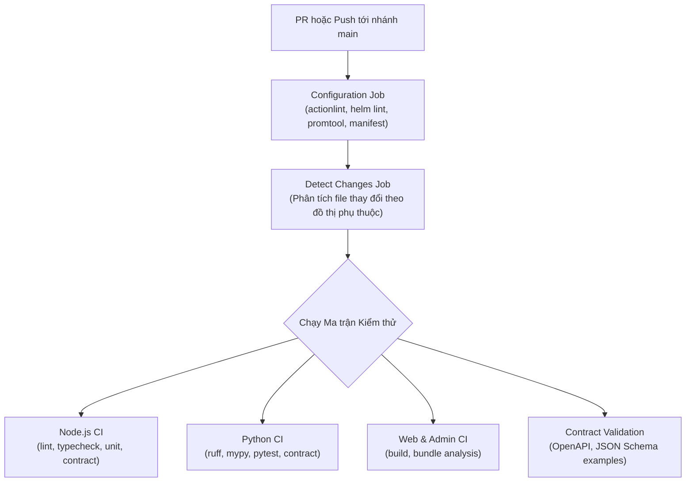

# Tài liệu Vận hành & DevOps (DevOps & Platform Engineering)

Thư mục này tập trung toàn bộ tài liệu về tự động hóa kiểm thử (CI/CD), quy chuẩn giám sát (Monitoring & Observability), kiểm chứng môi trường local và cẩm nang vận hành (Runbooks) của hệ thống **Badminton Manager V2**.

---

## 1. Danh mục Tài liệu DevOps & Vận hành

| Tài liệu | Định dạng | Mục đích & Trách nhiệm |
| :--- | :--- | :--- |
| [**ci-cd.md**](ci-cd.md) | Tài liệu kỹ thuật | Quy trình tự động hóa kiểm thử và đóng gói CI/CD GitHub Actions: cơ chế phát hiện thay đổi (`detect_changes.py`), ma trận kiểm thử 22 components, kiểm tra hợp đồng `check_node_contract.mjs` / `check_python_contract.py` và quy chuẩn merge PR. |
| [**provenance.md**](provenance.md) | Chuẩn mực kỹ thuật | Quy chuẩn truy xuất nguồn gốc (Provenance) & bảo mật chuỗi cung ứng: 6 mục tiêu Traceability, Reproducibility, Security, Audit, Debugging, Rollback; quy chuẩn lockfile, immutable image tags, AI model/prompt versioning và GitOps promotion. |
| [**monitoring.md**](monitoring.md) | Chuẩn mực kỹ thuật | Tiêu chuẩn đo lường và giám sát toàn diện hệ thống: quy tắc đặt tên Prometheus metrics, thiết lập Alertmanager rules, Grafana dashboards, Loki logging labels và chuẩn phân tán OpenTelemetry W3C trace context. |
| [**validation.md**](validation.md) | Biên bản kiểm chứng | Bảng kiểm tra sức khỏe và nghiệm thử môi trường local: kết quả khởi động docker-compose, seed data mẫu, kiểm tra endpoints Core, Gateway, AI và Web frontend. |
| [**artifact-validation.md**](artifact-validation.md) | Bảng kiểm tra | Bảng đối chiếu nghiệm thu tính đầy đủ và tính nhất quán của các artifact kỹ thuật Tuần 4 và Tuần 5 so với kế hoạch dự án. |
| [**runbooks/README.md**](runbooks/README.md) | Cẩm nang vận hành | Hướng dẫn ứng phó sự cố khẩn cấp: khởi động/dừng cụm dịch vụ, sao lưu/phục hồi PostgreSQL & MongoDB, xoay vòng JWT secrets và xử lý hàng đợi sự cố (DLQ). |

---

## 2. Luồng CI/CD Tự động hóa

---

## 3. Hệ sinh thái Giám sát Ứng dụng (Observability Stack)

Hạ tầng giám sát được khai báo đồng nhất tại thư mục [`monitoring/`](../../monitoring/README.md):
- **Prometheus**: Thu thập số liệu thời gian thực từ `/metrics` của Booking Core, API Gateway và AI Service theo chuẩn Prometheus scrape.
- **Alertmanager**: Định nghĩa các ngưỡng cảnh báo: Core HTTP 5xx rate > 1%, AI negotiation latency p95 > 2s, Database connection pool exhaustion.
- **Grafana**: Hệ thống dashboard trực quan hóa hiệu năng phục vụ việc chẩn đoán nhanh sự cố.
