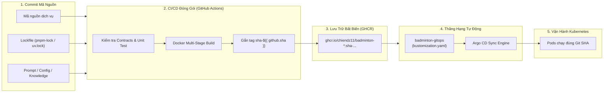

# Quy Chuẩn Truy Xuất Nguồn Gốc & Tính Toàn Vẹn Hệ Thống
## System Provenance & Software Supply Chain Standards — Badminton Manager V2

Tài liệu này quy định tiêu chuẩn kỹ thuật bắt buộc về **Truy xuất nguồn gốc (Provenance)** và **Bảo mật chuỗi cung ứng phần mềm (Software Supply Chain Security)** áp dụng cho toàn bộ các kỹ sư phát triển microservices, phân hệ AI và hạ tầng của dự án **Badminton Manager V2**.

---

## 1. Mục Đích & 6 Mục Tiêu Cốt Lõi

Provenance là khả năng chứng minh và truy vết nguồn gốc 1-1 không thể chối cãi của mọi thành phần phần mềm đang vận hành trên hệ thống: từ dòng code trong Git, thư viện bên thứ ba, mô hình AI/LLM, quá trình đóng gói CI/CD, cho đến container image đang chạy trong cụm Kubernetes.

Mọi thành viên phát triển dịch vụ phải tuân thủ tài liệu này nhằm bảo đảm 6 mục tiêu cốt lõi:

| Mục tiêu cốt lõi | Ý nghĩa & Tiêu chuẩn | Ví dụ thực tế trong hệ thống Badminton Manager |
| :--- | :--- | :--- |
| **Traceability** *(Khả năng truy vết)* | Xác định chính xác 100% commit SHA nào trên Git đã tạo ra container image đang chạy trên Kubernetes/Cluster. | Từ Pod `badminton-booking-core` chạy image `ghcr.io/chiendz11/badminton-booking-core:sha-043078e...`, tra ngay ra commit `043078e...` trên repo `badminton-system`. |
| **Reproducibility** *(Khả năng tái lập)* | Khả năng build lại artifact ở bất kỳ thời điểm nào từ mã nguồn và môi trường build mà ra kết quả y hệt (Deterministic Builds). | Dùng `pnpm-lock.yaml` và `uv.lock` kết hợp Docker multi-stage build để bảo đảm dù build hôm nay hay 1 năm sau thì hash thư viện và mã máy vẫn đồng nhất. |
| **Security** *(An toàn chuỗi cung ứng)* | Kiểm chứng tính xác thực, tính toàn vẹn của artifact và ngăn chặn các cuộc tấn công đầu độc mã nguồn (Supply Chain Poisoning). | Kiểm tra mã băm SHA-512 của package npm, SHA256 của Python wheel; phát hiện và chặn các image trôi nổi không rõ nguồn gốc. |
| **Audit** *(Kiểm toán & Tuân thủ)* | Cung cấp bằng chứng minh bạch, lịch sử phiên bản đầy đủ về quá trình biên dịch, kiểm thử và phát hành (Release). | Mọi đợt cập nhật lên môi trường đều được ghi nhận qua commit lịch sử trên repo `badminton-gitops` bởi bot tự động kèm link run ID của GitHub Actions. |
| **Debugging** *(Truy tìm nguồn gốc lỗi)* | Khi phát hiện bug trên môi trường live, xác định được ngay phiên bản/PR nào bắt đầu phát sinh lỗi. | Khi có lỗi exception log trên Loki hoặc Prometheus alert, dựa vào nhãn image tag để khoanh vùng chính xác PR vừa merge gây ra lỗi. |
| **Rollback** *(Khôi phục tức thì)* | Tìm lại chính xác artifact bất biến của bản triển khai ổn định liền trước để khôi phục dịch vụ trong vài giây. | Khi bản release mới gặp sự cố, chỉ cần thực hiện `git revert` commit trên repo `badminton-gitops`, Argo CD sẽ tự động hạ tải về image SHA cũ ngay lập tức. |

---

## 2. Các Nguyên Tắc Bất Di Bất Dịch (Core Principles)

1. **Tuyệt đối cấm sử dụng tag `latest` trên môi trường Staging/Production**:
   * Tag `latest` là con trỏ có thể bị ghi đè (*mutable pointer*), gây lỗi cache Kubernetes node và làm mất hoàn toàn khả năng rollback trong GitOps.
   * Tất cả container images triển khai qua GitOps bắt buộc dùng **Immutable Tag** dạng `sha-<commit-hash>` hoặc **Image Digest** (`@sha256:...`).
2. **GitOps là Single Source of Truth**:
   * Không bao giờ dùng `kubectl edit`, `kubectl apply` thủ công trên cụm Kubernetes.
   * Toàn bộ trạng thái triển khai (Desired State) phải được khai báo bằng code trong repo [badminton-gitops](https://github.com/chiendz11/badminton-gitops).
3. **Lockfile là Bắt buộc (Strict Lockfile Enforcement)**:
   * Mọi repo/service phải commit lockfile (`pnpm-lock.yaml`, `uv.lock`). Cấm thêm dependency mà bỏ qua lockfile.
4. **Không đưa Artifacts từ máy cá nhân lên Cluster**:
   * Artifacts chạy trên môi trường chung bắt buộc phải được đóng gói bởi CI Server (GitHub Actions) từ nhánh Git được phê duyệt (Merged PR).

---

## 3. Hướng Dẫn Kỹ Thuật Dành Cho Từng Dịch Vụ



### A. Đối với Microservices Node.js / TypeScript (`booking-core`, `api-gateway`, `content-service`, `web`, `admin`)

1. **Quản lý Dependencies đồng nhất**:
   * Hệ thống sử dụng PNPM Monorepo. Mọi thay đổi thư viện phải được cập nhật vào [pnpm-lock.yaml](file:///home/chienqt/Dev/newBTL/badminton-system/pnpm-lock.yaml) tại root.
   * Trong file `Dockerfile`, bước cài đặt dependencies bắt buộc dùng chế độ đóng băng (*frozen lockfile*):
     ```dockerfile
     # Bắt buộc: Chặn build nếu package.json và pnpm-lock.yaml lệch nhau
     RUN pnpm install --frozen-lockfile
     ```
2. **Khai báo OCI Labels trong Dockerfile**:
   * Mọi container image phải chứa metadata chuẩn OpenContainers để phục vụ việc audit:
     ```dockerfile
     ARG COMMIT_SHA
     LABEL org.opencontainers.image.revision=$COMMIT_SHA \
           org.opencontainers.image.source="https://github.com/chiendz11/badminton-system" \
           org.opencontainers.image.vendor="Badminton Team"
     ```
3. **Database Migration Provenance (`booking-core`)**:
   * Mọi thay đổi cấu trúc bảng cơ sở dữ liệu phải được lưu dưới dạng file migration có gắn timestamp (Prisma migrations).
   * Image migrations (`badminton-booking-core-migrations`) được đóng gói cùng Git SHA với core service để bảo đảm tính tương thích schema 100%.

---

### B. Đối với Phân Hệ Trí Tuệ Nhân Tạo (`ai-service` - AI / LLM Provenance)

Phân hệ AI có tính chất phức tạp hơn do phụ thuộc vào Model, Prompt, Hyperparameters và Tri thức miền. Các kỹ sư phát triển `ai-service` bắt buộc tuân thủ:

1. **Thư viện Python & Lockfile**:
   * Quản lý qua `uv`. Khi thêm package vào `pyproject.toml`, phải chạy `uv lock` và commit file [services/ai-service/uv.lock](file:///home/chienqt/Dev/newBTL/badminton-system/services/ai-service/uv.lock).
   * Dockerfile sử dụng cờ `--frozen`:
     ```dockerfile
     RUN uv sync --frozen --no-dev
     ```
2. **Phiên bản Hóa LLM (Model Snapshot Pinning)**:
   * Không sử dụng các alias chung chung có thể bị nhà cung cấp âm thầm cập nhật checkpoint phía sau.
   * Cấu hình model tại [services/ai-service/app/config.py](file:///home/chienqt/Dev/newBTL/badminton-system/services/ai-service/app/config.py) phải định danh rõ ràng phiên bản:
     * Ví dụ chuẩn: `llm_model: str = "gpt-4.1-mini"` hoặc dated snapshots `gpt-4o-2024-08-06`.
   * Ghi log cấu hình model đang dùng trong payload phản hồi và metrics đo lường.
3. **Prompt as Code (Prompt Provenance)**:
   * Toàn bộ System Prompt, User Prompt template và bộ luật trích xuất tiếng Việt phải được lưu trực tiếp trong mã nguồn Git (tại [providers.py](file:///home/chienqt/Dev/newBTL/badminton-system/services/ai-service/app/providers.py) và [parser.py](file:///home/chienqt/Dev/newBTL/badminton-system/services/ai-service/app/assistance/parser.py)).
   * Tuyệt đối không chỉnh sửa prompt trực tiếp trên web dashboard ngoài luồng Git.
4. **Tham số Suy luận Tiền định (Deterministic Inference)**:
   * Đặt `temperature=0` và `max_retries=0` đối với các tác vụ trích xuất cấu trúc dữ liệu (`ParsedMessage`) nhằm loại bỏ tính ngẫu nhiên khi kiểm tra hồi quy.
5. **Dữ liệu Tri thức Miền (Knowledge Base)**:
   * Tri thức FAQ, quy tắc sân bãi và chính sách hủy vé tại [services/ai-service/app/assistance/knowledge.json](file:///home/chienqt/Dev/newBTL/badminton-system/services/ai-service/app/assistance/knowledge.json) được version hóa trực tiếp cùng mã nguồn.
6. **Bộ Tiêu Chuẩn Đánh Giá (Golden Evaluation Suite)**:
   * Trước khi merge PR tính năng AI, bộ kiểm thử đánh giá [evaluate.py](file:///home/chienqt/Dev/newBTL/badminton-system/services/ai-service/evaluation/evaluate.py) phải chạy qua tập kịch bản chuẩn [scenarios.jsonl](file:///home/chienqt/Dev/newBTL/badminton-system/services/ai-service/evaluation/scenarios.jsonl).
   * Kết quả báo cáo độ chính xác được lưu vết tại [reports/golden.json](file:///home/chienqt/Dev/newBTL/badminton-system/services/ai-service/reports/golden.json).
7. **Quy tắc Thư mục Model Artifacts**:
   * Tuân thủ quy định tại [model-artifacts/README.md](file:///home/chienqt/Dev/newBTL/badminton-system/model-artifacts/README.md): Chỉ commit manifest, mã băm SHA256 và evaluation report. Không đưa model weights nặng (trên 100MB) hoặc khóa bí mật API vào Git.

---

## 4. Luồng Tự Động Hóa CI/CD & Thăng Hạng GitOps (GitOps Promotion)

Quy trình tự động từ lúc kỹ sư merge mã nguồn đến khi Pod trên Kubernetes cập nhật:

1. **Kỹ sư merge Pull Request vào nhánh `main`**:
   * GitHub Actions kích hoạt workflow [.github/workflows/publish-and-deploy.yml](file:///home/chienqt/Dev/newBTL/badminton-system/.github/workflows/publish-and-deploy.yml).
2. **Build & Publish Image**:
   * CI đóng gói Docker image cho từng service thay đổi.
   * Image được gắn tag bất biến: `ghcr.io/chiendz11/badminton-<service>:sha-${{ github.sha }}`.
   * Image được đẩy lên GitHub Container Registry (GHCR).
3. **Cập nhật Manifests GitOps tự động**:
   * Job `update-gitops` chạy script [.github/scripts/update_gitops_images.py](file:///home/chienqt/Dev/newBTL/badminton-system/.github/scripts/update_gitops_images.py).
   * Script tự động mở repo `badminton-gitops`, cập nhật tag `sha-<commit>` tương ứng vào file [environments/local/apps/kustomization.yaml](file:///home/chienqt/Dev/newBTL/badminton-gitops/environments/local/apps/kustomization.yaml).
   * Bot `github-actions[bot]` commit và đẩy thay đổi lên GitOps repo.
4. **Argo CD Đồng bộ Hóa**:
   * Argo CD phát hiện GitOps repository có commit mới.
   * Kéo image chính xác mang tag `sha-<commit>` từ GHCR và tiến hành Rolling Update trên Kubernetes cluster.

---

## 5. Hướng Dẫn Vận Hành & Khắc Phục Sự Cố Dựa Trên Provenance

### A. Kiểm tra nguồn gốc của Pod đang chạy (Traceability Check)
Khi cần biết Pod trên Kubernetes chạy từ commit nào:
```bash
# Lấy danh sách image tag của các pod đang chạy
kubectl get pods -n badminton -o jsonpath='{range .items[*]}{.metadata.name}{"\t"}{.spec.containers[*].image}{"\n"}{end}'
```
*Kết quả mẫu:*
```text
booking-core-79f8b4d8f5-x2n8m    ghcr.io/chiendz11/badminton-booking-core:sha-043078e20429aa089bd6099dfc79f3ddf56c58ea
ai-service-679948db5b-k8p2l      ghcr.io/chiendz11/badminton-ai-service:sha-043078e20429aa089bd6099dfc79f3ddf56c58ea
```
$\rightarrow$ Lấy phần mã hash `043078e...` mở trên GitHub: `https://github.com/chiendz11/badminton-system/commit/043078e20429aa089bd6099dfc79f3ddf56c58ea`.

### B. Quy trình Rollback Khẩn Cấp (Emergency Rollback)
Nếu bản deploy mới nhất phát sinh lỗi nghiêm trọng:
1. Mở repo `badminton-gitops`:
   ```bash
   cd badminton-gitops
   git log --oneline -n 5
   ```
2. Revert commit promote gần nhất:
   ```bash
   git revert HEAD --no-edit
   git push origin feat/initial-implementation # hoặc main
   ```
3. Argo CD sẽ tự động nhận diện desired state cũ và hạ tải (downgrade) toàn bộ Pods về image ổn định trước đó chỉ trong vòng vài giây.

---

## 6. Bảng Kiểm Tra Nghiệm Thu Provenance Khi Review Pull Request (PR Checklist)

Mọi Pull Request trước khi được phê duyệt merge vào nhánh chính cần được đối chiếu bảng kiểm sau:

- [ ] **Mã nguồn**: Code đã pass toàn bộ các bước linter, typecheck và unit test trong CI.
- [ ] **Lockfile**: Không chỉnh sửa file lockfile thủ công; lockfile (`pnpm-lock.yaml` hoặc `uv.lock`) được sinh tự động bởi công cụ và commit kèm code.
- [ ] **Docker**: Dockerfile sử dụng cờ cài đặt đóng băng (`--frozen-lockfile` hoặc `--frozen`).
- [ ] **AI Service (nếu có sửa đổi)**:
  - [ ] Model ID được chỉ định tường minh, không dùng alias trôi nổi.
  - [ ] Prompt được lưu vết trực tiếp trong code, không đọc từ nguồn ngoài không xác thực.
  - [ ] Bộ golden test suite (`evaluate.py`) chạy đạt yêu cầu độ chính xác.
  - [ ] Không commit model weights hoặc credential vào Git.
- [ ] **GitOps Compatible**: Service tương thích với cơ chế override tag tự động qua `kustomization.yaml`.
