# Kế hoạch Thực hiện Dự án 10 Tuần (Tuần 4 — Tuần 13)

Thư mục này lưu trữ toàn bộ hồ sơ kế hoạch tổng thể 10 tuần của dự án **Badminton Manager V2**, từ giai đoạn khảo sát nghiệp vụ (Tuần 4) cho tới nghiệm thu, đóng gói và bàn giao sản phẩm (Tuần 13).

---

## 1. Danh mục Tài liệu Kế hoạch

| Tài liệu / Tập tin | Định dạng | Mục đích sử dụng |
| :--- | :--- | :--- |
| [**Badminton_Manager_Ke_Hoach_10_Tuan_De_Hieu.xlsx**](Badminton_Manager_Ke_Hoach_10_Tuan_De_Hieu.xlsx) | Excel (.xlsx) | File bảng tính chi tiết 50 tasks, định dạng trực quan cho cả 5 thành viên với đầy đủ cột: Mã việc, Người làm, Mô tả dễ hiểu, Đầu ra cụ thể, Tiêu chí xong và Giờ dự kiến. |
| [**ke_hoach_badminton_de_hieu.csv**](ke_hoach_badminton_de_hieu.csv) | CSV (.csv) | Bản xuất phẳng phục vụ CI/CD, script tự động hóa phân tích tiến độ và tra cứu nhanh. |
| [**PLAN_WEEK_04_13.md**](PLAN_WEEK_04_13.md) | Markdown | Bản phân rã chi tiết 10 tuần dưới dạng tài liệu kỹ thuật, quy định rõ quy ước mã `W04-N1` -> `W13-N5`, dependency giữa các tuần và tiêu chuẩn bàn giao. |
| [**source-provenance.json**](source-provenance.json) | JSON | Hồ sơ truy xuất nguồn gốc (provenance), mã băm SHA256 và ánh xạ đầu vào của kế hoạch dự án. |

---

## 2. Phân công Vai trò 5 Thành viên

Hệ thống được xây dựng bởi đội ngũ 5 kỹ sư, mỗi người sở hữu một phân hệ chuyên biệt xuyên suốt 10 tuần:

| Thành viên | Vai trò chính (DRI) | Phân hệ phụ trách |
| :--- | :--- | :--- |
| **Người 1** | Tech Lead & Core Backend | `services/booking-core`, quy tắc nghiệp vụ đặt sân, ACID transaction, concurrency slot locking. |
| **Người 2** | Frontend & Marketplace Lead | `apps/web`, giao diện người dùng Web, tính năng sang nhượng sân (Pass Marketplace). |
| **Người 3** | Real-time & Communication Lead | `services/social-service`, `services/notification-service`, WebSocket chat, tin nhắn bảo mật, thông báo đẩy. |
| **Người 4** | Identity & Platform Admin Lead | `services/identity-service`, `services/commerce-service`, `services/content-service`, `apps/admin`, RBAC, POS bán hàng, CMS tin tức. |
| **Người 5** | AI Platform & DevOps Lead | `services/ai-service`, Trợ lý ảo AI LangGraph/LLM, hạ tầng Docker Compose, CI/CD GitHub Actions, hệ thống Prometheus/Grafana. |

---

## 3. Lộ trình Triển khai 10 Tuần

```mermaid
flowchart LR
    W4["Tuần 4<br/>Nghiệp vụ & BRD"] --> W5["Tuần 5<br/>Kiến trúc & Contract"]
    W5 --> W6["Tuần 6<br/>Khung Skeleton Local"]
    W6 --> W7["Tuần 7<br/>Lát cắt Đặt sân Core"]
    W7 --> W8["Tuần 8<br/>Thanh toán & Chat"]
    W8 --> W9["Tuần 9<br/>Sàn Pass Sân"]
    W9 --> W10["Tuần 10<br/>Admin & Tích hợp"]
    W10 --> W11["Tuần 11<br/>Staging & Đo kiểm"]
    W11 --> W12["Tuần 12<br/>Nghiệm thu UAT"]
    W12 --> W13["Tuần 13<br/>Demo & Bàn giao"]
```

- **Tuần 4 — Khảo sát & Chốt phạm vi MVP**: Phân tích yêu cầu nghiệp vụ, hoàn thành Master BRD và 5 artifact nghiệp vụ ([Xem chi tiết](../week-4/README.md)).
- **Tuần 5 — Thiết kế Kỹ thuật & System Contracts**: Thiết lập kiến trúc hệ thống V2, ERD dữ liệu, API/Socket contracts và bộ 9 ADR ([Xem chi tiết](../week-5/README.md)).
- **Tuần 6 — Khung Hệ thống (Skeleton) & Chạy Local**: Dựng khung toàn bộ các service, docker-compose, gateway routing và CI pipeline hoàn chỉnh ([Xem chi tiết](../week-6/README.md)).
- **Tuần 7 — Lát cắt Đặt sân Core**: Hoàn thiện API tìm kiếm sân trống, cơ chế giữ chỗ tạm thời và chống đặt trùng (anti-race condition).
- **Tuần 8 — Thanh toán & Chat riêng tư**: Tích hợp cổng thanh toán mô phỏng và phòng chat thời gian thực bảo mật với JWT.
- **Tuần 9 — Hoàn chỉnh Giao dịch Pass sân**: Khép kín vòng đời đăng tin nhượng sân, đặt cọc/thanh toán và đổi chủ sở hữu vé đặt sân.
- **Tuần 10 — Bán lẻ POS, CMS & Tích hợp liên miền**: Hoàn thiện cổng Admin, quản lý sản phẩm nước uống/vợt cầu lông và bảng tin tức.
- **Tuần 11 — Môi trường Staging & Đo lường Tải**: Kiểm thử tải k6, tối ưu hóa truy vấn cơ sở dữ liệu và tinh chỉnh cảnh báo Prometheus.
- **Tuần 12 — Nghiệm thu Người dùng (UAT) & Khóa bản RC**: Rà soát lỗi bảo mật, hoàn thiện trải nghiệm người dùng và chuẩn bị Release Candidate.
- **Tuần 13 — Demo, Phát hành & Bàn giao Sản phẩm**: Chạy kịch bản thuyết trình end-to-end, đóng gói container và bàn giao tài liệu kỹ thuật.
