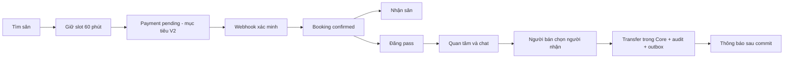

# W04-N1 — BRD outline, glossary và business context

| Thuộc tính | Giá trị |
| --- | --- |
| DRI theo kế hoạch | Người 1 — Tech Lead · Booking Core |
| Peer reviewer của task | Người 2 |
| Deliverable gốc, ô H2 | BRD outline + domain glossary + context nghiệp vụ |
| Ưu tiên / giờ dự kiến | P0 / 8 giờ |
| Phụ thuộc | Không |
| Definition of Done gốc | Actor, business state, happy/error paths được nhóm góp ý. |
| Nguồn kế hoạch | Sheet “Kế hoạch 10 tuần”, A2:O2 |
| Đầu ra của tuần | Tài liệu phân tích nghiệp vụ |

Tài liệu trình bày kết quả phân tích trong tuần 4: phạm vi, quy tắc nghiệp vụ và tiêu chí nghiệm thu làm đầu vào cho thiết kế tuần 5.

## Bối cảnh và phạm vi

Khách cần chọn sân đúng giờ và tránh trùng lịch; người có booking cần nhượng quyền hợp lệ; quản lý vận hành sân và bán hàng; người dùng trao đổi qua chat, nhận thông báo và tìm thông tin bằng AI. Phân tích tập trung vào hành trình người dùng, trạng thái nghiệp vụ và ranh giới giao dịch của từng chức năng.

Phạm vi toàn sản phẩm được tổng hợp tại [BRD_SYSTEM_V2](BRD_SYSTEM_V2.md), gồm đặt sân, thanh toán, nhượng sân, giao tiếp, quản trị, bán hàng và trợ lý AI. Tuần 4 mô tả yêu cầu và hành trình; tuần 5 chuyển các yêu cầu thành kiến trúc và contract.

## Actor và context nghiệp vụ

| Actor | Mục tiêu | Boundary chính |
| --- | --- | --- |
| Khách chưa đăng nhập | Xem trung tâm, giá, nội dung | Core/Content public read |
| user | Đặt sân, pass, chat, nhận thông báo, review | Core, Social, Notification, Content |
| center_manager | Quản trị sân và POS ở trung tâm được giao | Core + Commerce; kiểm tra center scope |
| super_admin | Quản trị toàn hệ thống, tài khoản, nội dung | Identity/Core/Content; audit thao tác nhạy cảm |
| Cổng thanh toán | Gửi kết quả đã ký | Core Payment; không tin redirect trình duyệt |
| AI | Diễn giải yêu cầu và tra cứu | FAQ, tìm sân và gợi ý bằng các công cụ tra cứu |

## Domain glossary

| Thuật ngữ | Ý nghĩa chuẩn |
| --- | --- |
| Center / Court | Trung tâm / sân vật lý thuộc đúng một trung tâm |
| Slot | Đơn vị 60 phút; `[start,end)` theo Asia/Ho_Chi_Minh khi nhập ngày/giờ |
| Availability | Snapshot lịch; không bảo đảm còn trống khi ghi |
| Reservation / Hold | Giữ tập slot có TTL; hết TTL không tiếp tục chặn slot |
| Booking | Quyền sử dụng sân; có owner và lịch cụ thể |
| PaymentAttempt | Lần tương tác cổng thanh toán; trạng thái độc lập với booking |
| PassPost | Bài nhượng một booking đủ điều kiện; không tạo slot mới |
| Interest | Một người quan tâm bài pass; không giữ sân hoặc tự nhận booking |
| Transfer | Đổi chủ booking nguyên tử, giữ nguyên slot; lưu audit |
| PASS_BOOKING conversation | Chat người bán và một người mua theo post; không đòi friendship |
| Sale / StockMovement | Giao dịch POS / biến động tồn; Commerce sở hữu |
| Event / Notification | Sự kiện domain / thông báo cho người nhận; hai bản ghi khác nhau |

## Hành trình liên miền

| Bước | Happy path | Lỗi/ngoại lệ phải biểu diễn |
| --- | --- | --- |
| Tìm/chọn | Lịch theo ngày, giá server | Slot vừa bị người khác lấy, giá thay đổi |
| Hold | Unique allocation, TTL | 409; retry cùng key, không tạo giữ chỗ trùng |
| Payment | Core kiểm chữ ký/amount/currency/order | Timeout, duplicate webhook, paid sau hold hết hạn cần reconciliation |
| Nhận sân | Manager kiểm booking của đúng trung tâm | Sai ngày, đã hủy, chủ đã chuyển; check-in còn là thiết kế |
| Pass | Owner đăng booking hợp lệ, chat từ bài pass | Hết hạn, self-interest, người khác transfer, double transfer |
| POS | Bán và trừ tồn cùng transaction | Thiếu tồn trả 409, không sinh hóa đơn thành công nửa chừng |
| AI | FAQ hoặc tìm sân, trả nguồn + lựa chọn | Thiếu giờ/địa điểm phải hỏi lại; không bịa slot hoặc đọc dữ liệu của người khác |

## Transaction boundary và ưu tiên

Core giữ booking/allocation/payment local state/pass/transfer/outbox cùng DB. Commerce giữ sale/items/stock/invoice/outbox cùng DB khác. Social giữ message bền vững trước emit. Notification tiêu thụ sau commit, không nằm trong transaction booking.

P0 đích: Identity/RBAC, booking không trùng, payment xác minh, pass nguyên tử, pass-chat có ACL, POS không âm tồn, notification dedupe, AI tra cứu an toàn. P1: friendship UX, nội dung/moderation, dashboard nâng cao. P2: recommendation cá nhân hóa và scale sau khi đo tải. Phân loại này xác định thứ tự ưu tiên cho thiết kế và triển khai trong kế hoạch 10 tuần.

## Đầu ra tài liệu và bàn giao

- BRD outline, actor/context, glossary và hành trình liên miền.
- Phạm vi MVP, thứ tự ưu tiên, transaction boundary và happy/error paths.
- Đầu vào liên quan: [thiết kế kiến trúc tuần 5](../week-5/W05-N1_architecture.md).
