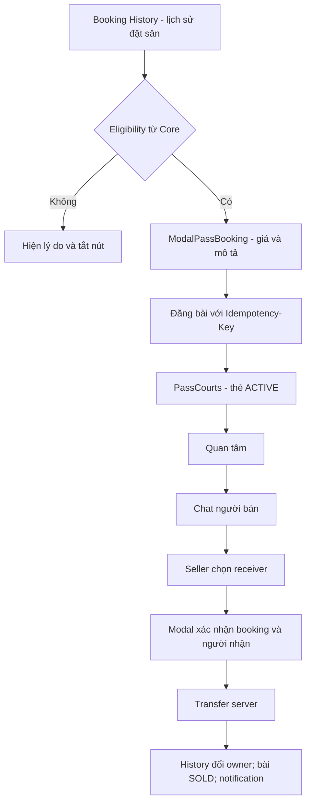

# W04-N2 — User stories, pass wireflow và acceptance criteria

| Thuộc tính | Giá trị |
| --- | --- |
| DRI theo kế hoạch | Người 2 — Pass Marketplace · Frontend |
| Peer reviewer của task | Người 1 |
| Deliverable gốc, ô H3 | User stories + pass wireflow + acceptance criteria |
| Ưu tiên / giờ dự kiến | P0 / 8 giờ |
| Phụ thuộc | Workshop chung |
| Definition of Done gốc | Có điều kiện VALID/INVALID cho từng hành động pass; cả nhóm duyệt. |
| Nguồn kế hoạch | Sheet “Kế hoạch 10 tuần”, A3:O3 |
| Đầu ra của tuần | Tài liệu phân tích nghiệp vụ |

Tài liệu trình bày kết quả phân tích trong tuần 4: phạm vi, quy tắc nghiệp vụ và tiêu chí nghiệm thu làm đầu vào cho thiết kế tuần 5.

## Nguyên tắc thiết kế giao diện

Luồng giao diện gồm lịch sử đặt sân, modal đăng nhượng, danh sách bài nhượng và thẻ trạng thái. UI nhận bookingId/postId từ API và hiển thị đúng trạng thái server; không tự suy quyền sở hữu hoặc điều kiện nhượng từ dữ liệu đã lưu trong trình duyệt.

## User stories và ưu tiên

| ID | Vai trò và nhu cầu | Ưu tiên | Kết quả |
| --- | --- | --- | --- |
| US-P01 | Owner nhấn “Pass sân” ở lịch sử | P0 | Chỉ hiện booking đủ điều kiện; modal giữ thông tin sân/giờ |
| US-P02 | Owner ghi giá và mô tả | P0 | Server tính eligibility, không nhận sellerId client |
| US-P03 | Người mua tìm bài theo ngày/trung tâm | P0 | Chỉ bài ACTIVE/chưa hết hạn; phân trang |
| US-P04 | Người mua quan tâm/bỏ quan tâm | P0 | Thao tác idempotent, không giữ booking |
| US-P05 | Hai bên chat từ bài | P0 | PASS_BOOKING context không yêu cầu kết bạn |
| US-P06 | Seller chọn receiver và xác nhận | P0 | Core chuyển owner đúng một lần, UI phản ánh SOLD |
| US-P07 | Seller hủy bài | P0 | ACTIVE → CANCELLED; không hủy booking gốc |
| US-P08 | Người dùng xem bài đã hết hạn | P1 | Hiện trạng thái, tắt hành động ghi; giữ lịch sử hợp lệ |

## Wireflow nghiệp vụ

## Eligibility VALID / INVALID

| Hành động | VALID đề xuất | INVALID và phản hồi |
| --- | --- | --- |
| Tạo bài | JWT owner, CONFIRMED, trước giờ bắt đầu, không có ACTIVE post | Không phải owner 403; hủy/hết giờ/đã chuyển/trùng bài 409 |
| Giá | Số nguyên VND ≥ 0, cùng currency booking | Âm, lẻ hoặc thiếu 400; mức trần theo cấu hình chính sách nhượng |
| Quan tâm | User khác seller, bài ACTIVE | Seller tự quan tâm 403; bài không active 409 |
| Chat | JWT hợp lệ, đúng seller/buyer của context | Đoán conversationId vẫn 403; không đọc tất cả người quan tâm |
| Transfer | Seller hiện tại, receiver tồn tại/active và đã quan tâm, post chưa hết hạn | Self-transfer 400; concurrent/lặp khác receiver 409; sai quyền 403 |
| Hủy bài | Seller và ACTIVE | Hủy bài SOLD/EXPIRED 409; không thay đổi booking owner |
| Bỏ quan tâm | User đã/không quan tâm | DELETE lặp vẫn thành công; trạng thái không bị đảo do retry |

Điều kiện thanh toán phải đọc từ trạng thái payment được server xác minh; không suy “đã thanh toán” chỉ từ nhãn CONFIRMED của booking. Nhượng miễn phí và hoàn tiền tuân theo chính sách nghiệp vụ tương ứng.

## Acceptance criteria

1. Given hai request tạo cùng post cùng key/body, when retry, then cùng postId; khác body cùng key → 409.
2. Given hai transfer đồng thời khác receiver, then tối đa một commit, một transfer audit và một outbox event cho kết quả thành công.
3. Given post ACTIVE nhưng booking bị hủy sau khi UI tải, then transfer 409; UI reload lý do, không báo thành công dựa state cũ.
4. Given reload hoặc mất mạng sau POST, then lưu key cho cùng thao tác, đọc lại trạng thái; không tự phát key mới để retry.
5. Given interest PUT lặp/DELETE lặp, then count không tăng sai; UI không dùng optimistic count làm nguồn sự thật.
6. Given post EXPIRED/SOLD, then vẫn hiển thị lịch sử và vô hiệu hóa gửi tin mới theo ACL đề xuất; dữ liệu riêng tư chỉ đúng thành viên.
7. Given slot 18:00–19:00, then thể hiện 1 slot, không hiển thị hai ô 30 phút; `[18:00,19:00)` và giá nguyên VND.

## Trạng thái UI và xử lý ngoại lệ

Mỗi màn có loading/empty/error/retry; giữ thông tin form khi lỗi mạng. HTTP 401 mời đăng nhập; 403 giải thích không có quyền; 409 refresh trạng thái và giữ nội dung người dùng; 429 cho biết thời gian thử lại. Không lộ PII người quan tâm ngoài seller và chính user đó.

Thiết kế dùng một post cho mỗi booking; tái kích hoạt phải có version và audit. Giới hạn giá, thời hạn bài, điều kiện người nhận và quyền chat sau khi bài đóng được kiểm tra ở server, UI hiển thị lý do từ API thay vì tự áp đặt luật riêng.

## Đầu ra tài liệu và bàn giao

- 8 user stories cho Pass Marketplace và wireflow từ Booking History.
- Bảng VALID/INVALID, trạng thái UI và 7 acceptance criteria.
- Đầu vào liên quan: [wireframe và Pass API tuần 5](../week-5/W05-N2_pass-ui-api.md).
