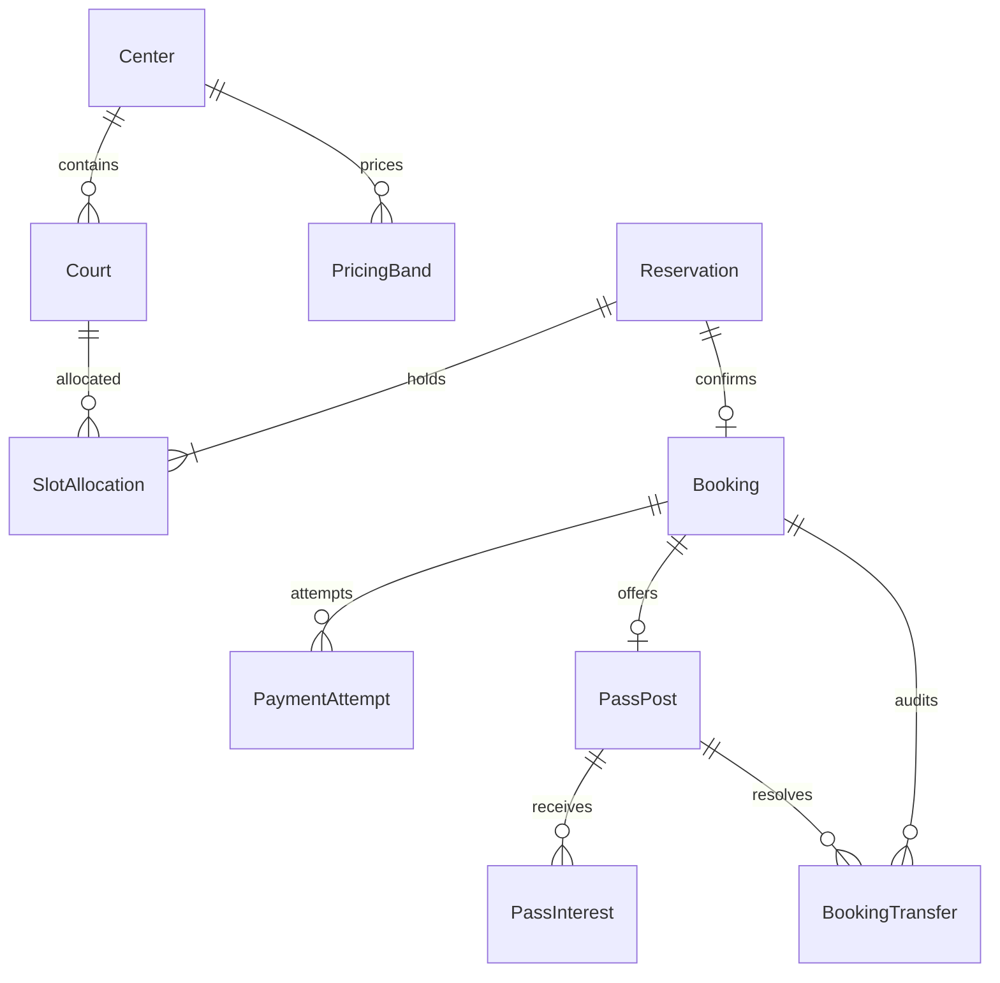

# W05-N1 — C4, transaction boundary, ERD và ADR-001/002/003

| Thuộc tính | Giá trị |
| --- | --- |
| DRI | Người 1 — Tech Lead · Booking Core |
| Peer reviewer của task | Người 4 |
| Deliverable gốc, ô H7 | C4 + ADR-001/002/003 + ERD tổng quát |
| Ưu tiên / giờ dự kiến | P0 / 9 giờ |
| Phụ thuộc | W4 BRD approved |
| Definition of Done gốc | Cả 5 người review, ADR accepted, câu hỏi kiến trúc quan trọng đã giải quyết. |
| Nguồn kế hoạch | Sheet “Kế hoạch 10 tuần”, A7:O7 |
| Đầu ra của tuần | Tài liệu thiết kế kỹ thuật và contract |

Tài liệu trình bày thiết kế trong tuần 5: ranh giới thành phần, mô hình dữ liệu và contract làm đầu vào cho giai đoạn triển khai.

## C4 và sơ đồ dữ liệu

Bản đầy đủ có [system/context/container/component diagrams](../architecture/SYSTEM_ARCHITECTURE.md). Mô hình chọn hybrid: Core và Commerce là hai modular monolith theo transaction boundary, các domain realtime/nội dung/AI tách process khi có nhu cầu riêng.

| Context | Owner | Store riêng | API/communication |
| --- | --- | --- | --- |
| Identity | Người 4 | PostgreSQL | Token, profile, role, internal user lookup |
| Booking Core | Người 1; Người 2 owner pass module | PostgreSQL | Center/court/price/slot/reservation/booking/payment/pass |
| Commerce | Người 4 | PostgreSQL | Product/stock/sale/invoice; không gọi Inventory HTTP khi bán |
| Social | Người 3 | MongoDB | Friendship/conversation/message + Socket.IO |
| Content | Người 4 | MongoDB | Review/rating/news |
| Notification | Người 3 | MongoDB | Consumer RabbitMQ, in-app/read state |
| Storage | Người 4 + Người 5 | MongoDB metadata + Cloudinary | FileId/URL, upload ACL |
| AI | Người 5 | Hiện có PostgreSQL state | Hội thoại, read tools và đánh giá theo profile AI |

Không có foreign key hoặc join xuyên database. External userId/centerId là reference; owner kiểm quyền hoặc projection versioned. Shared packages chỉ chứa types/policies có chủ đích, không thành shared ORM cho mọi service.

## ERD khái quát Booking Core

ERD bao quát Center/Court/Reservation/SlotAllocation/Booking/Outbox và các entity PaymentAttempt, PassPost, PassInterest, BookingTransfer trong thiết kế. Quan hệ Reservation–Booking tối đa một booking nhờ unique reservationId. Một slot dài 60 phút; thời gian lưu UTC, ngày/giờ người dùng diễn giải theo Asia/Ho_Chi_Minh.

## Transaction và race conditions

| Nghiệp vụ | Cùng local commit | Ngoài local commit |
| --- | --- | --- |
| Giữ/chốt booking | Kiểm conflict, allocation/reservation/booking state, outbox | Email/socket, gọi AI |
| Payment webhook | Dedupe provider event, amount/order validation, local payment + booking transition, outbox | Tạo checkout/provider HTTP; đối soát nếu callback trễ |
| Pass transfer | Lock/CAS post+booking, current owner/expiry, receiver, owner change, SOLD, audit, outbox, idempotency result | Social update, notification |
| POS sale | Conditional stock decrement, sale/items/invoice/movements/outbox/idempotency | Payment provider hoặc gửi hóa đơn |

Chọn transaction Serializable hoặc row lock/CAS + unique constraints theo engine và retry conflict có giới hạn. Không dựa Redis lock đơn lẻ để chống booking trùng. Allocation còn hiệu lực được bảo vệ bằng DB constraint; payment/pass không được tạo đường ghi bỏ qua invariant này.

## ADR bàn giao

- [ADR-001](../adr/ADR-001.md): boundaries, trách nhiệm của Core/Commerce/Identity và lý do chọn hybrid architecture.
- [ADR-002](../adr/ADR-002.md): DB ownership, local ACID, không giữ DB transaction xuyên PayOS/HTTP.
- [ADR-003](../adr/ADR-003.md): REST/event/socket version và compatibility.
- [System contract](../SYSTEM_CONTRACTS.md) là bảng giao tiếp chuẩn để các owner review.

## Đầu ra tài liệu và bàn giao

- Context map, DB ownership, ERD Booking Core và bảng transaction boundary.
- Nội dung ADR-001/002/003 và giao tiếp REST/event/socket.
- Đầu vào liên quan: [system contracts](../SYSTEM_CONTRACTS.md).
