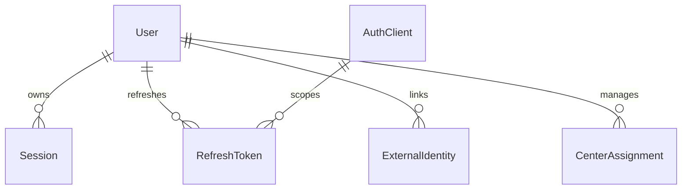
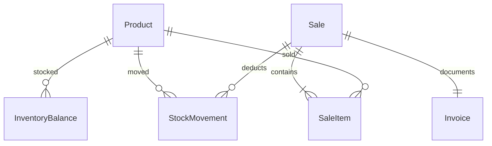

# W05-N4 — ERD/schema v1, role matrix và technology ADR

| Thuộc tính | Giá trị |
| --- | --- |
| DRI | Người 4 — Identity · Commerce · Content |
| Peer reviewer của task | Người 1 |
| Deliverable gốc, ô H10 | ERD/schema v1 + role matrix + technology ADR |
| Ưu tiên / giờ dự kiến | P0 / 8 giờ |
| Phụ thuộc | W4 identity/commerce rules |
| Definition of Done gốc | Transaction sale-stock và quyền được mô hình hóa, data owner rõ. |
| Nguồn kế hoạch | Sheet “Kế hoạch 10 tuần”, A10:O10 |
| Đầu ra của tuần | Tài liệu thiết kế kỹ thuật và contract |

Tài liệu trình bày thiết kế trong tuần 5: ranh giới thành phần, mô hình dữ liệu và contract làm đầu vào cho giai đoạn triển khai.

## Identity ERD và unique constraints

| Entity | Fields chính | Constraints / bảo mật |
| --- | --- | --- |
| User | id,email,username,role,isActive,passwordHash,version | UUID internal; email/username normalized unique; role lowercase |
| Session | id,userId,expiresAt,revokedAt | index userId/expiresAt; logout thu hồi |
| RefreshToken | id,userId,clientId,tokenHash,familyId,expiresAt,replacedBy | Unique hash, rotation + reuse detection; không lưu token thô |
| ExternalIdentity | userId,provider,providerSubject | Unique provider/subject; link cần re-auth |
| AuthClient | id,clientSecretHash,allowedRedirectUris | Không wildcard redirect; không commit secret |
| CenterAssignment | userId,centerId,status | Unique user/center; centerId external reference không FK xuyên Core DB |
| OutboxEvent | id,type,aggregateId,payload,createdAt,publishedAt | User update + version + event trong cùng local transaction; publisher retry cùng eventId |

Identity là nguồn sự thật cho userId, role và session. ID nội bộ có thể dùng UUID; contract actor ID giữa các service chấp nhận string 1–128, vì vậy consumer không tự ép mọi `sub` thành UUID. Public ID và JWT subject cần giữ nhất quán qua các API.

## Thiết kế JWT/RBAC

Current Gateway/Core verify HS256 với `sub`, `role`, `iss`, `aud`, `exp`; role `{user,center_manager,super_admin}`. Không chỉ tin header userId/role. Issuer và consumer dùng cùng tên claim/role; validator chỉ chấp nhận schema đã công bố.

ADR-006 đề xuất Identity issuer tương thích các claim đã công bố; dùng HS256 hoặc JWKS/RS256 khi có key rotation đồng bộ giữa Gateway/Core/Social/AI. Thay đổi algorithm phải có version, rollout, lịch gỡ key cũ và kế hoạch rollback tương ứng.

Role matrix ở [W04-N4](../week-4/W04-N4_identity-commerce-content.md) được bổ sung resource scope: booking owner/center assignment, sale/stock assigned center, chat member, notification recipient, Storage uploader/domain owner, content moderation permission. `super_admin` không mặc định bypass private chat ACL.

## Commerce schema v1

| Entity | Fields / constraints |
| --- | --- |
| Product | id,name,barcode(unique nếu có),unitSell,unitImportQuantity,active; price nguyên VND |
| InventoryBalance | productId,centerId,quantity; unique product/center; CHECK quantity ≥ 0 |
| StockMovement | id,productId,centerId,delta,reason,referenceId,actorId,createdAt; append-only |
| Sale/SaleItem | id,centerId,actorId; quantity > 0; unitPrice snapshot từ server; sum line totals = totalAmount |
| Invoice | id,saleId(unique),invoiceNumber(unique),totalAmount,currency,status |
| IdempotencyRecord | actorId,operation,key unique; requestHash,resultRef,expiresAt |
| Outbox | eventId unique,type,payload,publishedAt; cùng transaction với sale |

Invoice/POS paymentMethod không phải PaymentAttempt của đặt sân. Thuế, hóa đơn điện tử, refund và discounts thuộc policy tài chính; schema tách các tham số này để tránh hard-code giá trị không có căn cứ. Sale invariant: đủ tồn → commit tất cả; thiếu tồn → 409, không side effect thành công một phần. Sử dụng conditional UPDATE quantity >= requested hoặc lock balance theo thứ tự ổn định.

## Content/Storage schema v1

Content Mongo: Review/Rating(id,centerId,userId,bookingId?,stars1..5,comment,status,timestamps), News(id,title,summary,body?,imageFileId,sourceUrl,category,status,publishedAt). Review eligibility và unique user/booking thực hiện theo policy Content. Timestamp lưu ISO/UTC; ngày hiển thị trên UI được chuyển theo timezone nghiệp vụ.

Storage Mongo: FileMetadata(id,providerAssetId,uploaderId,uploaderService,type,mimeType,sizeBytes,status,createdAt); unique providerAssetId và public fileId. Cloudinary upload và metadata commit dùng pending/cleanup, không distributed ACID. File type và owner scope kiểm server, không tin URL client làm chứng minh sở hữu.

## Công nghệ và cost drivers

PostgreSQL/Prisma cho Identity/Commerce vì relational constraints và transaction; Mongo cho Content/Social/Notification/Storage theo access pattern document và conversation/message. Có chi phí vận hành nhiều stores: backup, indexes, replicas, migration, secrets và monitor. Cân nhắc shared infrastructure instance local nhưng database/credential/schema ownership tách; phân bổ instance production theo sizing thay vì mặc định mỗi DB một máy.

[ADR-006](../adr/ADR-006.md), [ADR-007](../adr/ADR-007.md) và [ADR-001](../adr/ADR-001.md) ghi các lựa chọn thay thế. Cost drivers gồm tài nguyên DB, backup, traffic, secrets và monitoring; dự toán được điều chỉnh theo sizing. Phân công phối hợp Storage: Người 4 phụ trách API/quyền, Người 5 hỗ trợ platform/provider.

## Đầu ra tài liệu và bàn giao

- ERD/schema v1 Identity/Commerce/Content/Storage và role/resource matrix.
- JWT claims, sale-stock transaction, technology trade-offs và cost drivers.
- Đầu vào liên quan: [hồ sơ ADR](../adr/README.md).
